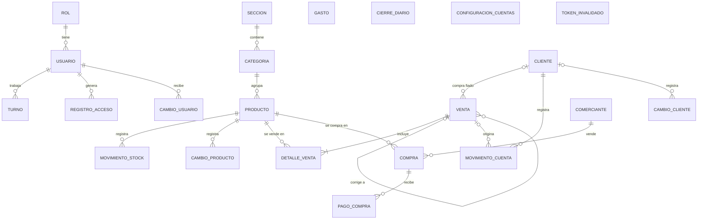
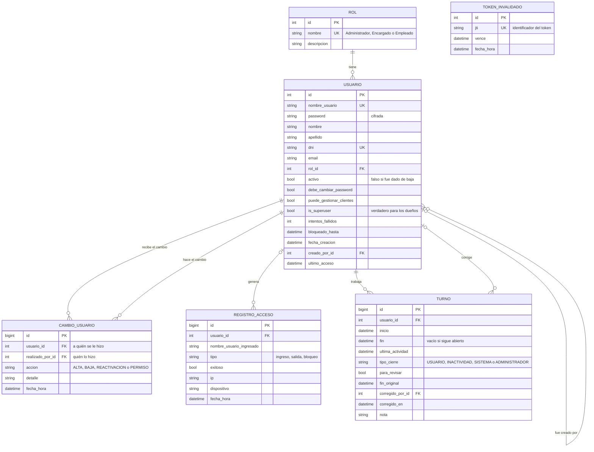
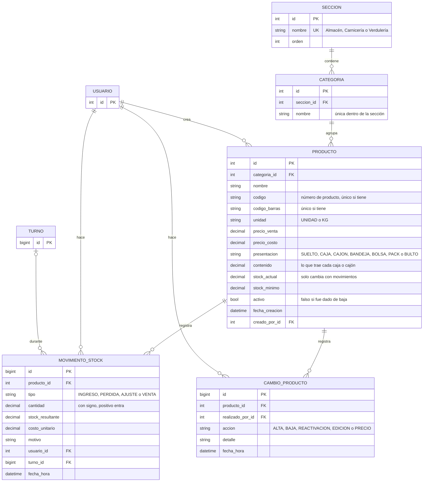
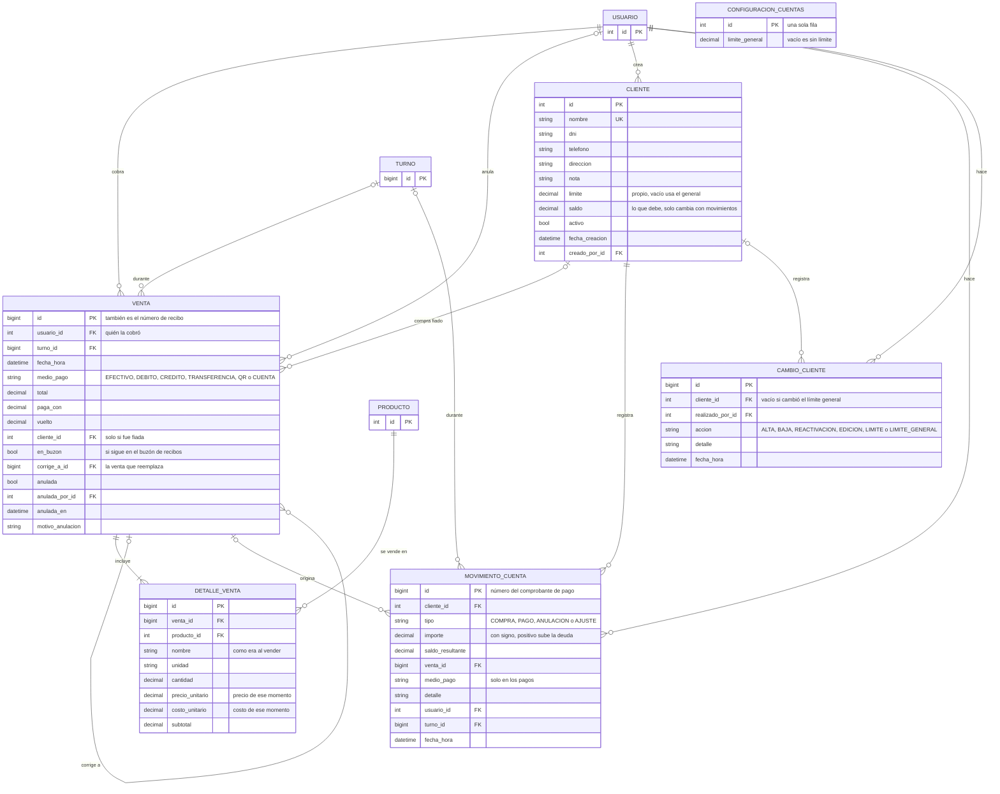
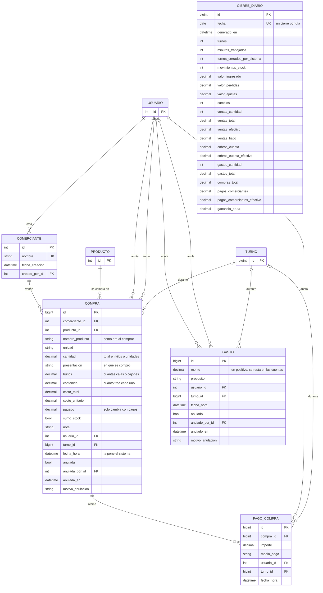

# Diagrama entidad-relación de la base de datos

Las tablas del Sistema de Mercado, sus campos y cómo se relacionan. Está hecho leyendo los modelos reales de Django (`backend/*/models.py`), que son los que crean las tablas en SQL Server. Son **21 tablas** propias, repartidas en 7 aplicaciones.

El detalle campo por campo con los tipos de SQL Server de las tablas más viejas está en [`documentacion.md`](documentacion.md), sección 7.

## Cómo leer los diagramas

- Cada caja es una **tabla**. Adentro, cada renglón es un campo: tipo, nombre y, si corresponde, una marca.
- **PK** es la clave primaria (el identificador de la fila). **FK** es una clave foránea (apunta a otra tabla). **UK** es un valor que no se puede repetir.
- Las líneas son las **relaciones**. Los extremos dicen cuántos puede haber:

| Símbolo | Significa |
| --- | --- |
| `\|\|` | exactamente uno |
| `\|o` | cero o uno (el dato puede faltar) |
| `o{` | cero, uno o muchos |
| `\|{` | uno o muchos |

Por ejemplo, `SECCION ||--o{ CATEGORIA` se lee: una sección tiene muchas categorías (o ninguna), y cada categoría pertenece a exactamente una sección.

Tipos usados en los diagramas: `int` y `bigint` (números enteros), `string` (texto), `decimal` (números con decimales exactos, para plata y cantidades), `bool` (sí o no), `datetime` (fecha y hora) y `date` (solo fecha).

## 1. Vista general

Todas las tablas y las relaciones principales, sin los campos.

Para que se pueda leer, este diagrama **no dibuja** dos relaciones que tiene casi toda tabla: quién hizo la operación (`usuario`) y en qué turno (`turno`). Están listadas en la tabla «Quién y cuándo», más abajo.

Las cuatro tablas sueltas del final no dependen de otra tabla de negocio:

- **`GASTO`** solo se relaciona con quién lo anotó y en qué turno.
- **`CIERRE_DIARIO`** es la foto de los totales de cada día: guarda números, no referencias.
- **`CONFIGURACION_CUENTAS`** tiene una sola fila, con el límite general de fiado.
- **`TOKEN_INVALIDADO`** guarda las sesiones que ya se cerraron.

## 2. Acceso, usuarios y turnos

Aplicaciones `usuarios` y `turnos`.

- `REGISTRO_ACCESO.usuario_id` puede estar vacío: se anotan también los intentos con un nombre de usuario que no existe.
- Las horas trabajadas no se guardan: se calculan como `fin` menos `inicio`.
- `TOKEN_INVALIDADO` no tiene relación con `USUARIO`: guarda solo el identificador del token.

## 3. Productos y stock

Aplicación `productos`.

- La **sección** de un producto no está en el producto: se llega a través de su categoría.
- `PRODUCTO.stock_actual` se guarda para que el semáforo sea rápido, pero cada cambio queda respaldado por una fila de `MOVIMIENTO_STOCK`.
- `turno_id` está vacío cuando la operación la hizo un dueño, porque los dueños no llevan turno. Vale lo mismo en todas las tablas que tienen ese campo.

## 4. Ventas y cuentas corrientes

Aplicaciones `ventas` y `clientes`.

- Una venta tiene **uno o más** renglones (`DETALLE_VENTA`); es la única relación «uno o muchos» obligatoria del sistema.
- `DETALLE_VENTA` copia el nombre, el precio y el costo del producto al momento de vender. Por eso, aunque después cambie el producto, los recibos y las ganancias anteriores no cambian.
- `VENTA.corrige_a_id` apunta a **otra venta**: cuando se modifica una compra ya pagada, la nueva guarda cuál era la original.
- La deuda del cliente (`CLIENTE.saldo`) funciona como el stock: cada cambio tiene su fila en `MOVIMIENTO_CUENTA`.

## 5. Compras a comerciantes, gastos y cierre del día

Aplicaciones `compras`, `gastos` y `turnos`.

- El **estado del pago** de una compra (pagado, falta una parte, sin pagar) no es un campo: se calcula comparando `pagado` con `costo_total`.
- `CIERRE_DIARIO` no tiene claves foráneas a propósito. Guarda los totales del día como quedaron a las 00:00; la plata que entró, la cuenta final y el efectivo esperado se calculan con esos números.

## Quién y cuándo

Casi todas las tablas guardan quién hizo la operación y, si corresponde, en qué turno. Son las relaciones que la vista general no dibuja.

| Tabla | Quién (apunta a `usuario`) | Turno (apunta a `turno`) |
| --- | --- | --- |
| `usuario` | `creado_por_id` | — |
| `cambio_usuario` | `realizado_por_id` | — |
| `turno` | `usuario_id`, `corregido_por_id` | — |
| `producto` | `creado_por_id` | — |
| `movimiento_stock` | `usuario_id` | `turno_id` |
| `cambio_producto` | `realizado_por_id` | — |
| `venta` | `usuario_id`, `anulada_por_id` | `turno_id` |
| `cliente` | `creado_por_id` | — |
| `movimiento_cuenta` | `usuario_id` | `turno_id` |
| `cambio_cliente` | `realizado_por_id` | — |
| `comerciante` | `creado_por_id` | — |
| `compra` | `usuario_id`, `anulada_por_id` | `turno_id` |
| `pago_compra` | `usuario_id` | `turno_id` |
| `gasto` | `usuario_id`, `anulado_por_id` | `turno_id` |

## Reglas que el diagrama no muestra

- **Nada se borra.** Usuarios, productos y clientes tienen `activo`; ventas, compras y gastos tienen `anulada` o `anulado`. Casi todas las claves foráneas están protegidas: la base no deja borrar una fila que otra está usando. La principal excepción son los renglones de una venta, que dependen de ella.
- **Plata y cantidades son `decimal`, nunca números con coma flotante**, para que las cuentas den exactas. La plata usa 2 decimales y las cantidades 3 (gramos).
- **Tablas de historial de solo lectura:** `cambio_usuario`, `cambio_producto`, `cambio_cliente`, `registro_acceso`, `movimiento_stock`, `movimiento_cuenta` y `pago_compra` no se modifican ni se borran desde el sistema.
- **Únicos con condición:** en `producto`, el número de producto y el código de barras son únicos solo cuando tienen valor. En `categoria`, el nombre es único dentro de su sección.
- **Tablas que no están acá:** Django crea además algunas tablas propias (permisos, sesiones del panel `/admin/`, registro de migraciones). No forman parte del modelo del negocio.
