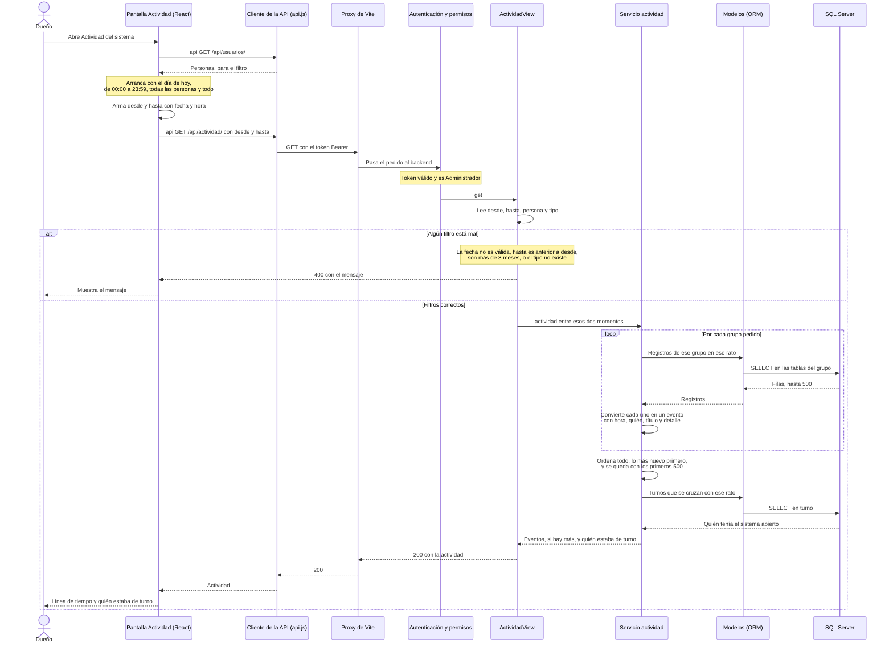
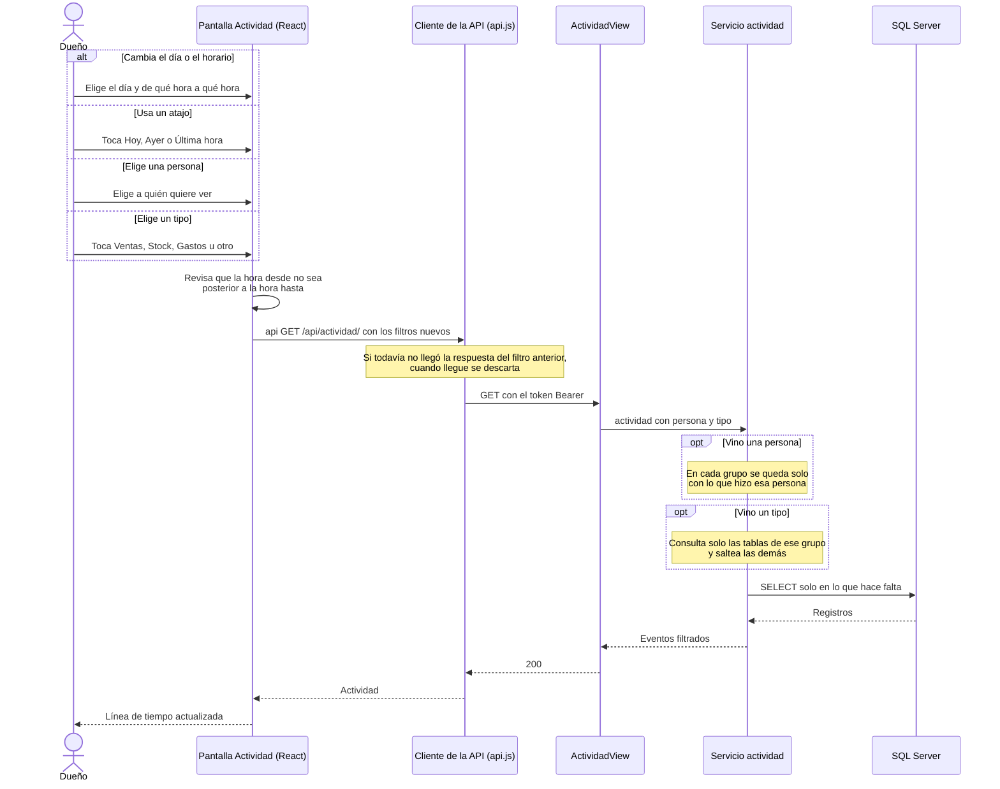
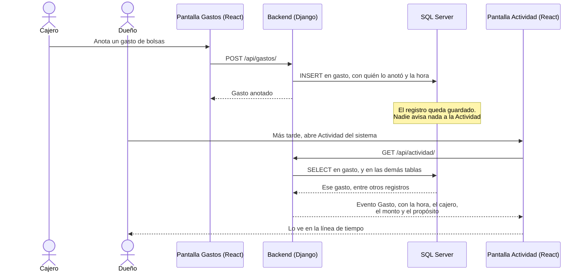

# Diagramas de secuencia: actividad del sistema

Cómo viaja un pedido entre las capas del sistema cuando un dueño **consulta la actividad** de un día y horario, y de dónde sale cada cosa que aparece ahí. Están hechos a partir del código real (`frontend/src/paginas/Actividad.jsx`, `frontend/src/useConsulta.js`, `frontend/src/api.js`, `backend/turnos/api.py` y `backend/turnos/servicios.py`).

## En qué se diferencia de los otros módulos

Este módulo es **solo de lectura**: no tiene alta ni baja. No guarda nada propio. Arma una línea de tiempo juntando los registros que cada uno de los otros módulos dejó cuando alguien hizo algo:

- El **«alta»** de un evento ocurre sola, en otro módulo, cada vez que alguien vende, anota un gasto, cambia un precio, entra al sistema, etc.
- **No hay «baja»**: los registros no se pueden modificar ni borrar desde el sistema. Si una venta o un gasto se anulan, eso aparece como un evento más, no desaparece el anterior.

Sirve para saber qué pasó a una hora determinada y quién estaba a cargo en ese momento.

## Las capas

| Capa | Qué es | Archivos |
| --- | --- | --- |
| Pantalla | Lo que ve el dueño en el navegador (React) | `Actividad.jsx` |
| Cliente de la API | Agrega el token a cada pedido y lo renueva si venció | `useConsulta.js`, `api.js` |
| Proxy de Vite | Recibe `/api/...` en el puerto 5173 y lo pasa al backend | `vite.config.js` |
| Autenticación y permisos | Verifica quién es y que sea dueño | `AutenticacionConTurno`, `EsAdministrador`, `PasswordAlDia` |
| Vista | Recibe el pedido y revisa los filtros | `ActividadView` |
| Servicio | Junta los registros de todos los módulos | `actividad` |
| Modelos (ORM) | Convierten los objetos en consultas SQL | los de la tabla de abajo |
| Base de datos | SQL Server | las tablas de la tabla de abajo |

La actividad es **solo para dueños**.

De dónde sale cada grupo de eventos:

| Grupo | Qué muestra | Tablas que lee |
| --- | --- | --- |
| Ventas | Ventas, compras modificadas y anulaciones | `venta` |
| Cuentas corrientes | Altas, bajas y cambios de clientes, límites, pagos y ajustes | `cambio_cliente`, `movimiento_cuenta` |
| Gastos | Gastos anotados y anulados | `gasto` |
| Compras a comerciantes | Compras, pagos y anulaciones | `compra`, `pago_compra` |
| Stock | Ingresos, pérdidas y recuentos | `movimiento_stock` |
| Productos | Altas, bajas, correcciones y cambios de precio | `cambio_producto` |
| Ingresos y salidas | Inicios y cierres de sesión, intentos fallidos y bloqueos | `registro_acceso` |
| Horarios | Correcciones de horario, cuentas olvidadas que cerró el sistema y cierres del día | `turno`, `cierre_diario` |
| Usuarios | Altas, bajas, reactivaciones y cambios de permiso | `cambio_usuario` |

## 1. Obtención: ver la actividad de un día y horario

Qué devuelve el servidor:

- **`eventos`:** hasta 500, del más nuevo al más viejo. Cada uno trae el grupo, la fecha y hora, quién lo hizo, un título y un detalle.
- **`hay_mas`:** verdadero si había más de 500, para avisar que conviene achicar el horario.
- **`de_turno`:** los empleados y encargados que tenían el sistema abierto en algún momento de ese rato, con su hora de entrada y de salida.

Lo que hace el sistema solo (cerrar una cuenta olvidada, generar el cierre del día a las 00:45) aparece a nombre de «El sistema».

## 2. Filtrar por horario, persona o tipo

Cada cambio de filtro vuelve a pedirle todo al servidor.

Filtrar por tipo hace la consulta más liviana, porque el servidor directamente no mira las otras tablas. Con una persona elegida no se muestran los eventos de «El sistema».

## 3. De dónde sale un evento

Nada se anota en este módulo. Cada evento nace en el módulo donde ocurrió y la Actividad lo encuentra después. Ejemplo con un gasto:

Por eso todos los módulos guardan, en cada operación, quién la hizo, la fecha y la hora: sin eso la Actividad no tendría de dónde armarse. Y por eso tampoco hay nada que borrar acá: para que algo deje de verse en la Actividad habría que borrar el registro original, y el sistema no borra ventas, gastos, movimientos ni cambios.

Cuando algo se anula, quedan **dos** eventos: el original a su hora (por ejemplo «Gasto») y la anulación a la suya («Gasto anulado», con quién lo anuló y el motivo).

## Casos comunes

El token vencido está en [`diagrama-secuencia-usuarios.md`](diagrama-secuencia-usuarios.md). Cómo se registra cada tipo de evento está en el diagrama de su módulo: [ventas](diagrama-secuencia-ventas.md), [recibos](diagrama-secuencia-recibos.md), [cuentas corrientes](diagrama-secuencia-cuentas-corrientes.md), [gastos](diagrama-secuencia-gastos.md), [compras a comerciantes](diagrama-secuencia-compras-comerciantes.md), [productos](diagrama-secuencia-productos.md), [horarios](diagrama-secuencia-horarios.md), [usuarios](diagrama-secuencia-usuarios.md) y [resumen y cierre](diagrama-secuencia-resumen-cierre.md).
