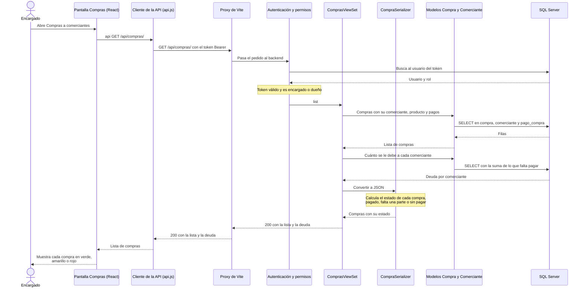
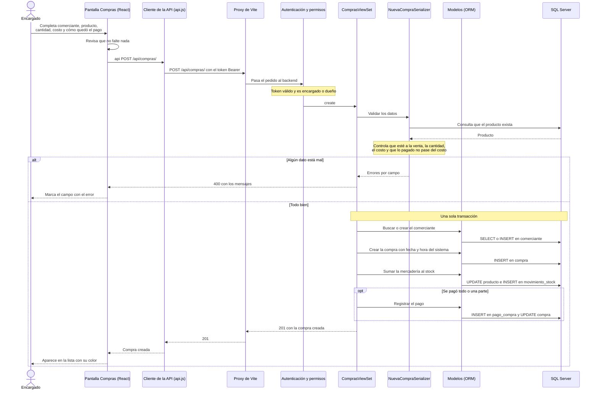
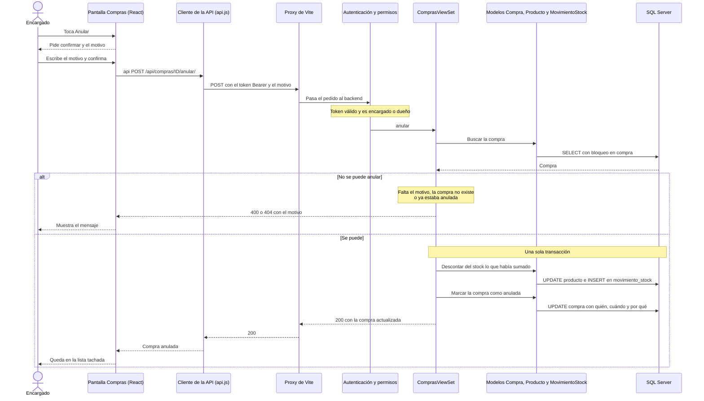

# Diagramas de secuencia: compras a comerciantes

Cómo viaja un pedido entre las capas del sistema cuando un dueño o un encargado **consulta** las compras, **da de alta** una compra o **da de baja** (anula) una compra. Están hechos a partir del código real (`frontend/src/paginas/Compras.jsx`, `frontend/src/api.js`, `backend/compras/api.py`, `backend/compras/models.py`, `backend/productos/api.py` y `backend/usuarios/permisos.py`).

## Las capas

| Capa | Qué es | Archivos |
| --- | --- | --- |
| Pantalla | Lo que se ve en el navegador (React) | `Compras.jsx` |
| Cliente de la API | Agrega el token a cada pedido y lo renueva si venció | `api.js` |
| Proxy de Vite | Recibe `/api/...` en el puerto 5173 y lo pasa al backend | `vite.config.js` |
| Autenticación y permisos | Verifica quién es y que sea encargado o dueño | `AutenticacionConTurno`, `EsEncargadoOAdministrador`, `PasswordAlDia` |
| Vista | Recibe el pedido y coordina | `ComprasViewSet` |
| Serializer | Valida los datos y arma la respuesta | `NuevaCompraSerializer`, `CompraSerializer` |
| Modelos (ORM) | Convierten los objetos en consultas SQL | `Comerciante`, `Compra`, `PagoCompra`, `Producto`, `MovimientoStock` |
| Base de datos | SQL Server | tablas `comerciante`, `compra`, `pago_compra`, `producto`, `movimiento_stock` |

Las tres operaciones son **solo para dueños y encargados**. Si el que pregunta es un empleado, la capa de permisos corta el pedido con un error 403 antes de llegar a la vista.

## 1. Obtención: ver la lista de compras

Con `?estado=`, `?comerciante=` o fechas, la vista filtra antes de consultar. El color lo pone la pantalla según el estado: verde pagado, amarillo falta una parte, rojo sin pagar.

## 2. Alta: anotar una compra

La fecha y la hora no se escriben: las pone el sistema al guardar. Si cualquier paso falla, no queda nada guardado, ni la compra, ni el stock, ni el pago.

## 3. Baja: anular una compra

La compra **no se borra**: queda en la lista como anulada, con quién la anuló y el motivo, y deja de contar en la deuda con el comerciante.

## Qué pasa si el token venció

Igual que en los demás módulos: si el token de acceso ya venció (dura 15 minutos), el cliente lo renueva solo y repite el pedido una vez. El diagrama está en [`diagrama-secuencia-usuarios.md`](diagrama-secuencia-usuarios.md).
