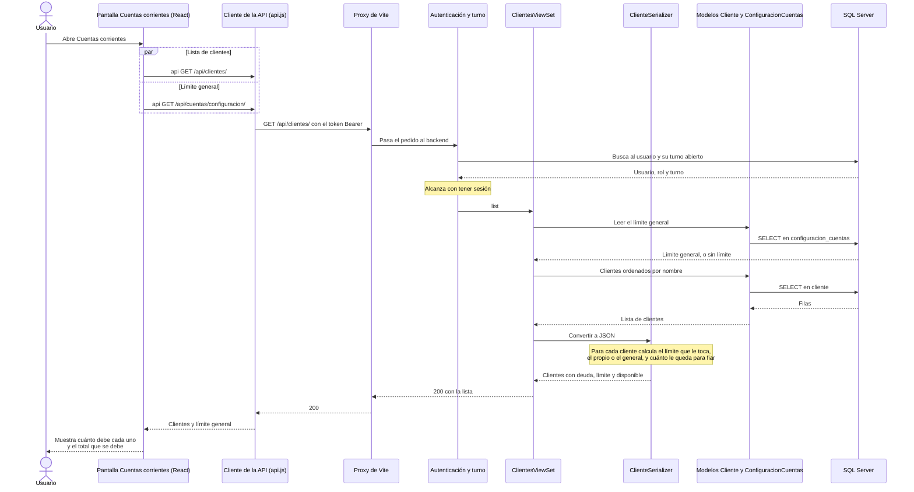
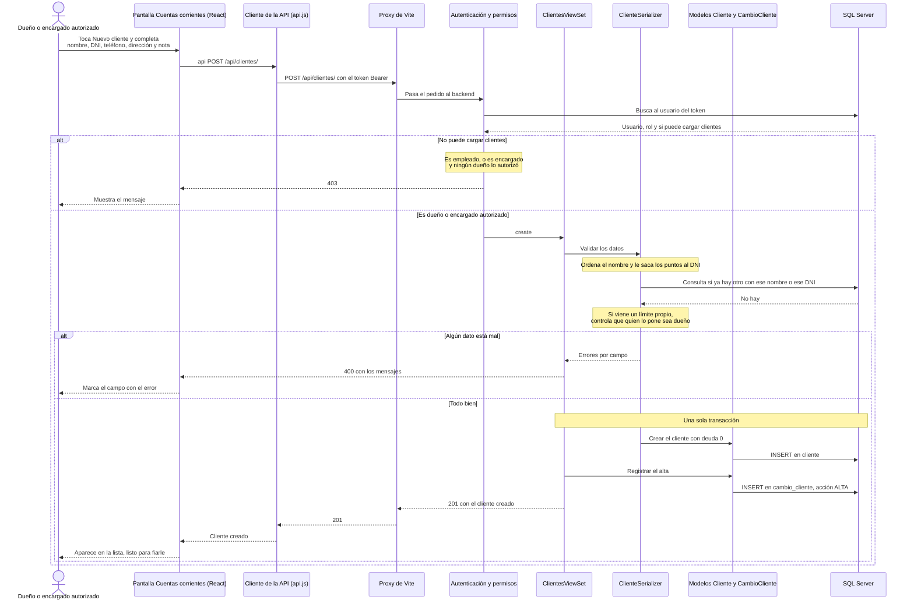
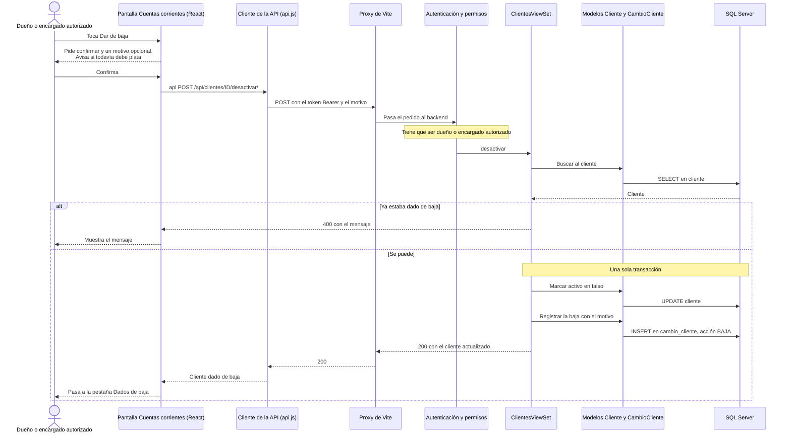
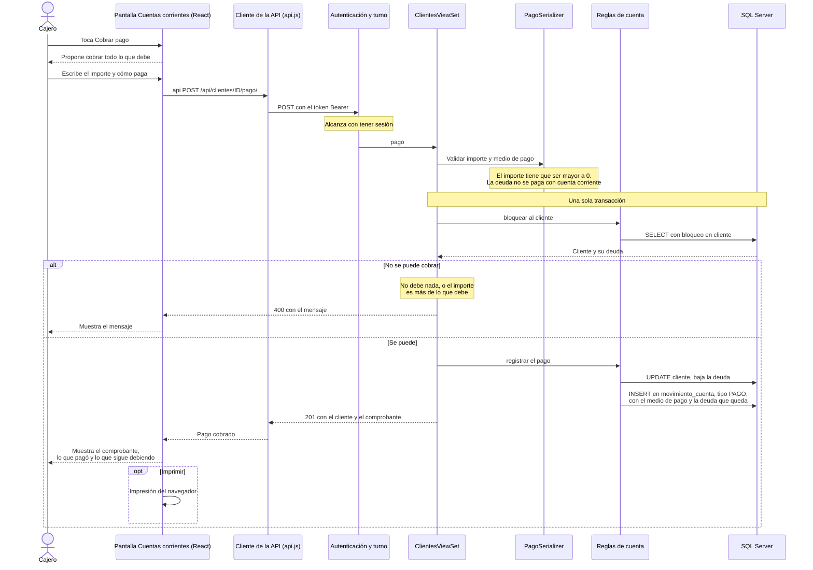
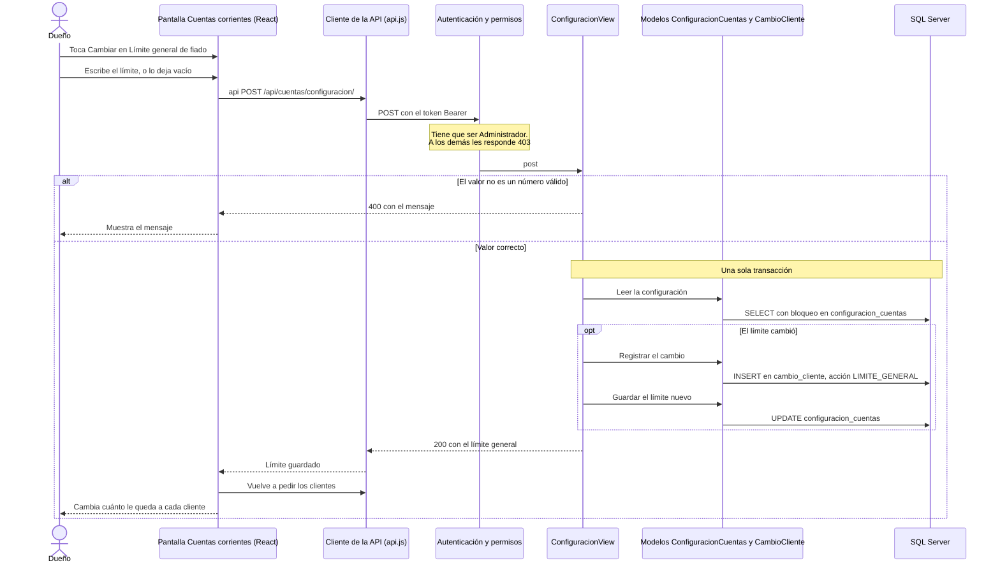

# Diagramas de secuencia: cuentas corrientes

Cómo viaja un pedido entre las capas del sistema cuando alguien **consulta** los clientes de cuenta corriente, **da de alta** o **da de baja** un cliente, **cobra un pago** de la deuda o **cambia el límite de fiado**. Están hechos a partir del código real (`frontend/src/paginas/Clientes.jsx`, `frontend/src/api.js`, `backend/clientes/api.py`, `backend/clientes/servicios.py`, `backend/clientes/models.py` y `backend/usuarios/permisos.py`).

## Las capas

| Capa | Qué es | Archivos |
| --- | --- | --- |
| Pantalla | Lo que se ve en el navegador (React) | `Clientes.jsx` |
| Cliente de la API | Agrega el token a cada pedido y lo renueva si venció | `api.js` |
| Proxy de Vite | Recibe `/api/...` en el puerto 5173 y lo pasa al backend | `vite.config.js` |
| Autenticación y permisos | Verifica quién es, su turno y qué puede hacer | `AutenticacionConTurno`, `GestionaClientes`, `EsAdministrador`, `PasswordAlDia` |
| Vista | Recibe el pedido y coordina | `ClientesViewSet`, `ConfiguracionView` |
| Serializer | Valida los datos y arma la respuesta | `ClienteSerializer`, `PagoSerializer`, `MovimientoSerializer` |
| Reglas de cuenta | Cambian la deuda dejando siempre un movimiento | `bloquear`, `registrar`, `limite_de` |
| Modelos (ORM) | Convierten los objetos en consultas SQL | `Cliente`, `MovimientoCuenta`, `CambioCliente`, `ConfiguracionCuentas` |
| Base de datos | SQL Server | tablas `cliente`, `movimiento_cuenta`, `cambio_cliente`, `configuracion_cuentas` |

En el código, «el cliente de la API» es el archivo que hace los pedidos; no tiene nada que ver con los clientes del mercado.

Quién puede hacer cada cosa:

| Operación | Quién |
| --- | --- |
| Ver los clientes y su cuenta | Todos |
| Cobrar un pago | Todos (cualquier cajero) |
| Dar de alta, corregir y dar de baja clientes | Dueños, y los encargados que un dueño autorizó |
| Fijar el límite general y el de cada cliente | Solo dueños |
| Ajustar una cuenta a mano | Solo dueños |

La deuda de un cliente funciona como el stock: **nadie la escribe a mano**. Solo cambia con un movimiento (compra fiada, pago, anulación o ajuste), y cada movimiento guarda quién lo hizo, cuándo y cómo quedó la deuda.

## 1. Obtención: ver los clientes y sus deudas

Al abrir la pantalla se hacen dos pedidos: la lista de clientes y el límite general.

Las pestañas (Activos, Dados de baja, Solo los que deben) y el buscador no vuelven a llamar al servidor. El total «Deben en total» lo suma la pantalla. Lo que cada persona puede hacer con la lista depende de `gestiona_clientes`, que llega con los datos del usuario al iniciar sesión.

Para **ver la cuenta** de un cliente se hace otro pedido, `GET /api/clientes/ID/movimientos/`, que devuelve sus últimos 200 movimientos con el mismo recorrido.

## 2. Alta: cargar un cliente

El permiso del encargado lo da un dueño desde la pantalla Usuarios, con la casilla «Puede cargar clientes de cuenta corriente» (`POST /api/usuarios/ID/permiso-clientes/`). Aunque esté autorizado, un encargado no puede ponerle límite a un cliente: eso es solo de los dueños. Corregir los datos de un cliente (`PATCH /api/clientes/ID/`) hace el mismo recorrido y registra la acción `EDICION`.

## 3. Baja: dar de baja un cliente

El cliente **no se borra** y su deuda tampoco: queda con `activo` en falso. No se le puede fiar más, pero lo que debe se puede seguir cobrando. Se reactiva con `POST /api/clientes/ID/reactivar/`.

## 4. Cobrar un pago de la deuda

Lo puede hacer cualquier cajero.

El bloqueo del cliente evita que dos cajas cobrándole a la vez pisen su deuda. El pago se guarda en negativo (baja la deuda) y su número sirve como número de comprobante. La plata cobrada entra en la cuenta final del día; si fue en efectivo, también suma al efectivo que debería haber en la caja.

Cómo se **anota una compra fiada** (lo que hace subir la deuda) está en [`diagrama-secuencia-ventas.md`](diagrama-secuencia-ventas.md).

## 5. Cambiar el límite general de fiado

Solo los dueños.

Cómo se decide el límite de cada cliente: si tiene uno **propio**, vale ese; si no, vale el **general**; si tampoco hay general, no tiene tope. El límite propio se cambia desde «Editar» en el cliente (`PATCH /api/clientes/ID/`) y registra la acción `LIMITE`. Vacío significa «sin límite general»; el límite propio vacío significa «usa el general».

El **ajuste a mano** de una cuenta (`POST /api/clientes/ID/ajuste/`, solo dueños) sigue el mismo recorrido que el pago, con un importe con signo y un motivo obligatorio. Sirve para cargar lo que el cliente ya debía en el cuaderno o corregir un error.

## Casos comunes

El token vencido está en [`diagrama-secuencia-usuarios.md`](diagrama-secuencia-usuarios.md) y el turno cerrado en [`diagrama-secuencia-ventas.md`](diagrama-secuencia-ventas.md). Cómo entran lo fiado y los pagos en la cuenta final y en el cierre de las 00:45 está en [`diagrama-secuencia-resumen-cierre.md`](diagrama-secuencia-resumen-cierre.md).
