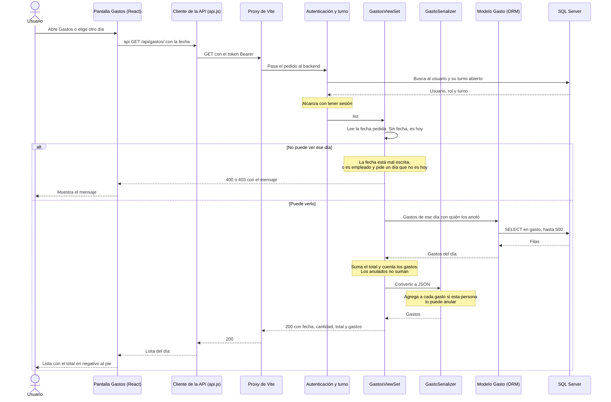
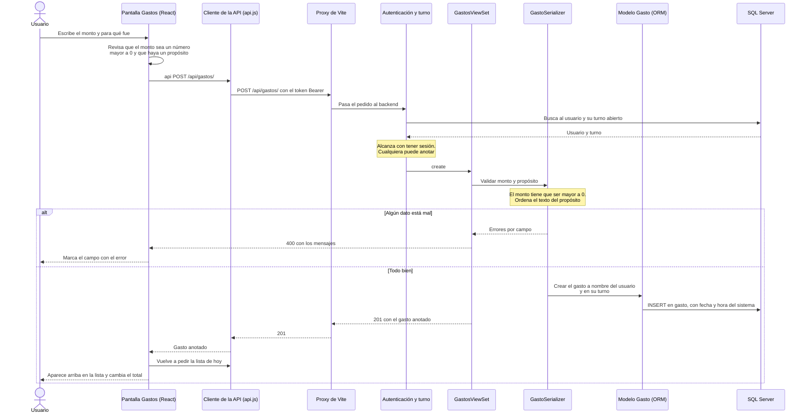
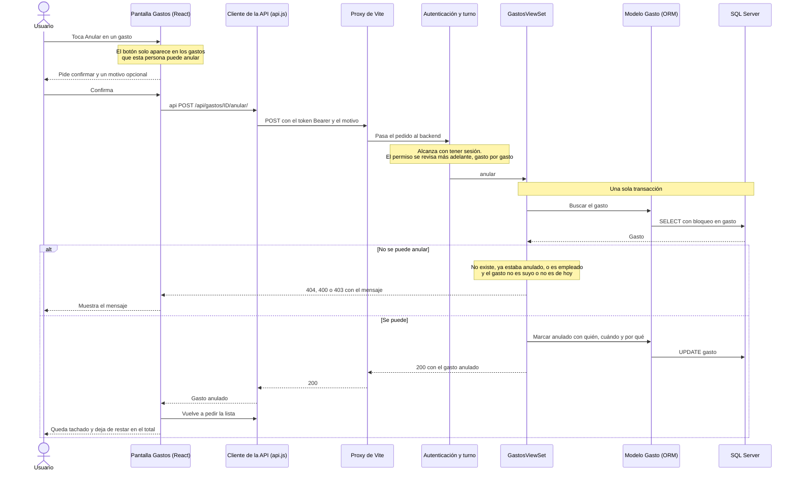
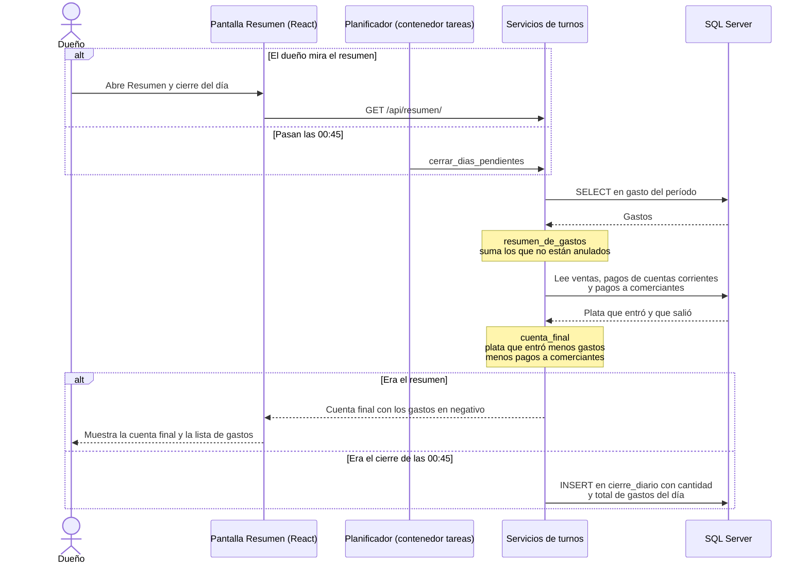

# Diagramas de secuencia: gastos

Cómo viaja un pedido entre las capas del sistema cuando alguien **consulta** la lista de gastos, **da de alta** (anota) un gasto o **da de baja** (anula) uno, y cómo esos gastos terminan restando en la cuenta final del día. Están hechos a partir del código real (`frontend/src/paginas/Gastos.jsx`, `frontend/src/useConsulta.js`, `frontend/src/api.js`, `backend/gastos/api.py`, `backend/gastos/models.py` y `backend/turnos/servicios.py`).

## Las capas

| Capa | Qué es | Archivos |
| --- | --- | --- |
| Pantalla | Lo que se ve en el navegador (React) | `Gastos.jsx` |
| Cliente de la API | Agrega el token a cada pedido y lo renueva si venció | `useConsulta.js`, `api.js` |
| Proxy de Vite | Recibe `/api/...` en el puerto 5173 y lo pasa al backend | `vite.config.js` |
| Autenticación y turno | Verifica quién es y que tenga su turno abierto | `AutenticacionConTurno`, `PasswordAlDia` |
| Vista | Recibe el pedido y coordina | `GastosViewSet` |
| Serializer | Valida los datos y arma la respuesta | `GastoSerializer` |
| Modelos (ORM) | Convierten los objetos en consultas SQL | `Gasto` |
| Base de datos | SQL Server | tabla `gasto` |

Los gastos son una **lista simple**, como una hoja de anotaciones: cada renglón es un monto y, al lado, para qué fue.

Quién puede hacer cada cosa:

| Operación | Quién |
| --- | --- |
| Anotar un gasto | Todos (dueño, encargado y empleado) |
| Ver la lista de hoy | Todos |
| Ver la lista de otro día | Dueños y encargados |
| Anular un gasto | Quien lo anotó, ese mismo día; encargados y dueños, cualquiera |

## 1. Obtención: ver la lista de gastos

Los gastos anulados siguen viniendo en la lista (se muestran tachados), pero no entran en el total. El selector de otro día solo le aparece a dueños y encargados.

## 2. Alta: anotar un gasto

El monto se guarda en positivo; es en las cuentas donde se resta. La fecha y la hora las pone el sistema. Un gasto anotado por un dueño queda sin turno, porque los dueños no llevan turno. Después de anotar, el cursor vuelve al monto para cargar el siguiente.

## 3. Baja: anular un gasto

El gasto **no se borra ni se edita**: queda en la lista tachado, con quién lo anuló y el motivo. Si se anotó mal, se anula y se anota de nuevo. Un gasto anulado no se puede volver a activar.

A diferencia de otros módulos, acá el permiso no lo decide solo el rol: depende de **quién anotó el gasto y de qué día es**, así que lo revisa la vista con el gasto en la mano.

## 4. Cómo llegan los gastos al cierre del día

Los gastos no restan de nada en el momento de anotarlos. Se suman cuando un dueño mira el resumen y cuando el sistema hace el cierre de las 00:45.

Los gastos se restan de dos números: de la **cuenta final** (lo que entró menos lo que salió) y del **efectivo que debería haber en la caja**, porque se asume que se pagan con la plata de la caja. El detalle del resumen y del cierre está en [`diagrama-secuencia-resumen-cierre.md`](diagrama-secuencia-resumen-cierre.md).

Los gastos no tienen sección: en **Resultados por sección** se restan una sola vez, en el resultado del mercado entero.

## Casos comunes

El token vencido está en [`diagrama-secuencia-usuarios.md`](diagrama-secuencia-usuarios.md) y el turno cerrado en [`diagrama-secuencia-ventas.md`](diagrama-secuencia-ventas.md).
