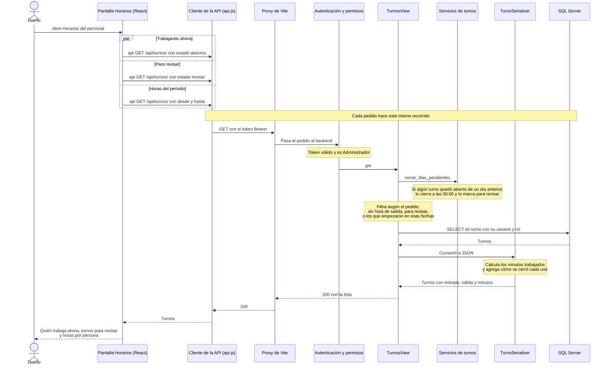
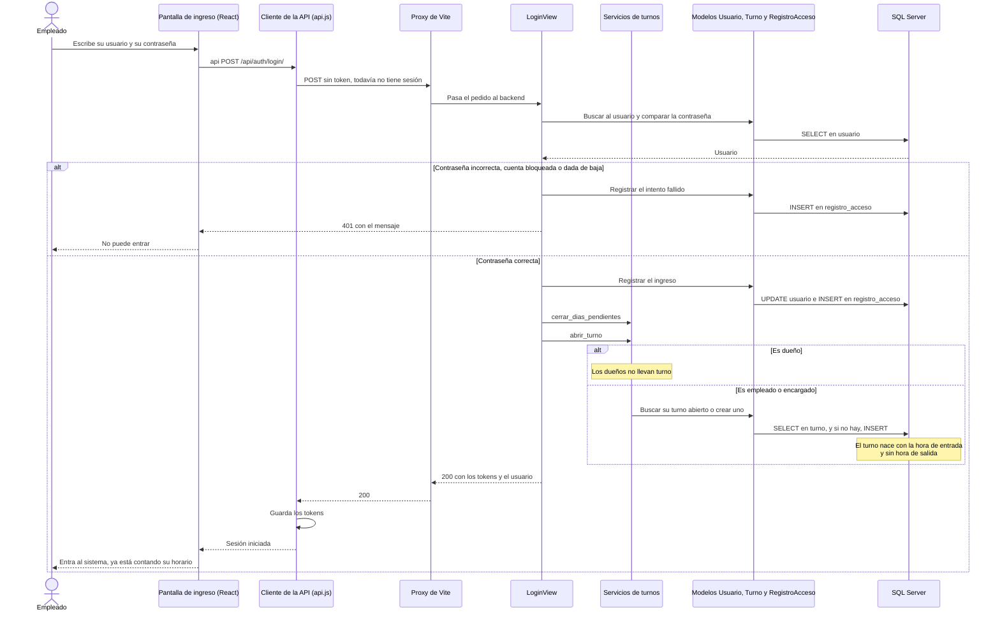
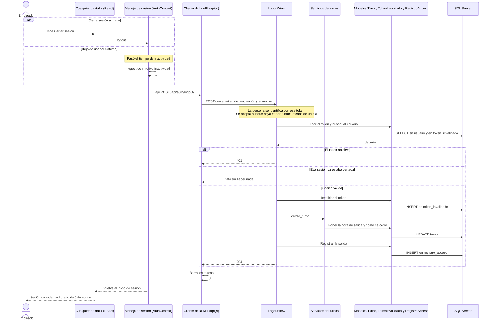
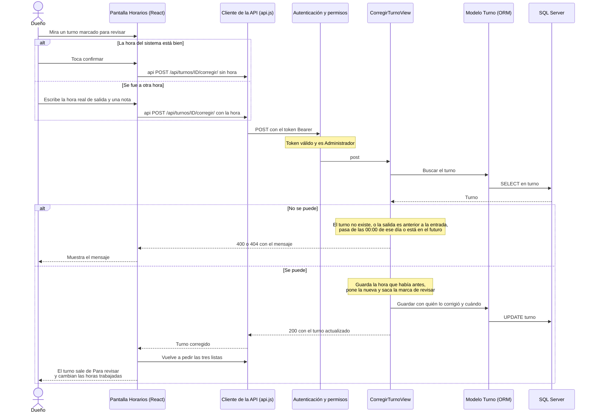

# Diagramas de secuencia: horarios del personal

Cómo viaja un pedido entre las capas del sistema cuando un dueño **consulta los horarios**, cuando se **da de alta un turno** (alguien empieza a trabajar), cuando se **da de baja** (termina) y cuando el dueño **corrige una hora de salida**. Están hechos a partir del código real (`frontend/src/paginas/Horarios.jsx`, `frontend/src/auth/AuthContext.jsx`, `frontend/src/api.js`, `backend/turnos/api.py`, `backend/turnos/servicios.py`, `backend/turnos/models.py` y `backend/usuarios/views.py`).

## Las capas

| Capa | Qué es | Archivos |
| --- | --- | --- |
| Pantalla | Lo que se ve en el navegador (React) | `Horarios.jsx`, `Login.jsx`, `AuthContext.jsx` |
| Cliente de la API | Agrega el token a cada pedido y lo renueva si venció | `useConsulta.js`, `api.js` |
| Proxy de Vite | Recibe `/api/...` en el puerto 5173 y lo pasa al backend | `vite.config.js` |
| Autenticación y permisos | Verifica quién es y que sea dueño | `AutenticacionConTurno`, `EsAdministrador`, `PasswordAlDia` |
| Vista | Recibe el pedido y coordina | `TurnosView`, `CorregirTurnoView`, `LoginView`, `LogoutView` |
| Servicios | Abren y cierran los turnos | `abrir_turno`, `cerrar_turno`, `cerrar_dias_pendientes` |
| Serializer | Arma cada turno para mostrar | `TurnoSerializer` |
| Modelos (ORM) | Convierten los objetos en consultas SQL | `Turno`, `Usuario`, `RegistroAcceso`, `TokenInvalidado` |
| Base de datos | SQL Server | tablas `turno`, `usuario`, `registro_acceso`, `token_invalidado` |

Un **turno** es el tiempo que un empleado o un encargado tuvo su cuenta abierta: desde que entra con su contraseña hasta que cierra sesión. Eso son sus horas trabajadas. **Nadie carga un turno a mano**: el alta y la baja ocurren solas al entrar y al salir. Los dueños no llevan turno.

Quién puede hacer cada cosa:

| Operación | Quién |
| --- | --- |
| Ver horarios y horas trabajadas | Solo dueños |
| Corregir o confirmar una hora de salida | Solo dueños |
| Abrir y cerrar su propio turno | Empleados y encargados, al entrar y salir del sistema |

## 1. Obtención: ver los horarios

Al abrir la pantalla se hacen tres pedidos a la misma ruta, uno para cada bloque.

Las horas trabajadas no se guardan: se calculan cada vez como la salida menos la entrada. El total por persona lo suma la pantalla con los turnos que llegaron. Con `?usuario=` se filtra por una persona.

## 2. Alta: el turno se abre al iniciar sesión

Si la persona ya tenía un turno abierto (por ejemplo, entró desde otro equipo), sigue con ese: no se abre uno nuevo. Mientras el turno esté abierto, cada pedido que hace anota su última actividad, como mucho una vez por minuto.

## 3. Baja: el turno se cierra al salir

El turno guarda **cómo se cerró**, y eso se ve en Horarios:

| Cómo se cerró | Cuándo pasa |
| --- | --- |
| Cerró sesión | La persona tocó «Cerrar sesión» |
| Se cerró por inactividad | Dejó la pantalla sin usar y la sesión se cortó sola |
| Lo cerró el sistema a las 00:00 | No cerró sesión; el planificador cerró el turno a medianoche y lo marcó para revisar |
| Lo cerró un dueño | El dueño lo cerró desde Horarios, o dio de baja al usuario mientras trabajaba |

El cierre de las 00:00 está en [`diagrama-secuencia-resumen-cierre.md`](diagrama-secuencia-resumen-cierre.md).

## 4. Corregir o confirmar una hora de salida

Cuando el sistema cierra un turno a las 00:00, no sabe a qué hora se fue de verdad la persona. El dueño lo revisa.

La hora que había puesto el sistema no se pierde: queda guardada como hora original, junto con quién la corrigió, cuándo y la nota. La corrección aparece en la Actividad del sistema (grupo «Horarios»). Con esta misma operación el dueño puede cerrar un turno que sigue abierto, indicando la hora de salida.

## Casos comunes

El token vencido está en [`diagrama-secuencia-usuarios.md`](diagrama-secuencia-usuarios.md). Qué pasa cuando alguien quiere seguir usando el sistema con el turno ya cerrado está en [`diagrama-secuencia-ventas.md`](diagrama-secuencia-ventas.md).
