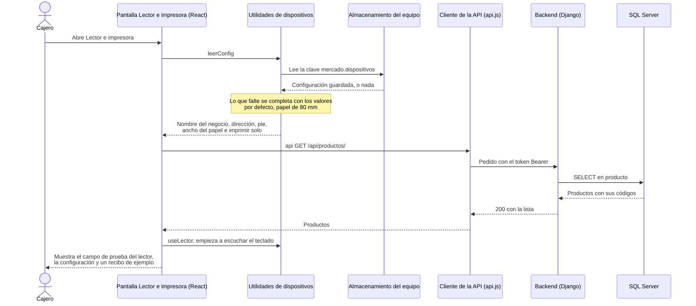
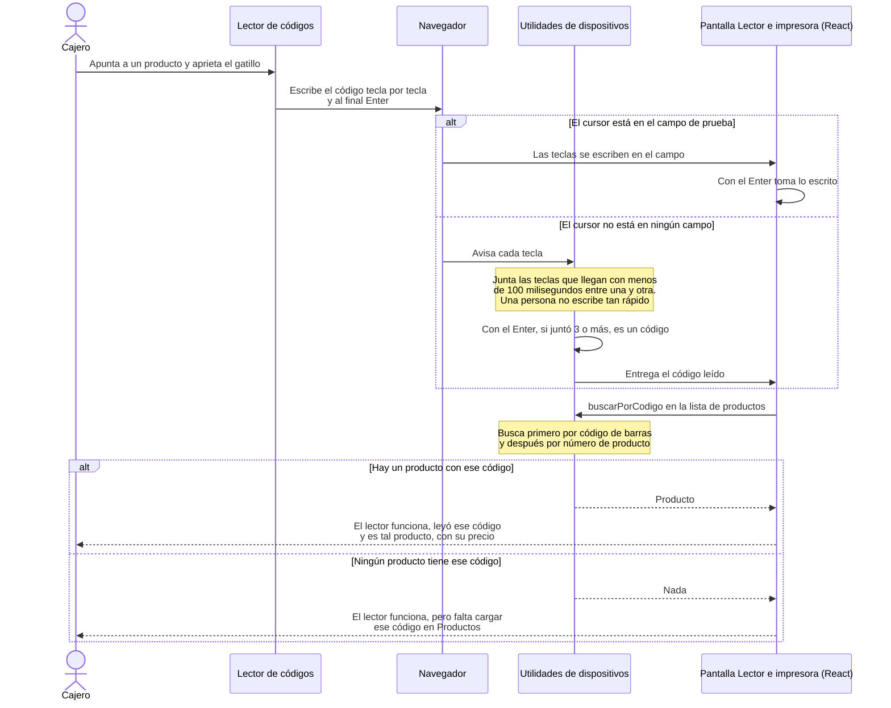
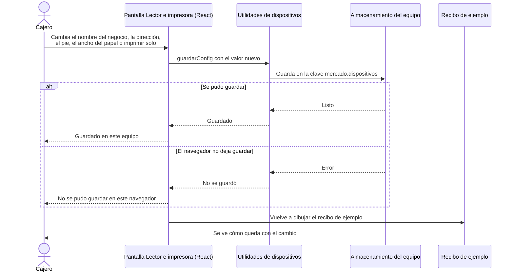
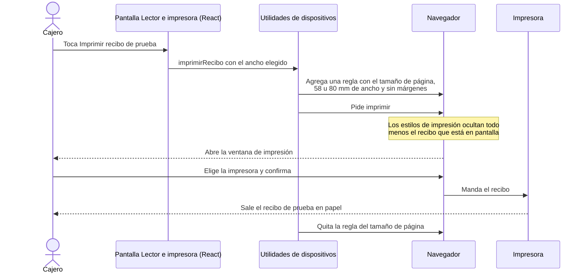
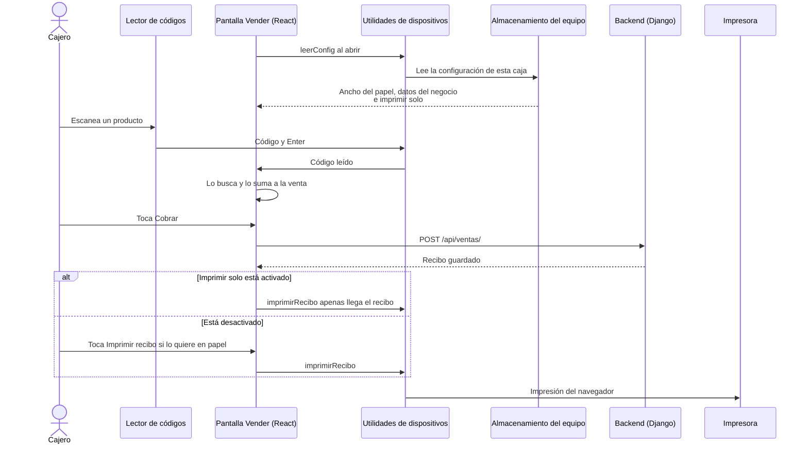

# Diagramas de secuencia: lector e impresora

Cómo funciona por dentro la pantalla **«Lector e impresora»**: probar el lector de códigos de barras, configurar el recibo e imprimir uno de prueba, y cómo usan esos aparatos las demás pantallas. Están hechos a partir del código real (`frontend/src/paginas/Dispositivos.jsx`, `frontend/src/dispositivos.js`, `frontend/src/componentes/Recibo.jsx`, `frontend/src/estilos.css` y `frontend/src/paginas/Venta.jsx`).

## En qué se diferencia de los otros módulos

En los demás módulos casi todo pasa por las tres capas (pantalla, servidor y base de datos). Acá **casi todo ocurre en el navegador**:

- El **lector** no habla con el sistema: se comporta como un teclado que escribe muy rápido y aprieta Enter.
- La **impresora** tampoco: el recibo se manda con la impresión del propio navegador.
- La **configuración** del recibo no se guarda en la base de datos, sino **en cada equipo**, porque cada caja puede tener otra impresora.

Por eso este módulo no tiene alta ni baja en el servidor. Lo único que pide a la API es la lista de productos, para poder decir a qué producto corresponde un código leído.

## Las capas

| Capa | Qué es | Archivos |
| --- | --- | --- |
| Aparatos | Lector de códigos (USB o Bluetooth) e impresora instalada en la computadora | — |
| Navegador | Recibe las teclas del lector, guarda la configuración y maneja la impresión | Chrome u otro |
| Pantalla | Lo que se ve (React) | `Dispositivos.jsx`, `Recibo.jsx` |
| Utilidades de dispositivos | Reconocen al lector, leen y guardan la configuración, mandan a imprimir | `dispositivos.js` |
| Almacenamiento del equipo | Donde queda la configuración del recibo | `localStorage`, clave `mercado.dispositivos` |
| Cliente de la API | Agrega el token al único pedido que se hace | `api.js` |
| Backend y base de datos | Devuelven la lista de productos | `ProductosViewSet`, tabla `producto` |

La pantalla la pueden usar **todos** (dueño, encargado y empleado), porque cada cajero tiene que poder probar los aparatos de su caja.

## 1. Obtención: abrir la pantalla

Este es el único pedido al servidor de todo el módulo. Trae también los productos dados de baja, para poder avisar si el código leído es de uno de ellos.

## 2. Probar el lector de códigos

No hace falta instalar nada: cualquier lector que funcione como teclado sirve. La búsqueda se hace sobre la lista que ya se trajo al abrir la pantalla, sin volver a preguntarle al servidor.

## 3. Configurar el recibo

Es lo más parecido a un «alta» en este módulo, pero se guarda en el equipo, no en la base de datos.

Se guarda con cada cambio, sin botón de guardar. Como queda en el equipo:

- Hay que configurarlo **una vez en cada caja**.
- Si se borran los datos del navegador, vuelve a los valores por defecto.
- No queda registrado en la Actividad del sistema, porque el servidor no se entera.

## 4. Imprimir un recibo de prueba

El recibo de prueba es un ejemplo inventado dentro de la pantalla: no es una venta y no se guarda en ningún lado. Sirve cualquier impresora instalada en Windows. Para que la ventana de impresión no aparezca en cada venta, se puede abrir Chrome con la opción `--kiosk-printing`.

## 5. Cómo lo usa la pantalla Vender

Lo que se prueba y configura acá es lo que después usa la caja.

El lector también funciona en Vender cuando el recibo de la venta anterior todavía está en pantalla: al escanear, empieza una venta nueva. El recibo queda guardado en el servidor se imprima o no. El detalle de cobrar está en [`diagrama-secuencia-ventas.md`](diagrama-secuencia-ventas.md) y el de reimprimir, en [`diagrama-secuencia-recibos.md`](diagrama-secuencia-recibos.md).

## Pendiente

Todo esto se probó simulando el lector desde el teclado y sin mandar nada a una impresora de verdad. **Falta probarlo con un lector y una impresora reales.**
