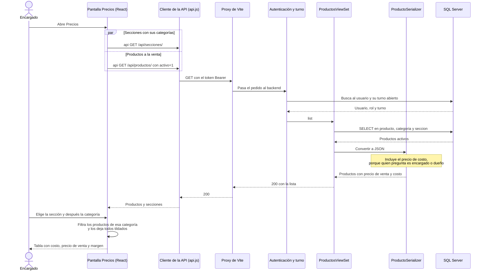
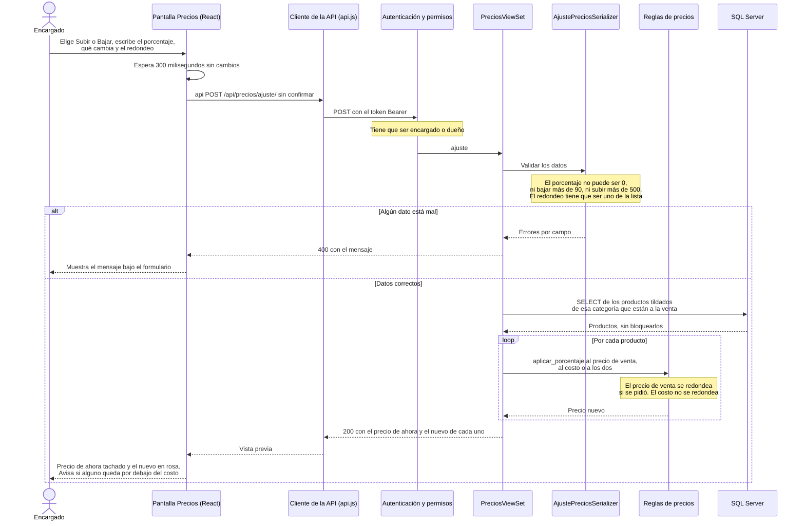
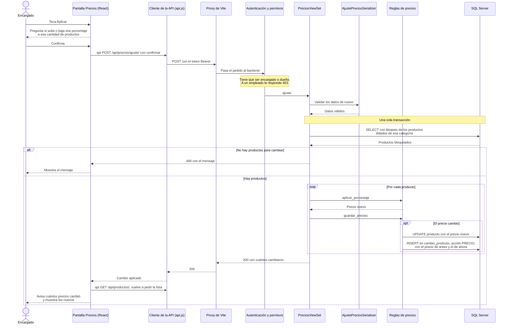
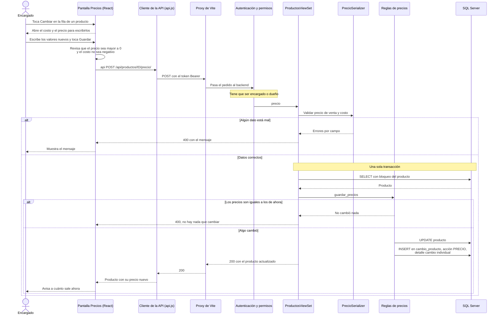

# Diagramas de secuencia: precios

Cómo viaja un pedido entre las capas del sistema cuando alguien **consulta** los precios de una categoría, **ve cómo quedarían** con un porcentaje, **aplica el cambio** a toda la categoría o **cambia el precio de un solo producto**. Están hechos a partir del código real (`frontend/src/paginas/Precios.jsx`, `frontend/src/api.js`, `backend/productos/api.py` y `backend/productos/models.py`).

## En qué se diferencia de los otros módulos

Acá no hay alta ni baja: los precios no se crean ni se eliminan, **se modifican**. Un producto nace con su precio en el módulo Productos, y este módulo es el único lugar donde después se cambia.

Lo particular es que el cambio por categoría tiene **dos pasos con el mismo pedido**: primero el servidor calcula cómo quedaría cada precio sin guardar nada (vista previa), y recién cuando la persona confirma, lo guarda.

## Las capas

| Capa | Qué es | Archivos |
| --- | --- | --- |
| Pantalla | Lo que se ve en el navegador (React) | `Precios.jsx` |
| Cliente de la API | Agrega el token a cada pedido y lo renueva si venció | `api.js` |
| Proxy de Vite | Recibe `/api/...` en el puerto 5173 y lo pasa al backend | `vite.config.js` |
| Autenticación y permisos | Verifica quién es, su turno y que sea encargado o dueño | `AutenticacionConTurno`, `EsEncargadoOAdministrador`, `PasswordAlDia` |
| Vista | Recibe el pedido y coordina | `PreciosViewSet`, `ProductosViewSet` |
| Serializer | Valida el porcentaje y los precios | `AjustePreciosSerializer`, `PrecioSerializer` |
| Reglas de precios | Hacen la cuenta y guardan el cambio con su registro | `aplicar_porcentaje`, `guardar_precios` |
| Modelos (ORM) | Convierten los objetos en consultas SQL | `Producto`, `Categoria`, `CambioProducto` |
| Base de datos | SQL Server | tablas `producto`, `categoria`, `cambio_producto` |

El módulo es **solo para dueños y encargados**. Un empleado no lo ve en el inicio y, si lo intenta, recibe un error 403. El encargado solo puede usarlo mientras su turno está abierto, porque sin turno no tiene sesión.

Cómo está organizado lo que se vende: **sección** (Almacén, Carnicería, Verdulería) → **categoría** (por ejemplo, Pollo) → **producto** (pechuga, alitas, milanesas). El cambio por porcentaje se aplica a una categoría.

## 1. Obtención: ver los precios de una categoría

Elegir la sección y la categoría no vuelve a llamar al servidor: la pantalla filtra los productos que ya trajo. El margen lo calcula la pantalla con el precio y el costo.

## 2. Vista previa: cómo quedarían los precios

Se dispara sola un momento después de que la persona deja de escribir. **No guarda nada.**

Si la persona sigue cambiando el formulario, la respuesta de una vista previa vieja se descarta cuando llega. La cuenta la hace siempre el servidor, no la pantalla, para que lo que se ve antes de confirmar sea exactamente lo que se va a guardar.

## 3. Modificación: aplicar el cambio a la categoría

Es el mismo pedido que la vista previa, pero con `confirmar`.

Puntos a tener en cuenta:

- **Se vuelve a calcular todo.** Al confirmar, el servidor no usa los números de la vista previa: parte otra vez del precio que el producto tiene en ese instante, ya bloqueado. Si alguien cambió un precio entre medio, se aplica sobre el valor nuevo.
- **Todo o nada.** Si falla un producto, no se cambia ninguno.
- **Solo los que están a la venta.** Los productos dados de baja no cambian con el ajuste por categoría.
- **Las ventas ya hechas no cambian.** Cada recibo guardó el precio de su momento.
- **Queda registrado, producto por producto**, con un detalle como «Venta $6500.00 → $7800.00 · +20 % a toda la categoría Pollo», y se ve en la Actividad del sistema.

## 4. Modificación: cambiar el precio de un solo producto

Se puede mandar solo el precio de venta, solo el costo, o los dos. Si el precio de venta queda por debajo del costo, la pantalla lo marca en rojo pero deja guardarlo.

## Qué no cambia los precios

Para no confundir, estas operaciones **no** tocan el precio de un producto:

| Operación | Qué pasa con el precio |
| --- | --- |
| Editar un producto (nombre, código, categoría) | Si se mandan precios, el servidor los ignora |
| Recibir mercadería con otro costo | El costo queda en el movimiento de stock, no en el producto |
| Anotar una compra a un comerciante | Igual: el costo queda en la compra y en el movimiento |
| Crear un producto nuevo | Es la única vez que el precio se pone fuera de este módulo |

## Casos comunes

El token vencido está en [`diagrama-secuencia-usuarios.md`](diagrama-secuencia-usuarios.md) y el turno cerrado en [`diagrama-secuencia-ventas.md`](diagrama-secuencia-ventas.md). Cómo se toma el precio al cobrar está también en el de ventas, y cómo nace un producto con su precio, en [`diagrama-secuencia-productos.md`](diagrama-secuencia-productos.md).
