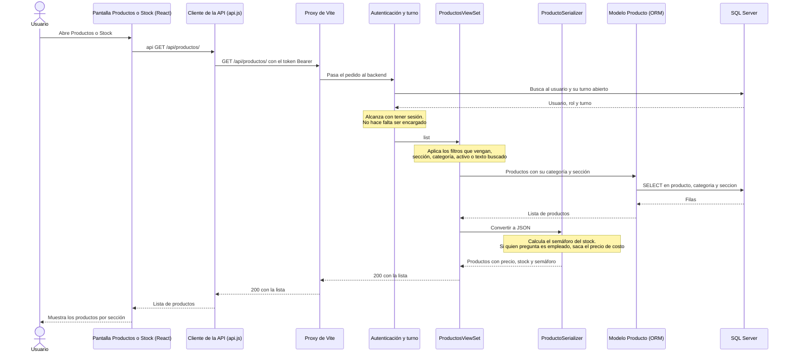
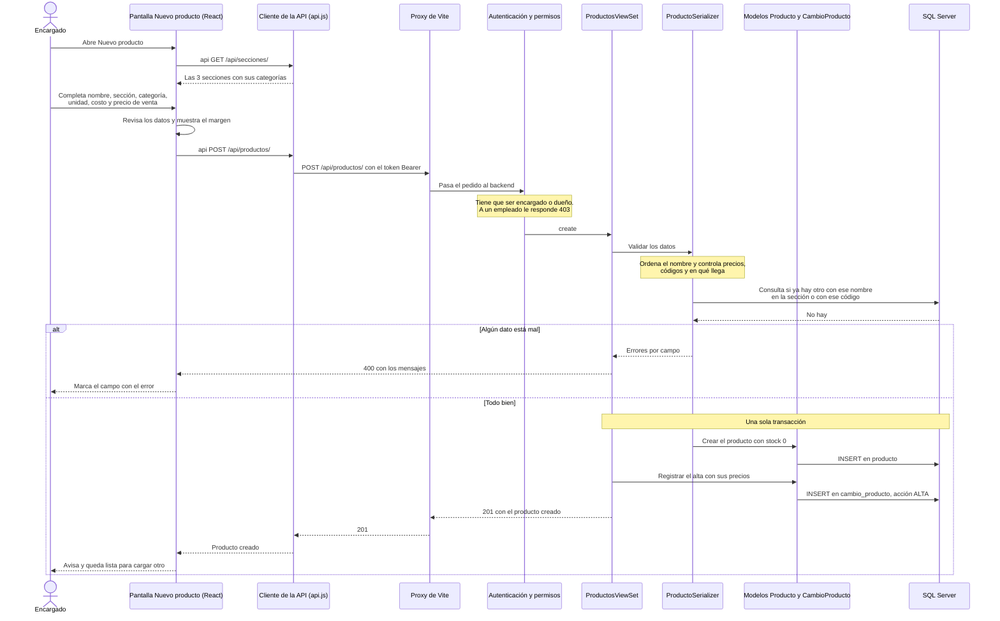
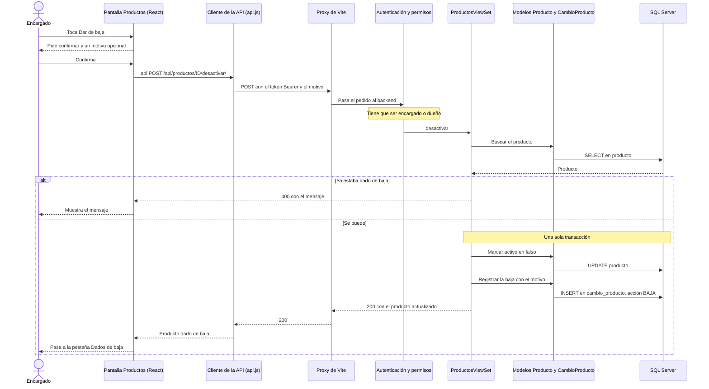

# Diagramas de secuencia: productos

Cómo viaja un pedido entre las capas del sistema cuando alguien **consulta**, **da de alta** o **da de baja** un producto. Están hechos a partir del código real (`frontend/src/paginas/Productos.jsx`, `NuevoProducto.jsx`, `Stock.jsx`, `frontend/src/api.js`, `backend/productos/api.py`, `backend/usuarios/permisos.py` y `backend/turnos/autenticacion.py`).

## Las capas

| Capa | Qué es | Archivos |
| --- | --- | --- |
| Pantalla | Lo que se ve en el navegador (React) | `Productos.jsx`, `NuevoProducto.jsx`, `Stock.jsx` |
| Cliente de la API | Agrega el token a cada pedido y lo renueva si venció | `api.js` |
| Proxy de Vite | Recibe `/api/...` en el puerto 5173 y lo pasa al backend | `vite.config.js` |
| Autenticación y permisos | Verifica quién es, su turno y su rol | `AutenticacionConTurno`, `EsEncargadoOAdministrador`, `PasswordAlDia` |
| Vista | Recibe el pedido y coordina | `ProductosViewSet` |
| Serializer | Valida los datos y arma la respuesta | `ProductoSerializer` |
| Modelos (ORM) | Convierten los objetos en consultas SQL | `Producto`, `Categoria`, `Seccion`, `CambioProducto` |
| Base de datos | SQL Server | tablas `producto`, `categoria`, `seccion`, `cambio_producto` |

Quién puede hacer cada cosa:

| Operación | Quién |
| --- | --- |
| Ver los productos | Todos (los empleados no reciben el precio de costo) |
| Dar de alta | Dueños y encargados |
| Dar de baja y reactivar | Dueños y encargados |

Productos y Stock son la misma lista: las dos pantallas hacen el mismo pedido de obtención.

## 1. Obtención: ver la lista de productos

Los filtros por sección, las pestañas y el buscador de la pantalla no vuelven a llamar al servidor: trabajan sobre la lista que ya llegó. Stock pide la lista con `activo=1` para ver solo los que están a la venta.

## 2. Alta: crear un producto

Puntos a tener en cuenta:

- **Nace con stock 0.** El stock se carga después desde Stock (recibir mercadería o recuento), nunca a mano en el producto.
- **Nombre repetido:** no puede haber dos productos con el mismo nombre en la misma sección, aunque uno esté dado de baja; en ese caso el mensaje sugiere reactivarlo.
- **Otras dos formas de alta** usan la misma validación: desde Stock («+ Agregar un producto nuevo», que hace este mismo pedido y después abre Recibir mercadería) y desde Compras a comerciantes («+ Es un producto nuevo», donde el producto se crea dentro de la misma transacción que la compra).

## 3. Baja: dar de baja un producto

El producto **no se borra**: queda con `activo` en falso. Deja de aparecer en la venta y en Stock, pero conserva su stock, sus ventas anteriores y su historial. Se puede reactivar con `POST /api/productos/ID/reactivar/`, que hace el camino inverso y registra la acción `REACTIVACION`.

## Casos comunes a los tres

El token vencido (se renueva solo y se repite el pedido) está explicado en [`diagrama-secuencia-usuarios.md`](diagrama-secuencia-usuarios.md), y el turno cerrado (el pedido se rechaza y vuelve al inicio de sesión) en [`diagrama-secuencia-ventas.md`](diagrama-secuencia-ventas.md). Funcionan igual acá.
