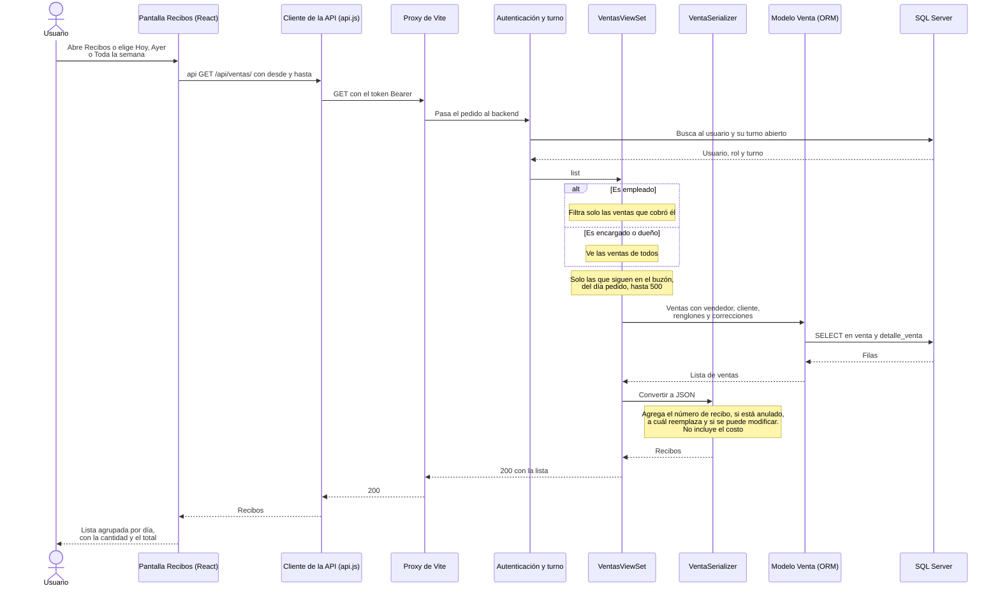
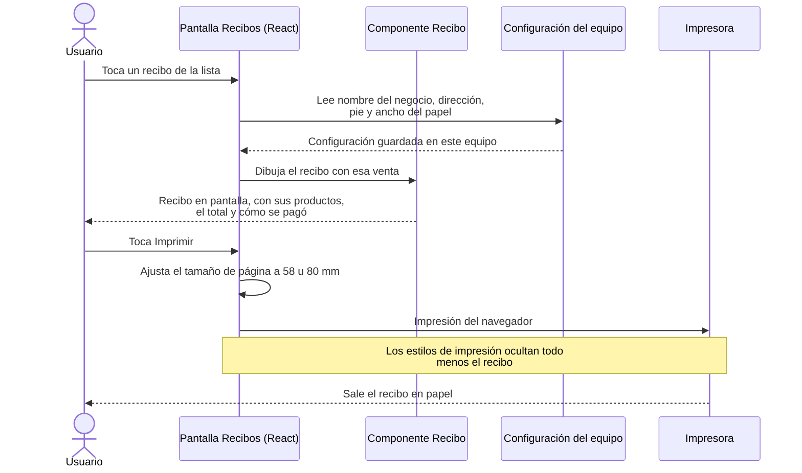
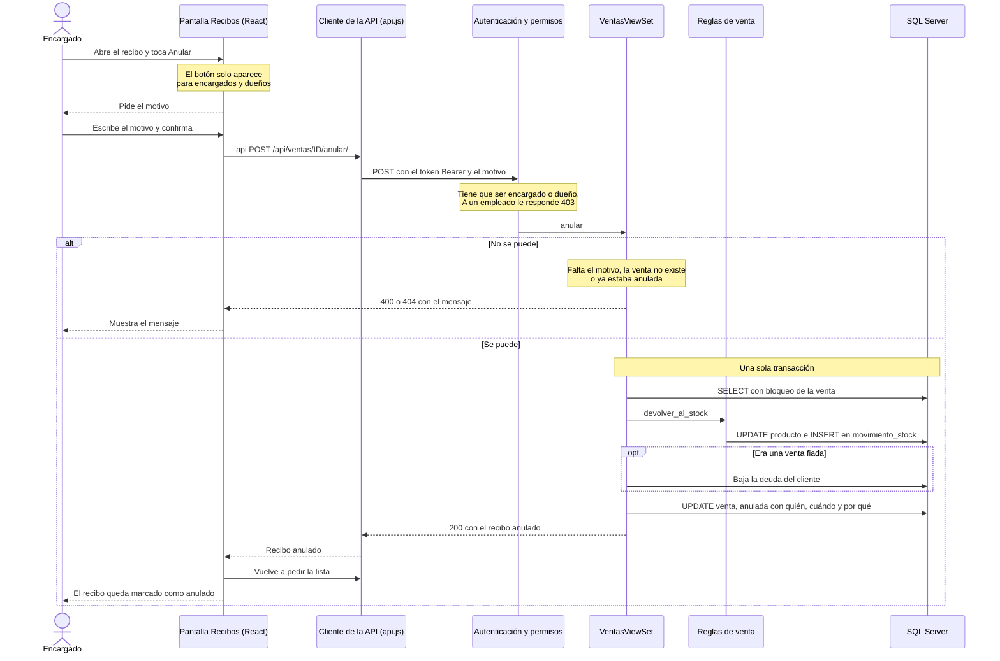
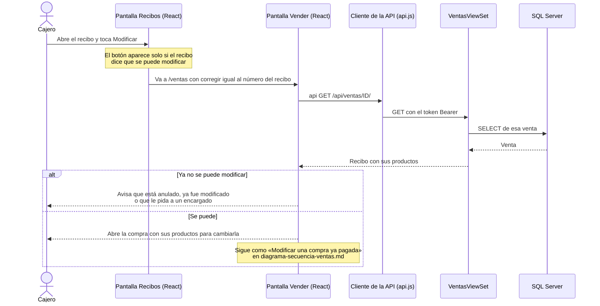
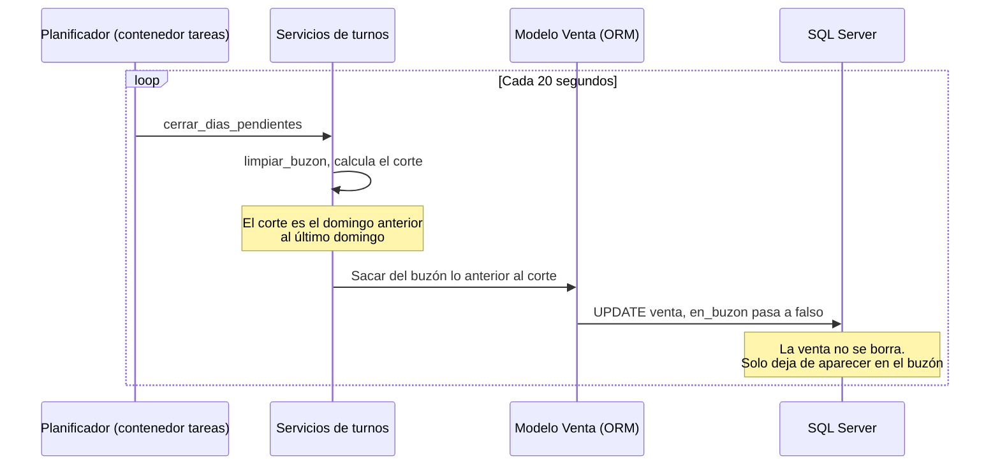

# Diagramas de secuencia: módulo Recibos

Cómo viaja un pedido entre las capas del sistema cuando alguien **consulta el buzón de recibos**, **abre y reimprime** uno, lo **anula** o pasa a **modificarlo**, y cómo el buzón **se limpia solo** cada semana. Están hechos a partir del código real (`frontend/src/paginas/Recibos.jsx`, `frontend/src/componentes/Recibo.jsx`, `frontend/src/dispositivos.js`, `frontend/src/useConsulta.js`, `backend/ventas/api.py` y `backend/turnos/servicios.py`).

## Las capas

| Capa | Qué es | Archivos |
| --- | --- | --- |
| Pantalla | Lo que se ve en el navegador (React) | `Recibos.jsx`, `Recibo.jsx` |
| Impresora | El recibo sale por la impresión del navegador, en 58 u 80 mm | `dispositivos.js` |
| Cliente de la API | Agrega el token a cada pedido y lo renueva si venció | `useConsulta.js`, `api.js` |
| Proxy de Vite | Recibe `/api/...` en el puerto 5173 y lo pasa al backend | `vite.config.js` |
| Autenticación y turno | Verifica quién es, su turno y su rol | `AutenticacionConTurno`, `EsEncargadoOAdministrador`, `PasswordAlDia` |
| Vista | Recibe el pedido y coordina | `VentasViewSet` |
| Serializer | Arma cada recibo para mostrar | `VentaSerializer`, `DetalleSerializer` |
| Planificador | Proceso aparte que limpia el buzón | contenedor `tareas`, `limpiar_buzon` |
| Modelos (ORM) | Convierten los objetos en consultas SQL | `Venta`, `DetalleVenta` |
| Base de datos | SQL Server | tablas `venta`, `detalle_venta` |

Un recibo **no es un dato aparte**: es la misma venta, mostrada con forma de ticket. Por eso este módulo usa las rutas de ventas (`/api/ventas/`).

Quién puede hacer cada cosa:

| Operación | Quién |
| --- | --- |
| Ver recibos y reimprimirlos | Todos. Un empleado ve solo los suyos; encargados y dueños ven todos |
| Modificar una compra | El cajero que la cobró, el mismo día; encargados y dueños, cualquiera |
| Anular | Encargados y dueños |

## 1. Obtención: ver el buzón de recibos

El buscador (por número de recibo, producto o vendedor) no vuelve a llamar al servidor: filtra la lista que ya llegó. El total que se muestra arriba no cuenta los recibos anulados.

## 2. Abrir un recibo y reimprimirlo

Los datos del recibo ya llegaron con la lista, así que **no hay ningún pedido al servidor**: todo pasa en el navegador.

La configuración del recibo se guarda en cada equipo, porque cada caja puede tener otra impresora. Se cambia en la pantalla «Lector e impresora».

## 3. Anular un recibo

El recibo anulado **sigue en la lista**, marcado, con quién lo anuló y por qué. La mercadería vuelve al stock.

## 4. Modificar una compra desde Recibos

Recibos no la modifica: manda a la pantalla Vender con ese recibo abierto.

Un empleado que pide un recibo ajeno recibe «no existe» (404): no puede saber si esa venta existe.

## 5. La limpieza semanal del buzón

Nadie la pide: la hace el planificador, el mismo proceso del cierre de las 00:00.

Como el corte se mueve una vez por semana, en el buzón siempre quedan a mano los recibos de esta semana y los de la anterior. El resto de los días la limpieza no encuentra nada para sacar. Las ventas viejas siguen en la base para el resumen, los cierres y los resultados; un dueño puede pedirlas todas con `GET /api/ventas/?todas=1`. La limpieza también corre en cada inicio de sesión, por si la computadora estuvo apagada.

## Casos comunes

El token vencido está en [`diagrama-secuencia-usuarios.md`](diagrama-secuencia-usuarios.md); el turno cerrado y el detalle de cobrar, modificar y anular, en [`diagrama-secuencia-ventas.md`](diagrama-secuencia-ventas.md); el cierre de las 00:00, en [`diagrama-secuencia-resumen-cierre.md`](diagrama-secuencia-resumen-cierre.md).
