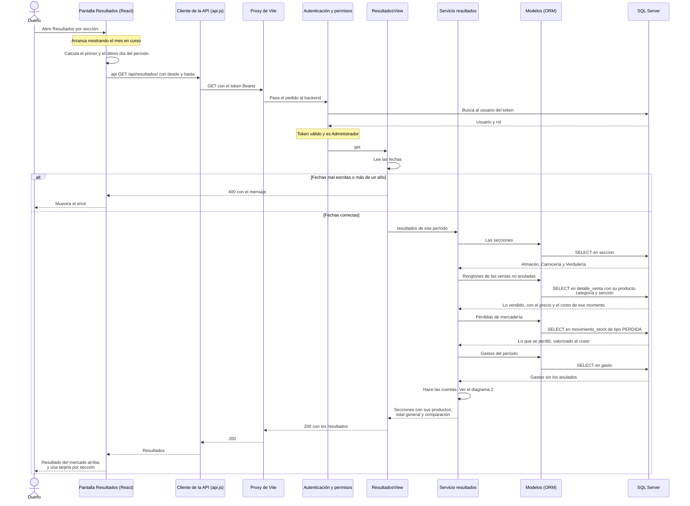
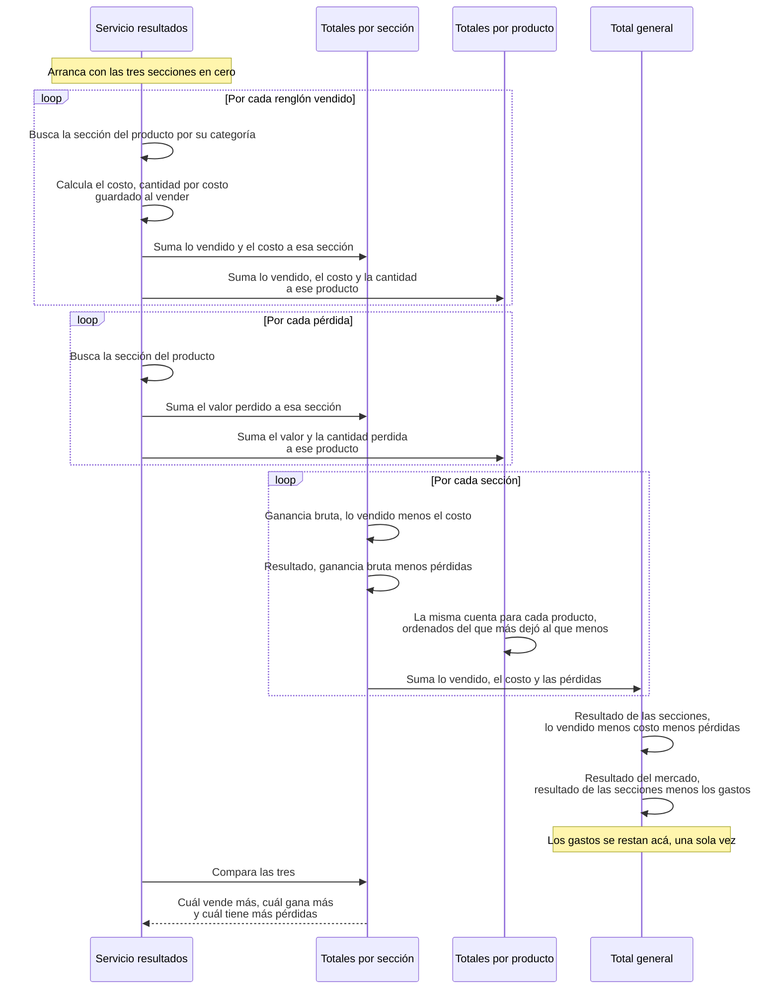
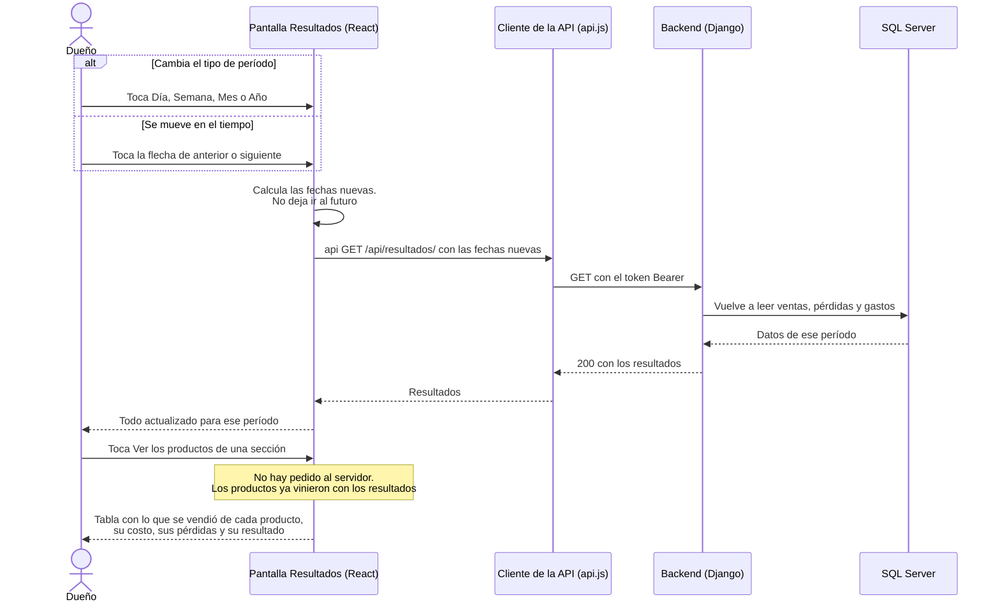

# Diagramas de secuencia: resultados por sección

Cómo viaja un pedido entre las capas del sistema cuando un dueño **consulta cuánto ganó o perdió cada sección**, cómo se arma esa cuenta y de dónde sale cada número. Están hechos a partir del código real (`frontend/src/paginas/Resultados.jsx`, `frontend/src/componentes/SelectorPeriodo.jsx`, `frontend/src/periodo.js`, `frontend/src/useConsulta.js`, `backend/turnos/api.py` y `backend/turnos/servicios.py`).

## En qué se diferencia de los otros módulos

Es un módulo **solo de lectura**: no tiene alta ni baja y no guarda nada propio. Cada vez que se consulta, hace la cuenta de nuevo con lo que dejaron otros módulos:

| Número | De dónde sale | Módulo que lo generó |
| --- | --- | --- |
| Lo vendido | Renglones de las ventas no anuladas | Vender |
| Lo que costó esa mercadería | El costo guardado en cada renglón al vender | Vender |
| Las pérdidas | Movimientos de stock de tipo pérdida, al costo | Stock |
| Los gastos | La lista de gastos, sin los anulados | Gastos |
| A qué sección pertenece cada cosa | La categoría del producto | Productos |

## Las capas

| Capa | Qué es | Archivos |
| --- | --- | --- |
| Pantalla | Lo que ve el dueño en el navegador (React) | `Resultados.jsx`, `SelectorPeriodo.jsx` |
| Cliente de la API | Agrega el token a cada pedido y lo renueva si venció | `useConsulta.js`, `api.js` |
| Proxy de Vite | Recibe `/api/...` en el puerto 5173 y lo pasa al backend | `vite.config.js` |
| Autenticación y permisos | Verifica quién es y que sea dueño | `AutenticacionConTurno`, `EsAdministrador`, `PasswordAlDia` |
| Vista | Recibe el pedido y revisa las fechas | `ResultadosView` |
| Servicio | Hace toda la cuenta | `resultados`, `resumen_de_gastos` |
| Modelos (ORM) | Convierten los objetos en consultas SQL | `Seccion`, `DetalleVenta`, `MovimientoStock`, `Gasto` |
| Base de datos | SQL Server | tablas `seccion`, `categoria`, `producto`, `venta`, `detalle_venta`, `movimiento_stock`, `gasto` |

Este módulo es **solo para dueños**. Un encargado o un empleado reciben un error 403.

La cuenta:

- **Resultado de una sección** = lo que vendió − lo que costó esa mercadería − lo que se perdió.
- **Resultado del mercado** = la suma de las tres secciones − los gastos.

Los gastos no tienen sección, así que se restan **una sola vez**, en el total general.

## 1. Obtención: ver los resultados de un período

Siempre vienen las tres secciones, aunque alguna no haya tenido movimientos en el período (aparece en cero).

## 2. Cómo se hace la cuenta dentro del servicio

Lo que pasa en el paso «hace las cuentas» del diagrama anterior, ya con los datos leídos.

Puntos a tener en cuenta:

- **El costo es el del día de la venta.** Cada renglón guardó cuánto costaba el producto cuando se vendió. Si después cambia el costo, los resultados anteriores no cambian.
- **La sección es la de hoy.** Cada producto cuenta en la sección donde está cargado ahora; si se lo pasó de una sección a otra, sus ventas viejas se mueven con él.
- **Las ventas anuladas no cuentan**, ni tampoco las que fueron reemplazadas por una modificación.
- **La comparación** devuelve vacío cuando las tres secciones están en cero.

## 3. Cambiar de período y ver los productos de una sección

Cambiar de período vuelve a pedirle todo al servidor. Abrir o cerrar el detalle de productos de una sección, en cambio, no pide nada: esa información ya llegó.

El período más largo que acepta es un año. El Resumen del día acepta como máximo tres meses; por eso «Año» está solo en esta pantalla.

## Qué no incluye

Para no confundir con otros números del sistema:

| No incluye | Dónde está |
| --- | --- |
| Las diferencias de recuento (lo que sobró o faltó al contar) | Resumen y cierre del día |
| Lo pagado a comerciantes | Resumen y cierre del día, en la cuenta final |
| El efectivo que debería haber en la caja | Resumen y cierre del día |
| Lo vendido fiado como algo aparte | Acá cuenta como venta, se haya cobrado o no |

La diferencia de fondo: **Resultados por sección** responde «¿este negocio gana o pierde con lo que vende?» (lo vendido contra lo que costó). **Resumen y cierre del día** responde «¿cuánta plata entró y salió hoy?» (lo cobrado contra lo pagado). Por eso un mismo día puede dar distinto en una pantalla y en la otra.

## Casos comunes

El token vencido está en [`diagrama-secuencia-usuarios.md`](diagrama-secuencia-usuarios.md). Cómo se generan los datos que este módulo lee está en [ventas](diagrama-secuencia-ventas.md), [stock](diagrama-secuencia-stock.md), [gastos](diagrama-secuencia-gastos.md) y [productos](diagrama-secuencia-productos.md). La otra forma de mirar la plata está en [`diagrama-secuencia-resumen-cierre.md`](diagrama-secuencia-resumen-cierre.md).
