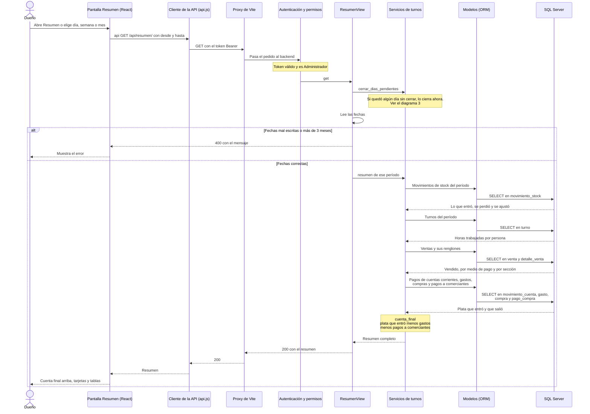
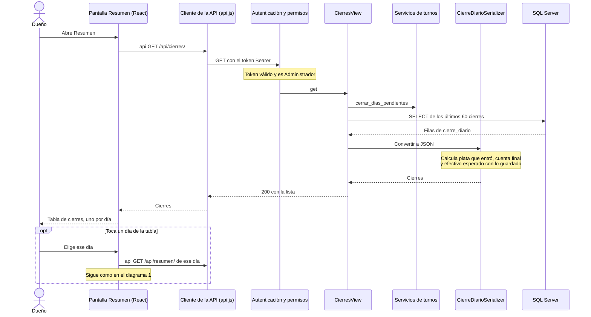
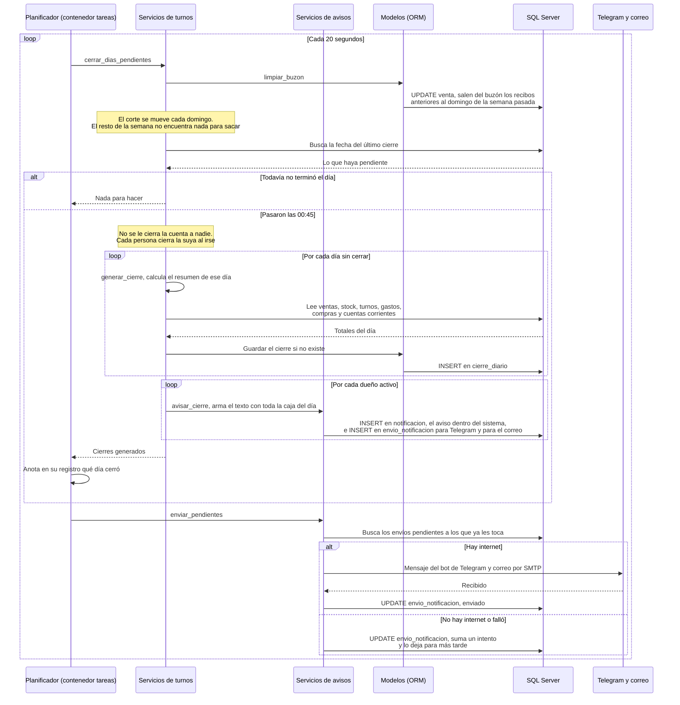
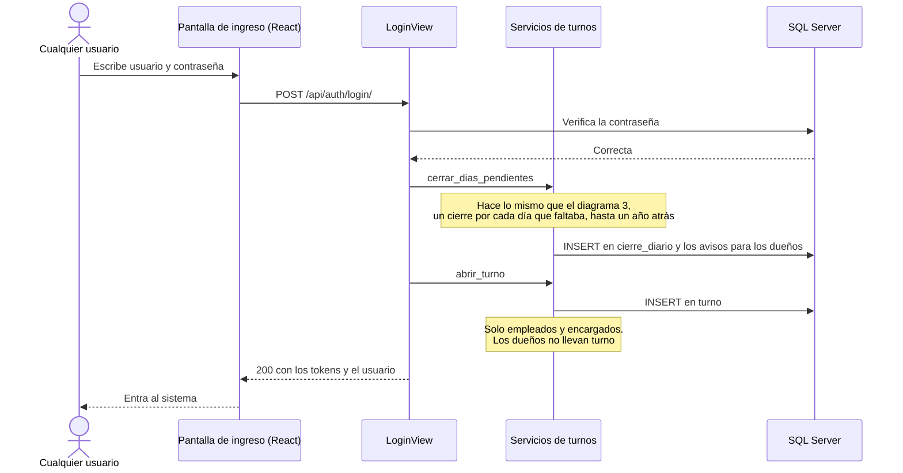

# Diagramas de secuencia: resumen y cierre del día

Cómo viaja un pedido entre las capas del sistema cuando un dueño **consulta el resumen** de un período o **la lista de cierres**, y cómo el sistema **hace solo el cierre del día a las 00:45 y les avisa a los dueños**. Están hechos a partir del código real (`frontend/src/paginas/Resumen.jsx`, `frontend/src/useConsulta.js`, `frontend/src/api.js`, `backend/turnos/api.py`, `backend/turnos/servicios.py`, `backend/turnos/management/commands/planificador.py` y `backend/usuarios/views.py`).

## Las capas

| Capa | Qué es | Archivos |
| --- | --- | --- |
| Pantalla | Lo que ve el dueño en el navegador (React) | `Resumen.jsx`, `SelectorPeriodo.jsx` |
| Cliente de la API | Agrega el token a cada pedido y lo renueva si venció | `useConsulta.js`, `api.js` |
| Proxy de Vite | Recibe `/api/...` en el puerto 5173 y lo pasa al backend | `vite.config.js` |
| Autenticación y permisos | Verifica quién es y que sea dueño | `AutenticacionConTurno`, `EsAdministrador`, `PasswordAlDia` |
| Vista | Recibe el pedido y coordina | `ResumenView`, `CierresView` |
| Servicios | Hacen las cuentas y el cierre | `resumen`, `cuenta_final`, `cerrar_dias_pendientes`, `generar_cierre`, `limpiar_buzon` |
| Planificador | Proceso aparte que revisa cada 20 segundos si terminó el día | contenedor `tareas`, `planificador.py` |
| Modelos (ORM) | Convierten los objetos en consultas SQL | `Venta`, `DetalleVenta`, `MovimientoStock`, `Turno`, `Gasto`, `Compra`, `PagoCompra`, `MovimientoCuenta`, `CierreDiario` |
| Base de datos | SQL Server | las tablas de esos modelos |

Todo este módulo es **solo para dueños**. Un encargado o un empleado reciben un error 403 antes de llegar a la vista.

Este módulo casi no guarda nada propio: **lee** lo que dejaron los demás (ventas, stock, gastos, compras, cuentas corrientes y turnos) y hace las cuentas. Lo único que escribe es la fila del cierre de cada día.

## 1. Obtención: ver el resumen de un período

Qué trae el resumen:

- **`caja`:** plata que entró, gastos, pagos a comerciantes, cuenta final y efectivo que debería haber.
- **`ventas`:** cantidad, total, por medio de pago, por sección, lo vendido fiado y la ganancia bruta.
- **`cuenta_corriente`**, **`gastos`** y **`comerciantes`:** los pagos de clientes, la lista de gastos y las compras y pagos a comerciantes.
- **`mercaderia`** y **`personal`:** lo que entró y salió del stock, y las horas trabajadas.
- **`por_dia`:** los mismos totales día por día, para la semana y el mes.

La cuenta final se arma así: lo vendido, menos lo fiado (no entró plata), más los pagos de cuentas corrientes; a eso se le restan los gastos y lo pagado a comerciantes. Las ventas anuladas y los gastos anulados no cuentan.

## 2. Obtención: ver los cierres automáticos

Al abrir la pantalla se hace este pedido junto con el del resumen.

La diferencia entre las dos cosas: el **resumen** se calcula en el momento con los datos de ahora; el **cierre** es la foto que el sistema guardó de cada día cuando terminó.

## 3. El cierre automático de las 00:45 y el aviso a los dueños

Acá no interviene ninguna persona ni ninguna pantalla: lo dispara el planificador, un proceso que corre en su propio contenedor.

Puntos a tener en cuenta:

- **El día del mercado va de 00:45 a 00:45.** Lo que se vende o se gasta antes de las 00:45 es del día anterior (`backend/core/dia.py`).
- **El sistema no le cierra la cuenta a nadie.** Cada empleado cierra la suya al irse; el aviso nombra a quienes siguen con la cuenta abierta.
- **El aviso sale por tres caminos:** dentro del sistema (pantalla «Avisos»), por Telegram y por correo. Si no hay internet, se reintenta solo durante varias horas. Un fallo al avisar nunca frena el cierre.
- **Los empleados no hacen el cierre.** Lo hace el sistema solo y el resultado lo ven únicamente los dueños.
- **No se duplica.** La fecha del cierre es única y se guarda solo si no existe, así que llamar a la función muchas veces no hace daño.
- **El buzón de recibos no borra ventas.** Solo dejan de aparecer en el buzón; siguen en la base para los reportes.
- **Qué guarda el cierre:** turnos y minutos trabajados, movimientos y valor de la mercadería, cambios registrados, ventas (total, efectivo y fiado), pagos de cuentas corrientes, gastos, compras y pagos a comerciantes, y la ganancia bruta.

## 4. Si la computadora estaba apagada a las 00:45

El planificador no pudo correr, así que el cierre se pone al día la próxima vez que alguien entra.

La misma puesta al día ocurre también al pedir el resumen o los cierres (diagramas 1 y 2) y en la autenticación de un empleado cuyo turno quedó abierto de un día anterior.

## Casos comunes

El token vencido (se renueva solo y se repite el pedido) está explicado en [`diagrama-secuencia-usuarios.md`](diagrama-secuencia-usuarios.md). Los demás módulos están en [`diagrama-secuencia-ventas.md`](diagrama-secuencia-ventas.md) y [`diagrama-secuencia-productos.md`](diagrama-secuencia-productos.md).
