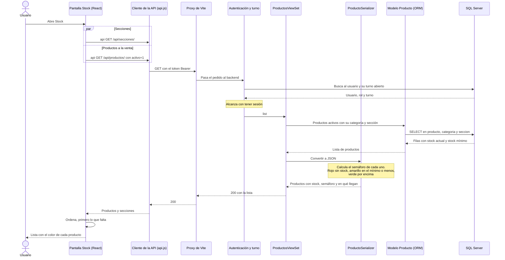
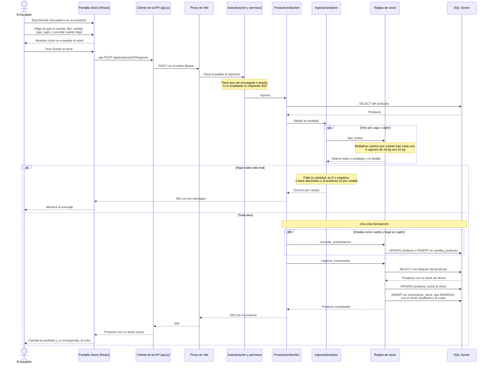
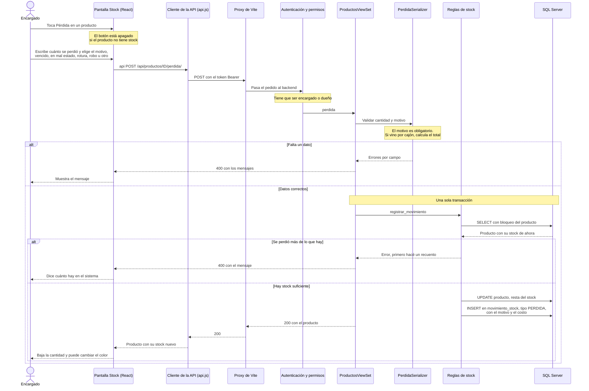
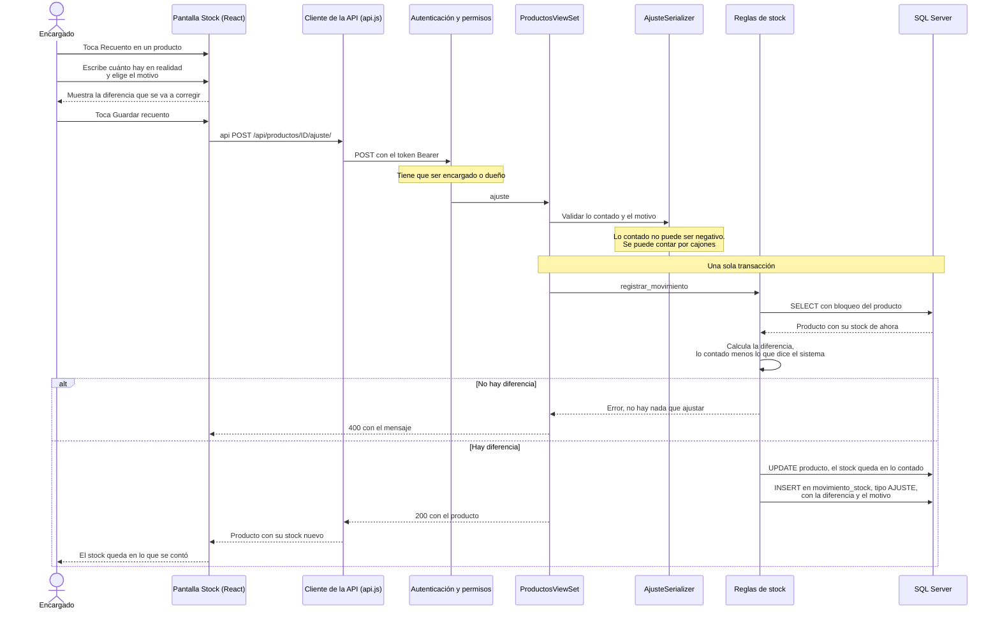
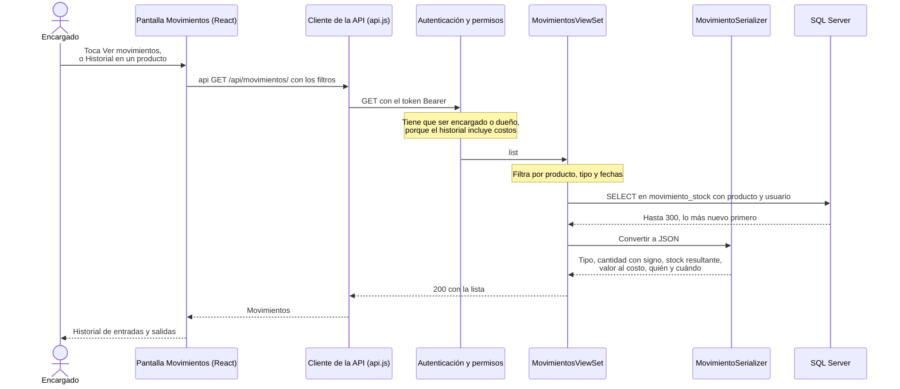

# Diagramas de secuencia: stock

Cómo viaja un pedido entre las capas del sistema cuando alguien **consulta** el stock, cuando se **da de alta** mercadería (se recibe), cuando se **da de baja** (se pierde) y cuando se hace un **recuento**. Están hechos a partir del código real (`frontend/src/paginas/Stock.jsx`, `frontend/src/componentes/FormularioStock.jsx`, `frontend/src/paginas/MovimientosStock.jsx`, `frontend/src/presentaciones.js`, `frontend/src/api.js`, `backend/productos/api.py` y `backend/productos/models.py`).

## Las capas

| Capa | Qué es | Archivos |
| --- | --- | --- |
| Pantalla | Lo que se ve en el navegador (React) | `Stock.jsx`, `FormularioStock.jsx`, `MovimientosStock.jsx` |
| Cliente de la API | Agrega el token a cada pedido y lo renueva si venció | `api.js` |
| Proxy de Vite | Recibe `/api/...` en el puerto 5173 y lo pasa al backend | `vite.config.js` |
| Autenticación y permisos | Verifica quién es, su turno y su rol | `AutenticacionConTurno`, `EsEncargadoOAdministrador`, `PasswordAlDia` |
| Vista | Recibe el pedido y coordina | `ProductosViewSet`, `MovimientosViewSet` |
| Serializer | Valida las cantidades y arma la respuesta | `IngresoSerializer`, `PerdidaSerializer`, `AjusteSerializer`, `ProductoSerializer` |
| Reglas de stock | Cambian el stock dejando siempre un movimiento | `registrar_movimiento`, `leer_bultos`, `recordar_presentacion` |
| Modelos (ORM) | Convierten los objetos en consultas SQL | `Producto`, `MovimientoStock`, `CambioProducto` |
| Base de datos | SQL Server | tablas `producto`, `movimiento_stock`, `cambio_producto` |

La regla central del módulo: **nadie escribe el stock a mano**. El número que se ve solo cambia a través de un movimiento, y cada movimiento guarda cuánto entró o salió, cómo quedó el stock, a qué costo, quién lo hizo, en qué turno y cuándo.

Los cuatro tipos de movimiento:

| Tipo | Cuándo | Efecto |
| --- | --- | --- |
| `INGRESO` | Llegó mercadería (desde Stock o desde una compra a un comerciante) | Suma |
| `PERDIDA` | Se venció, se rompió o está en mal estado | Resta |
| `AJUSTE` | Un recuento no coincidió con lo que decía el sistema | Suma o resta la diferencia |
| `VENTA` | Se vendió, o se anuló una venta | Resta, o devuelve |

Quién puede hacer cada cosa:

| Operación | Quién |
| --- | --- |
| Ver el stock | Todos (los empleados no reciben los costos) |
| Recibir mercadería, registrar pérdidas, hacer recuentos y cambiar el mínimo | Dueños y encargados |
| Ver el historial de movimientos | Dueños y encargados |

## 1. Obtención: ver el stock

El stock no se calcula al consultar: está guardado en el producto (`stock_actual`) y cada movimiento lo actualiza, así la lista es rápida. Los filtros por sección y por color, el buscador y el cambio entre «ver en unidades y kilos» y «ver en cajas, cajones, bandejas…» los resuelve la pantalla con lo que ya llegó, sin volver a llamar al servidor. Es la misma lista que usa la pantalla Productos.

## 2. Alta: recibir mercadería

Puntos a tener en cuenta:

- **El bloqueo del producto** hace que dos personas cargando a la vez, o una caja vendiendo mientras tanto, no pisen el stock: cada operación espera a que termine la anterior.
- **El costo** de esa entrega es opcional; si no se escribe, vale el costo que ya tiene el producto. Queda guardado en el movimiento, pero no cambia el precio del producto.
- **Por caja o cajón:** el stock se guarda siempre en kilos o unidades. El movimiento anota cómo llegó («3 cajones × 18 kg»).
- **Un producto que todavía no existe** se crea con «+ Agregar un producto nuevo» y después se le carga cuánto hay con este mismo recorrido. Está en [`diagrama-secuencia-productos.md`](diagrama-secuencia-productos.md).
- **Una compra a un comerciante** también suma al stock por este camino. Está en [`diagrama-secuencia-compras-comerciantes.md`](diagrama-secuencia-compras-comerciantes.md).

## 3. Baja: registrar una pérdida

La pérdida se valoriza al costo del producto en ese momento. Ese valor es el que después aparece como «Pérdidas de mercadería» en el Resumen y el que se resta en Resultados por sección. No se puede perder más de lo que el sistema tiene: si en la realidad hay otra cantidad, primero se hace un recuento.

## 4. Recuento: corregir el stock

Cuando lo que se cuenta a mano no coincide con lo que dice el sistema.

La persona escribe **cuánto hay**, no la diferencia: la diferencia la calcula el servidor con el stock del momento, ya bloqueado. El recuento con motivo «Carga inicial de stock» es la forma de cargar lo que ya había cuando se empezó a usar el sistema, sin que cuente como una compra.

El **stock mínimo** (con cuánto hay que avisar que queda poco) se cambia con `PATCH /api/productos/ID/`. No genera un movimiento, porque no cambia cuánto hay: solo cambia a partir de cuándo el producto pasa a amarillo.

## 5. Ver el historial de movimientos

Los movimientos son de **solo lectura**: no se modifican ni se borran. Un error se corrige con otro movimiento (un recuento), y los dos quedan en el historial.

## Casos comunes

El token vencido está en [`diagrama-secuencia-usuarios.md`](diagrama-secuencia-usuarios.md) y el turno cerrado en [`diagrama-secuencia-ventas.md`](diagrama-secuencia-ventas.md), donde también está cómo una venta descuenta el stock y una anulación lo devuelve.
