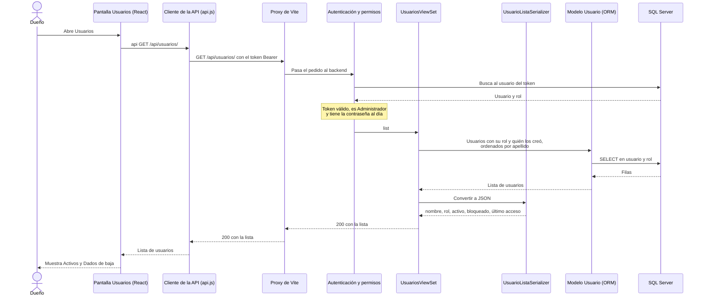
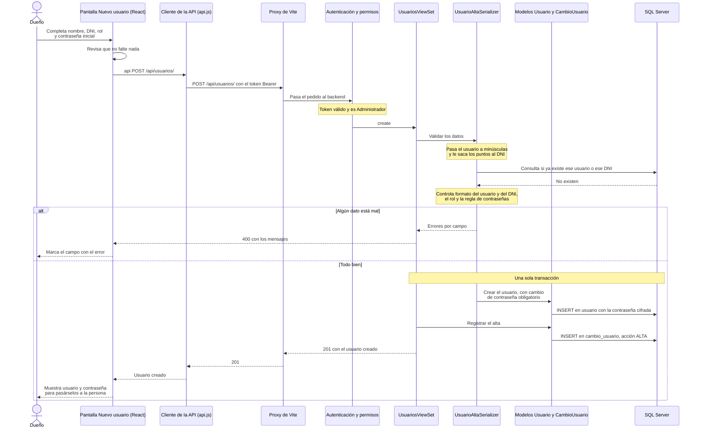
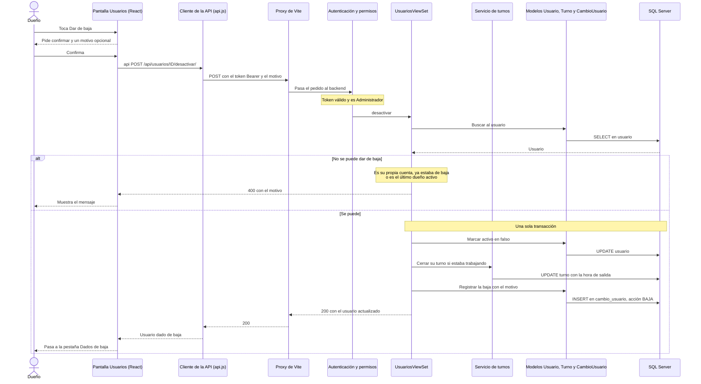
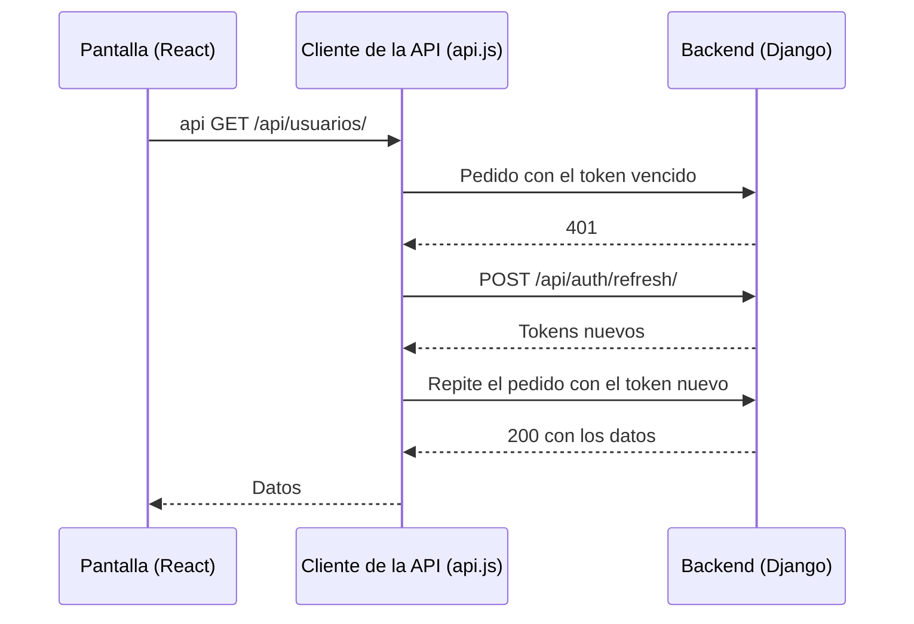

# Diagramas de secuencia: usuarios

Cómo viaja un pedido entre las capas del sistema cuando un dueño **consulta**, **da de alta** o **da de baja** a un usuario. Están hechos a partir del código real (`frontend/src/paginas/Usuarios.jsx`, `NuevoUsuario.jsx`, `frontend/src/api.js`, `backend/usuarios/gestion.py`, `backend/usuarios/permisos.py` y `backend/turnos/autenticacion.py`).

## Las capas

| Capa | Qué es | Archivos |
| --- | --- | --- |
| Pantalla | Lo que ve el dueño en el navegador (React) | `Usuarios.jsx`, `NuevoUsuario.jsx` |
| Cliente de la API | Agrega el token a cada pedido y lo renueva si venció | `api.js` |
| Proxy de Vite | Recibe `/api/...` en el puerto 5173 y lo pasa al backend | `vite.config.js` |
| Autenticación y permisos | Verifica quién es y si es dueño | `AutenticacionConTurno`, `EsAdministrador`, `PasswordAlDia` |
| Vista | Recibe el pedido y coordina | `UsuariosViewSet` |
| Serializer | Valida los datos y arma la respuesta | `UsuarioAltaSerializer`, `UsuarioListaSerializer` |
| Modelos (ORM) | Convierten los objetos en consultas SQL | `Usuario`, `CambioUsuario`, `Turno` |
| Base de datos | SQL Server | tablas `usuario`, `cambio_usuario`, `turno` |

Las tres operaciones son **solo para dueños** (rol Administrador). Si el que pregunta no lo es, la capa de permisos corta el pedido con un error 403 antes de llegar a la vista.

## 1. Obtención: ver la lista de usuarios

Con `?activo=1` o `?activo=0` la vista filtra antes de consultar. El buscador de la pantalla no vuelve a llamar al servidor: filtra la lista que ya tiene.

## 2. Alta: crear un usuario

La contraseña nunca se guarda tal cual: Django guarda solo su versión cifrada. La persona está obligada a cambiarla en su primer ingreso.

## 3. Baja: dar de baja a un usuario

El usuario **no se borra**: queda con `activo` en falso, deja de poder ingresar y su sesión abierta se corta porque su turno se cerró. Se puede reactivar con `POST /api/usuarios/ID/reactivar/`, que hace el camino inverso y registra la acción `REACTIVACION`.

## Qué pasa si el token venció

En cualquiera de los tres casos, si el token de acceso ya venció (dura 15 minutos), el cliente lo renueva solo y repite el pedido una vez:

Si la renovación también falla, el cliente avisa que la sesión terminó y la pantalla vuelve al inicio de sesión.
