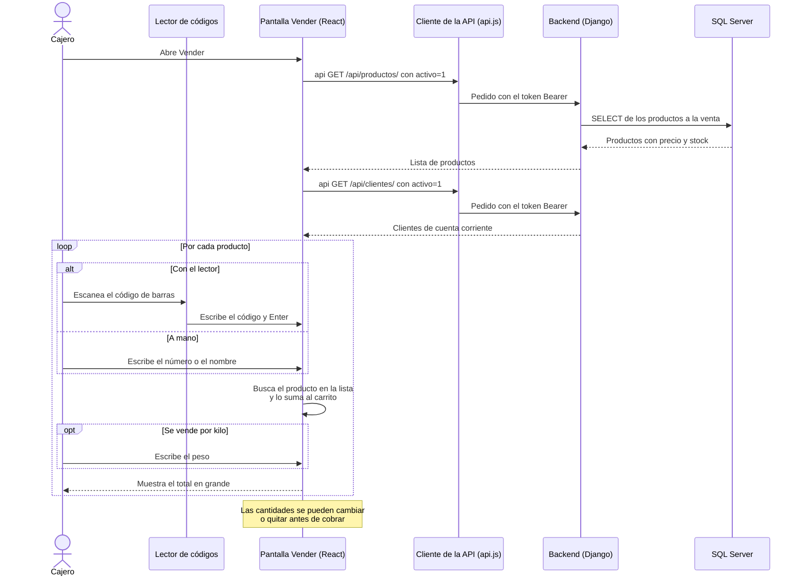
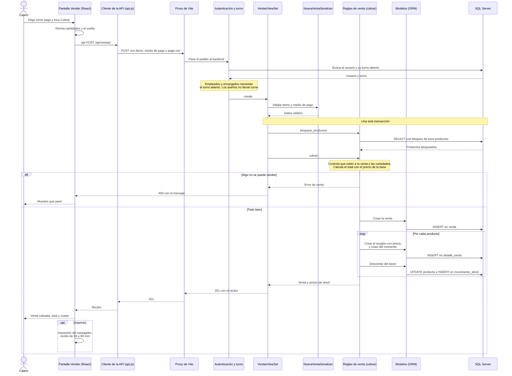
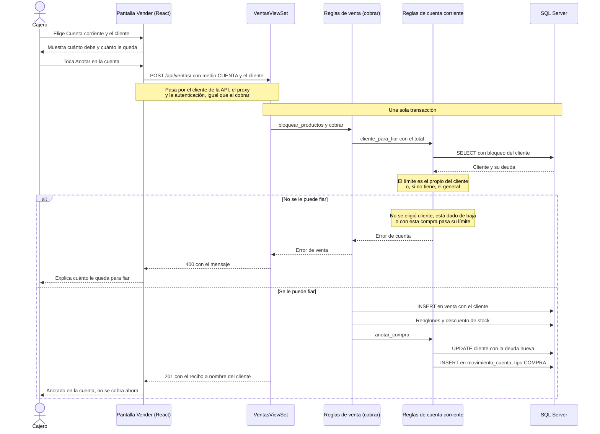
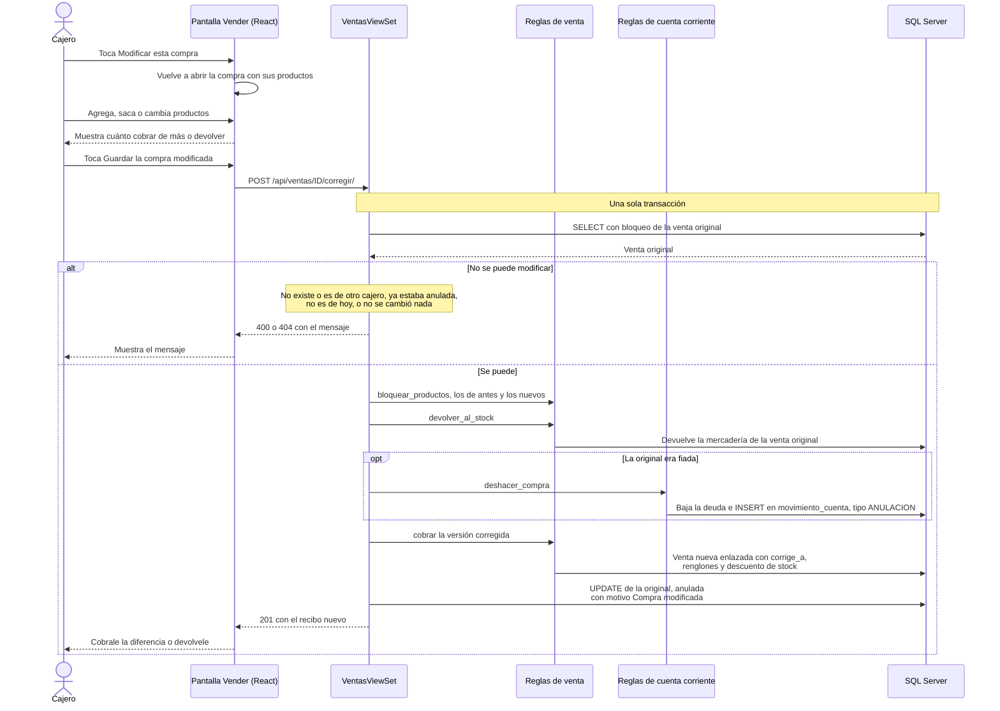
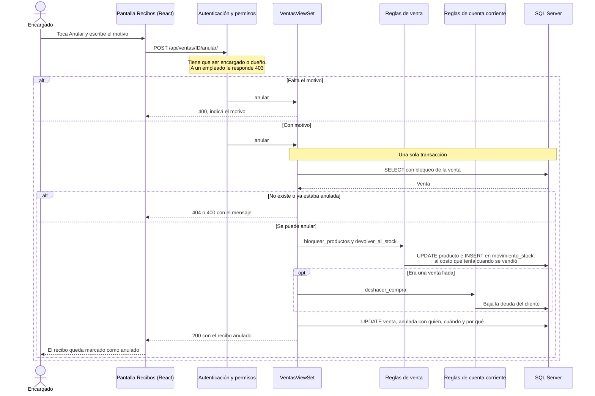
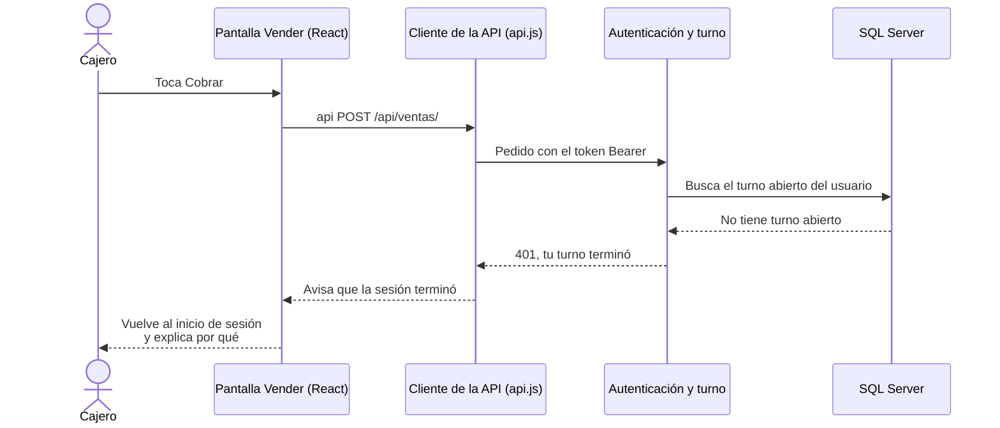

# Diagramas de secuencia: módulo Vender

Cómo viaja un pedido entre las capas del sistema cuando alguien **arma y cobra una venta**, la **anota en cuenta corriente**, **modifica una compra ya pagada** o la **anula**. Están hechos a partir del código real (`frontend/src/paginas/Venta.jsx`, `Recibos.jsx`, `frontend/src/api.js`, `frontend/src/dispositivos.js`, `backend/ventas/api.py`, `backend/clientes/servicios.py` y `backend/turnos/autenticacion.py`).

## Las capas

| Capa | Qué es | Archivos |
| --- | --- | --- |
| Pantalla | Lo que ve el cajero en el navegador (React) | `Venta.jsx`, `Recibos.jsx`, `Recibo.jsx` |
| Lector e impresora | El lector escribe como un teclado; el recibo sale por la impresión del navegador | `dispositivos.js` |
| Cliente de la API | Agrega el token a cada pedido y lo renueva si venció | `api.js` |
| Proxy de Vite | Recibe `/api/...` en el puerto 5173 y lo pasa al backend | `vite.config.js` |
| Autenticación y turno | Verifica quién es y que tenga su turno abierto | `AutenticacionConTurno`, `PasswordAlDia` |
| Vista | Recibe el pedido y coordina | `VentasViewSet` |
| Serializer | Valida los datos y arma el recibo | `NuevaVentaSerializer`, `VentaSerializer` |
| Reglas de venta | Calculan el total, descuentan stock y anotan la deuda | `cobrar`, `bloquear_productos`, `mover_stock`, `devolver_al_stock` y `clientes/servicios.py` |
| Modelos (ORM) | Convierten los objetos en consultas SQL | `Venta`, `DetalleVenta`, `Producto`, `MovimientoStock`, `Cliente`, `MovimientoCuenta` |
| Base de datos | SQL Server | tablas `venta`, `detalle_venta`, `producto`, `movimiento_stock`, `cliente`, `movimiento_cuenta` |

Quién puede hacer cada cosa:

| Operación | Quién |
| --- | --- |
| Vender | Todos (dueño, encargado, empleado) |
| Vender en cuenta corriente | Todos, a un cliente ya cargado |
| Modificar una compra pagada | El cajero que la cobró, el mismo día; encargados y dueños, cualquiera |
| Anular una venta | Encargados y dueños |

## 1. Armar la venta en la pantalla

Mientras se cargan los productos no se guarda nada: todo pasa en el navegador. El servidor solo interviene al entrar (para traer los productos) y al cobrar.

El precio que se ve en pantalla es solo para mostrar: al cobrar, el servidor vuelve a tomar el precio de la base.

## 2. Cobrar la venta

Puntos a tener en cuenta:

- **Bloqueo de productos:** se bloquean siempre en el mismo orden para que dos cajas vendiendo a la vez no pisen el stock.
- **Vender sin stock:** se permite. El stock queda en negativo y el recibo vuelve con un aviso para que alguien haga un recuento.
- **Precio y costo del momento:** cada renglón guarda el precio y el costo que tenía el producto al cobrar. Si después cambia el precio, los recibos y las ganancias anteriores no cambian.
- **El recibo siempre queda guardado**, se imprima o no.

## 3. Vender en cuenta corriente (fiado)

Es el mismo camino que cobrar, con dos pasos más: se elige el cliente y se controla su límite.

Si el límite no alcanza, la venta entera se cancela: no se crea el recibo ni se descuenta stock.

## 4. Modificar una compra ya pagada

El cliente se olvidó algo, o quiere sacar o cambiar un producto. La venta original no se toca: queda anulada como «Compra modificada» y se crea una nueva enlazada.

Los totales del día cuentan solo la versión corregida. En la Actividad del sistema aparece como «Compra modificada», con el recibo que reemplaza y cómo cambió el total.

## 5. Anular una venta

Devolver la compra entera. Solo encargados y dueños, desde Recibos.

La venta **no se borra**: queda guardada con quién la anuló, cuándo y el motivo, y deja de sumar en los totales.

## Qué pasa si el turno se cerró

Un empleado o encargado solo puede vender con su turno abierto. Si el sistema lo cerró a las 00:00, o se cerró sesión en otro equipo, el próximo pedido se rechaza:

El caso del token vencido (se renueva solo y se repite el pedido) está en [`diagrama-secuencia-usuarios.md`](diagrama-secuencia-usuarios.md) y funciona igual acá.
