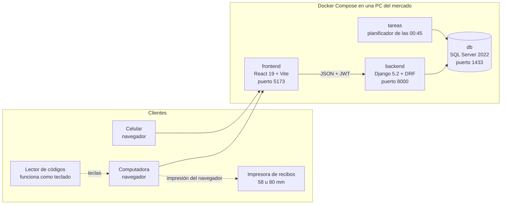
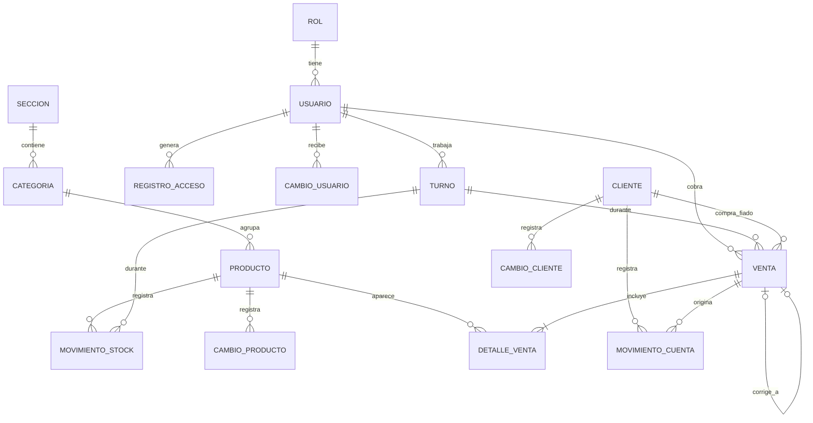

# Sistema de Mercado — Documentación técnica y arquitectura

Estado al **13/11/2026**. Este documento reúne la arquitectura, el detalle técnico del código y todo lo que estaba anotado en la memoria de trabajo del proyecto (decisiones, avance, entorno, pendientes y forma de trabajo).

Los requerimientos completos (RF, RN, RNF), la matriz de permisos y el detalle campo por campo de las tablas están en [`documentacion.md`](documentacion.md), que sigue siendo la fuente principal. Acá está el resumen técnico.

## Índice

1. [Qué es el sistema](#1-qué-es-el-sistema)
2. [Arquitectura](#2-arquitectura)
3. [Contenedores y configuración](#3-contenedores-y-configuración)
4. [Estructura del código](#4-estructura-del-código)
5. [Backend](#5-backend)
6. [Modelo de datos](#6-modelo-de-datos)
7. [API](#7-api)
8. [Frontend](#8-frontend)
9. [Cómo levantarlo, probarlo y revisarlo](#9-cómo-levantarlo-probarlo-y-revisarlo)
10. [Avance por etapa](#10-avance-por-etapa)
11. [Decisiones tomadas](#11-decisiones-tomadas)
12. [Preguntas abiertas](#12-preguntas-abiertas)
13. [Problemas conocidos y pendientes](#13-problemas-conocidos-y-pendientes)
14. [Datos y cuentas de prueba](#14-datos-y-cuentas-de-prueba)
15. [Trampas del entorno de desarrollo](#15-trampas-del-entorno-de-desarrollo)
16. [Forma de trabajo](#16-forma-de-trabajo)

---

## 1. Qué es el sistema

Sistema de gestión para un mercado de barrio en **Argentina**, hecho como proyecto de pasantía (empezado el 10/11/2026). Reemplaza el papel: stock, ventas, recibos, precios, horas del personal y cierre del día. Más adelante: compras a comerciantes, gastos, cuentas corrientes (fiado) y factura electrónica de ARCA. Se usa desde la computadora y desde el celular, y tiene que ser muy fácil para alguien que recién empieza a trabajar.

El mercado tiene **3 secciones** (Almacén, Carnicería, Verdulería). Dentro de cada sección hay **categorías** (por ejemplo Carnicería → Pollo) y dentro de cada categoría, los productos.

### Roles

| Rol | Quién es | Qué puede |
| --- | --- | --- |
| **Administrador** | Los dueños | Todo. Son los únicos que crean usuarios y que ven horarios, actividad, resumen y el cierre diario. No llevan turno |
| **Encargado** | 2 o 3 empleados de confianza | Vende; recibe mercadería, carga pérdidas y recuentos; alta, baja y edición de productos y categorías; cambia precios; anula ventas; ve todos los recibos y lo vendido hoy |
| **Empleado** | El resto del personal | Vende, ve el stock sin costos y solo sus propios recibos. No cambia precios ni stock |

---

## 2. Arquitectura

Arquitectura de **tres capas**: el navegador habla con la aplicación React, React habla con la API por HTTP/JSON, y solo la API toca la base de datos.



| Capa | Tecnología | Responsabilidad |
| --- | --- | --- |
| Presentación | React 19, React Router 7, Vite 8 (JavaScript, sin TypeScript) | Pantallas. No guarda datos de negocio ni decide permisos: solo oculta lo que el rol no usa |
| Negocio | Python 3.12, Django 5.2, Django REST Framework 3.16, simplejwt 5.5, django-cors-headers | Reglas, permisos por rol, auditoría, cálculo de stock, ventas, precios y cierre del día |
| Datos | Microsoft SQL Server 2022 (Developer), con `mssql-django` + `pyodbc` + ODBC Driver 18 | Guarda todo. Los datos están en un volumen de Docker |

### Principios que respeta el código

- **El frontend nunca toca la base.** La API verifica el rol en cada petición, aunque la pantalla oculte el botón.
- **Dinero y cantidades en `DECIMAL`, nunca `FLOAT`.** Dinero con 2 decimales; cantidades (kg) con 3.
- **Nada se borra.** Usuarios y productos se dan de baja; las ventas se anulan; los movimientos de stock se corrigen con otro movimiento. Las tablas de historial son de solo lectura.
- **Todo queda a nombre de alguien.** Cada operación guarda usuario, fecha, hora y, si corresponde, el turno.
- **El stock no se escribe a mano.** Solo cambia a través de un `MovimientoStock`, dentro de una transacción que bloquea la fila del producto (`select_for_update`) para que dos cajas no se pisen.
- **Las ventas guardan el precio y el costo del momento.** Si después cambia un precio, los recibos y las ganancias anteriores no cambian.
- **El cierre del día lo hace el sistema solo a las 00:45**, no los empleados. El día del mercado va de 00:45 a 00:45 (`core/dia.py`) y el sistema no le cierra la cuenta a nadie: cada uno cierra la suya.
- **Hora de Argentina** (`America/Argentina/Buenos_Aires`), mostrada en formato 24 h. Idioma `es-ar`.

---

## 3. Contenedores y configuración

Todo corre con **Docker Compose** (`docker-compose.yml`, proyecto `sistema-mercado`). En la PC no hay Python, Node ni Git instalados: todo se ejecuta dentro de los contenedores.

| Servicio | Contenedor | Imagen | Puerto | Qué hace |
| --- | --- | --- | --- | --- |
| `db` | `mercado-db` | `mcr.microsoft.com/mssql/server:2022-latest` | 1433 | SQL Server. Volumen `mercado_db_data`. Tiene control de salud (`sqlcmd SELECT 1`) |
| `backend` | `mercado-backend` | `python:3.12-slim-bookworm` + ODBC 18 | 8000 | Al iniciar: espera a la base (`esperar_db.py`), aplica migraciones y levanta `runserver` |
| `tareas` | `mercado-tareas` | la misma del backend | — | `python manage.py planificador`: caja de las 00:45, envío de los avisos a los dueños (Telegram y correo) y limpieza del buzón de recibos |
| `frontend` | `mercado-frontend` | `node:22` | 5173 | Servidor de desarrollo de Vite con recarga automática |

Las carpetas `backend/` y `frontend/` están montadas como volumen: el código se actualiza sin reconstruir la imagen. `node_modules` queda dentro del contenedor.

### Variables de entorno (`.env`, no se sube al repositorio; plantilla en `.env.example`)

| Variable | Para qué |
| --- | --- |
| `MSSQL_SA_PASSWORD` | Contraseña de SQL Server |
| `DB_NAME`, `DB_USER`, `DB_HOST`, `DB_PORT` | Conexión a la base (por defecto `sistema_mercado`, `sa`, `db`, `1433`) |
| `DJANGO_SECRET_KEY` | Clave secreta de Django (firma los tokens) |
| `DJANGO_DEBUG` | `1` en desarrollo |
| `DJANGO_ALLOWED_HOSTS` | Nombres desde los que se acepta la API |
| `CORS_ALLOWED_ORIGINS` | Desde qué dirección puede llamar el frontend |
| `VITE_API_URL` | Dirección de la API que usa el frontend. Vacío (como está hoy) = usa `/api` de la misma dirección, a través del proxy de Vite; sirve para PC y celular |

### Alojamiento

Por ahora es **local**: una PC del mercado con Docker. Tiene que estar encendida. El acceso desde el celular por WiFi y desde afuera todavía no está resuelto (ver [problemas conocidos](#13-problemas-conocidos-y-pendientes)). Falta planificar las copias de seguridad de la base. En producción el frontend se serviría compilado con nginx (todavía no está hecho).

---

## 4. Estructura del código

Repositorio: `C:\proyectos\sistema-mercado`

```text
sistema-mercado/
├── docker-compose.yml
├── .env / .env.example
├── docs/
│   ├── documentacion.md            requerimientos, permisos, tablas, plan
│   └── documentacion-tecnica.md    este archivo
├── backend/
│   ├── Dockerfile, requirements.txt, manage.py, esperar_db.py
│   ├── config/                     settings.py, urls.py
│   ├── core/                       /api/estado/
│   ├── usuarios/                   acceso, usuarios, roles, permisos
│   ├── productos/                  secciones, categorías, productos, stock, precios
│   ├── turnos/                     turnos, actividad, resumen, cierre diario, planificador
│   └── ventas/                     ventas y recibos
└── frontend/
    ├── Dockerfile, package.json, vite.config.js, .oxlintrc.json
    └── src/
        ├── main.jsx, App.jsx       arranque y rutas
        ├── api.js                  cliente de la API y tokens
        ├── auth/                   AuthContext.jsx, RutaProtegida.jsx
        ├── componentes/            piezas compartidas
        ├── paginas/                una por pantalla
        ├── formato.js, periodo.js, useConsulta.js,
        │   dispositivos.js, presentaciones.js
        └── estilos.css             todos los estilos y colores
```

---

## 5. Backend

### 5.1 Aplicaciones de Django

| App | Archivos principales | Contenido |
| --- | --- | --- |
| `core` | `views.py` | `GET /api/estado/`: comprueba que la API y SQL Server responden |
| `usuarios` | `models.py`, `views.py` (login, logout, yo, cambiar contraseña), `gestion.py` (alta, baja, reactivar), `permisos.py`, `serializers.py`, `validadores.py` | Usuario propio (`AUTH_USER_MODEL = usuarios.Usuario`), roles, bloqueo por intentos, cambio de contraseña obligatorio, historial de accesos y de cambios |
| `productos` | `models.py`, `api.py` | Secciones, categorías, productos, presentaciones (caja, cajón…), movimientos de stock, semáforo y **precios** |
| `turnos` | `models.py`, `servicios.py`, `api.py`, `autenticacion.py`, `management/commands/planificador.py` | Turnos, horas trabajadas, actividad, resumen por período y cierre diario automático |
| `ventas` | `models.py`, `api.py` | Cobro, recibos, anulación, modificación de una compra pagada, vendido hoy |
| `clientes` | `models.py`, `servicios.py`, `api.py` | Clientes, cuenta corriente («fiado»), límites de fiado, pagos y ajustes |
| `gastos` | `models.py`, `api.py` | Lista de gastos: monto y propósito, anotados por cualquiera; anulación |
| `compras` | `models.py`, `api.py` | Compras a comerciantes: producto, cantidad, costo, comerciante, pagos y estado (pagado, falta una parte, sin pagar) |

### 5.2 Autenticación y sesión

- **JWT** con `djangorestframework-simplejwt`. Token `access` de 15 minutos y `refresh` de 30 minutos, que rota en cada renovación.
- Los tokens que ya no sirven (logout o renovación) se guardan en la tabla propia `token_invalidado`. No se usa la app `token_blacklist` de simplejwt porque sus migraciones no funcionan con SQL Server.
- **Bloqueo** de la cuenta tras varios intentos fallidos (`intentos_fallidos`, `bloqueado_hasta`).
- **Primer ingreso:** `debe_cambiar_password`. Mientras esté en verdadero, la API solo permite `yo`, `cambiar-password` y `logout` (permiso `PasswordAlDia`).
- Reglas de contraseña: mínimo 8 caracteres, no común, no solo números, con letra y número (`usuarios.validadores.LetraYNumeroValidator`).
- El logout acepta un `refresh` vencido hace menos de un día (verifica la firma), porque cuando la sesión se corta por inactividad el token ya venció.

### 5.3 Sesión atada al turno

La clase `turnos.autenticacion.AutenticacionConTurno` (autenticación por defecto de toda la API) agrega una regla sobre el JWT:

1. Los dueños no llevan turno: pasan directo.
2. Empleados y encargados solo pueden usar la API **mientras tengan un turno abierto**. Si el turno se cerró (cerraron su cuenta en otro equipo, lo cerró un dueño, o era una cuenta olvidada de un día anterior), la API responde 401 con «Tu turno terminó. Volvé a iniciar sesión.».
3. Anota la última actividad del turno, como mucho una vez por minuto.
4. Deja el turno en `request.user.turno_abierto`, y ventas y movimientos de stock lo guardan.

El **turno** se abre al iniciar sesión y se cierra al salir; eso son las horas trabajadas.

### 5.4 Permisos

| Clase (`usuarios/permisos.py`) | Deja pasar a |
| --- | --- |
| `IsAuthenticated` + `PasswordAlDia` (por defecto) | Cualquiera con sesión y contraseña al día |
| `EsEncargadoOAdministrador` | Encargados y dueños |
| `EsAdministrador` | Solo dueños |
| `GestionaClientes` | Dueños, y los encargados con `puede_gestionar_clientes` (lo da un dueño desde Usuarios) |

Además, el costo de los productos (`precio_costo`) se quita de la respuesta cuando quien pregunta es un empleado.

### 5.5 Tareas automáticas (contenedor `tareas`)

`python manage.py planificador` revisa cada 20 segundos si terminó el día y llama a `turnos.servicios.cerrar_dias_pendientes()`, que:

1. **No cierra turnos** (desde el 18/11/2026): cada persona cierra su cuenta al irse. Una cuenta olvidada (de un día anterior y sin uso hace más de una hora) se cierra en su último movimiento cuando esa persona vuelve —`cerrar_turno_olvidado()`, que se llama en el login, en la autenticación y en el logout— y queda **para revisar**.
2. Genera el `CierreDiario` del día del mercado (de 00:45 a 00:45) y crea el aviso para cada dueño con `notificaciones.servicios.avisar_cierre()`: turnos y minutos trabajados, movimientos de stock y su valor, cambios registrados, cantidad y total de ventas, efectivo y ganancia bruta.
3. Los domingos ejecuta `limpiar_buzon()`: los recibos de más de una semana salen del buzón (`en_buzon = 0`). **Las ventas no se borran.**

La misma función se ejecuta en cada inicio de sesión y en la autenticación, por si la PC estuvo apagada a las 00:45. Se puede llamar muchas veces sin duplicar nada.

Después el planificador llama a `notificaciones.servicios.enviar_pendientes()`: manda por Telegram (API HTTP del bot, con `urllib`) y por correo (SMTP, con el correo de Django) los envíos en cola. Si falla, vuelve a intentar con esperas de 1, 2, 4, 8, 16 y después 30 minutos, hasta 30 intentos. Las vistas web nunca mandan nada hacia afuera (salvo el aviso de prueba), así el login no se demora si no hay internet.

**El día del mercado** (`core/dia.py`): `HORA_DE_CIERRE = 00:45`, `inicio_del_dia(fecha)`, `fecha_local(momento)` y `hoy()`. Todo el backend los usa para saber a qué día pertenece cada cosa (resumen, resultados, gastos de hoy, vendido hoy, «el mismo día» para modificar una venta o anular un gasto, filtros por fecha). En el frontend el equivalente es `hoyDelMercado()` y `HORA_CIERRE` en `formato.js`.

### 5.6 Lógica destacada

- **Stock** (`productos.api.registrar_movimiento`): bloquea el producto, suma o resta, guarda el `MovimientoStock` con el stock resultante y el costo de ese momento. Tipos: `INGRESO`, `PERDIDA`, `AJUSTE` (recuento) y `VENTA`.
- **Semáforo:** rojo sin stock, amarillo en el mínimo o menos, verde por encima.
- **Presentaciones:** un producto puede llegar en caja, cajón, bandeja, bolsa, pack o bulto con un contenido fijo («cajón de 18 kg»). El stock y la venta se guardan siempre en unidades o kilos, pero en Stock y en Compras se puede **contar** por caja, cajón, etc.: al recibir mercadería, registrar una pérdida, hacer un recuento o anotar una compra se elige la presentación, cuántos y cuánto trae cada uno, y `CantidadSerializer.leer_bultos()` calcula el total. Si un producto «suelto» se recibe o se compra por cajón, `recordar_presentacion()` lo deja anotado en el producto. La pantalla de Stock tiene un interruptor para ver las cantidades en unidades y kilos o en cajas y cajones.
- **Venta** (`ventas.api.cobrar`): el precio lo pone el servidor, no la pantalla. Bloquea los productos siempre en el mismo orden, crea la venta y sus renglones, descuenta el stock y devuelve avisos. Se puede vender sin stock: queda en negativo con un aviso.
- **Modificar una compra pagada** (`corregir`): la venta original se conserva, queda anulada con motivo «Compra modificada», su mercadería vuelve al stock y se crea una venta nueva enlazada por `corrige_a`. Los totales cuentan solo la versión corregida.
- **Precios** (`productos.api.PreciosViewSet`): sube o baja un porcentaje a los productos a la venta de una categoría. Sin `confirmar` devuelve la vista previa y no guarda. Aplica a venta, costo o los dos; el precio de venta se puede redondear (1, 10, 50 o 100); el costo no se redondea. Límites: distinto de 0, entre −90 % y +500 %. Cada producto cambiado deja un `CambioProducto` con acción `PRECIO`.
- **Cuenta corriente** (`clientes/servicios.py`): la deuda de un cliente (`saldo`) funciona igual que el stock: solo cambia con un `MovimientoCuenta` (`COMPRA`, `PAGO`, `ANULACION`, `AJUSTE`), dentro de una transacción que bloquea la fila del cliente. Al vender con medio de pago `CUENTA`, `cliente_para_fiar()` exige un cliente activo y controla el límite (el propio del cliente o, si no tiene, el general de `ConfiguracionCuentas`); si lo pasa, la venta no se hace y no se descuenta stock. Anular o modificar una venta fiada llama a `deshacer_compra()`. Para evitar bloqueos cruzados, siempre se bloquean primero los productos y después el cliente.
- **Gastos y cuenta final** (`turnos.servicios.cuenta_final`): plata que entró = ventas − lo vendido fiado + pagos de cuentas corrientes; cuenta final = plata que entró − gastos; efectivo esperado = ventas en efectivo + pagos en efectivo − gastos (se asume que los gastos salen de la caja). Los gastos anulados no restan. El `CierreDiario` guarda cantidad y total de gastos y calcula `entro`, `resultado_dia` y `efectivo_esperado` como propiedades, así los cierres viejos también dan bien.
- **Compras a comerciantes** (`compras/api.py`): cada compra es un renglón (producto, cantidad, costo total, comerciante, fecha y hora del sistema). La cantidad se anota suelta (kilos o unidades) o por caja, cajón, bandeja, bolsa, pack o bulto: en ese caso se guardan `presentacion`, `bultos` y `contenido`, y el sistema calcula la cantidad total («2 cajones × 18 kg = 36 kg»), que es lo que suma al stock. El estado sale de lo pagado: `PAGADO` (verde), `PARCIAL` (amarillo) o `DEBE` (rojo). Suma al stock con un `MovimientoStock` de ingreso al costo de la compra (salvo que se destilde); anularla lo vuelve a restar. Los pagos (`PagoCompra`) se restan en la cuenta final el día en que se hacen; los de efectivo bajan el efectivo esperado.
- **Productos y Stock son la misma lista:** las dos pantallas leen `GET /api/productos/` (Stock, solo los activos). Para no tener que pasar antes por Productos, un producto que todavía no existe se puede crear desde Compras (`producto_nuevo` en `POST /api/compras/`, validado con el mismo `ProductoSerializer` del alta y guardado en la misma transacción que la compra) o desde Stock (el formulario `ProductoNuevoRapido.jsx` llama al alta común y abre «Recibir mercadería»).
- **Resultados por sección** (`turnos.servicios.resultados`): por sección, ventas − costo de lo vendido − pérdidas, con el detalle por producto. Los gastos no tienen sección: se restan una sola vez en el resultado general. Acepta hasta un año.
- **Actividad y resumen** (`turnos.servicios.actividad` y `resumen`): juntan accesos, cambios de usuarios, cambios de productos (incluye precios), movimientos de stock, turnos, ventas y cuentas corrientes en una sola línea de tiempo y en totales por día, sección y producto. Lo vendido fiado se informa aparte del efectivo, y los pagos de cuentas corrientes se suman como plata que entró.

---

## 6. Modelo de datos



| Tabla | App | Qué guarda |
| --- | --- | --- |
| `rol` | usuarios | Administrador, Encargado, Empleado |
| `usuario` | usuarios | Cuenta de cada persona: nombre de usuario, nombre, apellido, DNI, rol, activo, debe cambiar contraseña, intentos fallidos, bloqueo, último acceso, quién la creó |
| `cambio_usuario` | usuarios | Altas, bajas y reactivaciones de cuentas, con quién las hizo |
| `registro_acceso` | usuarios | Ingresos, salidas, bloqueos e intentos fallidos, con IP y dispositivo |
| `token_invalidado` | usuarios | Tokens de renovación que ya no sirven |
| `seccion` | productos | Almacén, Carnicería, Verdulería (cargadas por migración) |
| `categoria` | productos | Subdivisión de una sección. Única por sección |
| `producto` | productos | Nombre, número de producto, código de barras, unidad (`UNIDAD` o `KG`), precio de venta, costo, presentación y contenido, stock actual, stock mínimo, activo |
| `movimiento_stock` | productos | Cada entrada o salida: tipo, cantidad con signo, stock resultante, costo, motivo, usuario, turno |
| `cambio_producto` | productos | Alta, baja, reactivación, corrección de datos y **cambio de precio**, con el detalle |
| `turno` | turnos | Inicio, fin, última actividad, cómo se cerró, si hay que revisarlo, y la corrección del dueño |
| `cierre_diario` | turnos | Una fila por día con los totales calculados a las 00:45 |
| `configuracion_notificaciones` | notificaciones | Una sola fila: token y nombre del bot de Telegram, y cuenta y contraseña de aplicación del correo (guardados sin cifrar; la API nunca los devuelve) |
| `vinculo_telegram` | notificaciones | El Telegram de cada dueño: código del enlace, `chat_id` y nombre |
| `notificacion` | notificaciones | Aviso para un dueño: cierre que avisa, título, texto, cuándo se creó y cuándo lo leyó |
| `envio_notificacion` | notificaciones | Envío de un aviso por Telegram o correo: destino, estado, intentos, próximo intento y último error |
| `venta` | ventas | Recibo: usuario, turno, medio de pago, total, paga con, vuelto, si está en el buzón, si corrige a otra, y los datos de la anulación. El `id` es el número de recibo |
| `detalle_venta` | ventas | Renglones: producto, nombre, unidad, cantidad, precio y costo del momento, subtotal |
| `cliente` | clientes | Nombre, DNI o CUIT, teléfono, dirección, nota, límite propio (vacío = usa el general), saldo (lo que debe), activo |
| `movimiento_cuenta` | clientes | Cada cambio de la deuda: tipo, importe con signo, saldo resultante, venta, medio de pago, detalle, usuario, turno. Su `id` es el número del comprobante de pago |
| `cambio_cliente` | clientes | Altas, bajas, correcciones y cambios de límite (del cliente o el general) |
| `configuracion_cuentas` | clientes | Una sola fila con el límite general de fiado |
| `gasto` | gastos | Monto (en positivo), propósito, usuario, turno, fecha y hora, y los datos de la anulación |
| `comerciante` | compras | Nombre del proveedor (único) |
| `compra` | compras | Comerciante, producto, cantidad, costo total y por unidad, lo pagado, si sumó stock, usuario, turno, fecha y hora, y los datos de la anulación |
| `pago_compra` | compras | Cada pago a un comerciante: compra, importe, medio de pago, usuario, fecha y hora |

Medios de pago: `EFECTIVO`, `DEBITO`, `CREDITO`, `TRANSFERENCIA`, `QR` y `CUENTA` (cuenta corriente; la venta guarda además el `cliente`). El número de producto y el código de barras son únicos solo cuando tienen valor (índice filtrado, porque en SQL Server un `UNIQUE` común no admite dos `NULL`).

---

## 7. API

Base: `http://localhost:8000`. Todo responde JSON. Salvo el login y el estado, todo pide `Authorization: Bearer <access>`. Los errores vienen como `{"detail": "mensaje"}` o `{"campo": ["mensaje"]}`, en español y listos para mostrar.

### Acceso

| Método | Ruta | Quién | Qué hace |
| --- | --- | --- | --- |
| GET | `/api/estado/` | Cualquiera | Comprueba API y base |
| POST | `/api/auth/login/` | Cualquiera | `nombre_usuario`, `password` → tokens y datos del usuario. Abre el turno |
| POST | `/api/auth/refresh/` | Con sesión | Renueva los tokens |
| POST | `/api/auth/logout/` | Con el `refresh` | Invalida el token y cierra el turno (`motivo: "inactividad"` opcional) |
| GET | `/api/auth/yo/` | Con sesión | Datos del usuario conectado |
| POST | `/api/auth/cambiar-password/` | Con sesión | `password_actual`, `password_nueva` |

### Usuarios (solo dueños)

| Método | Ruta | Qué hace |
| --- | --- | --- |
| GET | `/api/usuarios/` | Lista (`?activo=1\|0`) |
| POST | `/api/usuarios/` | Alta con contraseña inicial |
| GET | `/api/usuarios/{id}/` | Un usuario |
| POST | `/api/usuarios/{id}/desactivar/` | Baja con motivo opcional |
| POST | `/api/usuarios/{id}/reactivar/` | Reactivar |

### Productos, stock y precios

| Método | Ruta | Quién | Qué hace |
| --- | --- | --- | --- |
| GET | `/api/secciones/` | Con sesión | Las 3 secciones con sus categorías |
| POST | `/api/categorias/` | Dueño, encargado | Nueva categoría: `seccion`, `nombre` |
| GET | `/api/productos/` | Con sesión | Lista. Filtros `?seccion=`, `?categoria=`, `?activo=1\|0`, `?q=` |
| POST | `/api/productos/` | Dueño, encargado | Alta |
| GET | `/api/productos/{id}/` | Con sesión | Un producto |
| PATCH | `/api/productos/{id}/` | Dueño, encargado | Corrige datos y stock mínimo. Ignora precios y stock actual |
| POST | `/api/productos/{id}/desactivar/` | Dueño, encargado | Baja |
| POST | `/api/productos/{id}/reactivar/` | Dueño, encargado | Reactivar |
| POST | `/api/productos/{id}/ingreso/` | Dueño, encargado | Llegó mercadería (`cantidad`, o `bultos` y `contenido`; costo opcional) |
| POST | `/api/productos/{id}/perdida/` | Dueño, encargado | Pérdida: `cantidad`, `motivo` |
| POST | `/api/productos/{id}/ajuste/` | Dueño, encargado | Recuento: `stock_real`, `motivo` |
| GET | `/api/movimientos/` | Dueño, encargado | Historial de stock (hasta 300) |
| POST | `/api/productos/{id}/precio/` | Dueño, encargado | Cambia el precio de un producto: `precio_venta` y/o `precio_costo` |
| POST | `/api/precios/ajuste/` | Dueño, encargado | Porcentaje a una categoría: `categoria`, `porcentaje`, `aplicar_a` (`VENTA`, `COSTO`, `AMBOS`), `redondeo` (0, 1, 10, 50, 100), `productos` (opcional), `confirmar` |

### Ventas y recibos

| Método | Ruta | Quién | Qué hace |
| --- | --- | --- | --- |
| POST | `/api/ventas/` | Con sesión | Cobra: `items`, `medio_pago`, `paga_con` opcional |
| GET | `/api/ventas/` | Con sesión | Buzón de recibos (hasta 500). El empleado ve solo los suyos |
| GET | `/api/ventas/{id}/` | Con sesión | Un recibo |
| POST | `/api/ventas/{id}/corregir/` | Quien la cobró (mismo día), encargado o dueño | Modifica una compra pagada |
| POST | `/api/ventas/{id}/anular/` | Dueño, encargado | Anula con motivo y devuelve la mercadería |
| GET | `/api/ventas/hoy/` | Dueño, encargado | Vendido hoy, por medio de pago y por sección |

### Clientes y cuenta corriente

| Método | Ruta | Quién | Qué hace |
| --- | --- | --- | --- |
| GET | `/api/clientes/` | Con sesión | Lista con deuda, límite vigente y disponible. Filtros `?activo=`, `?q=`, `?deben=1` |
| POST | `/api/clientes/` | Dueño, encargado autorizado | Alta (`limite` solo los dueños) |
| PATCH | `/api/clientes/{id}/` | Dueño, encargado autorizado | Corrige datos (`limite` solo los dueños) |
| POST | `/api/clientes/{id}/desactivar/`, `/reactivar/` | Dueño, encargado autorizado | Baja y reactivación |
| GET | `/api/clientes/{id}/movimientos/` | Con sesión | La cuenta del cliente |
| POST | `/api/clientes/{id}/pago/` | Con sesión | Cobra un pago: `importe`, `medio_pago`. Devuelve el comprobante |
| POST | `/api/clientes/{id}/ajuste/` | Dueño | Suma o resta deuda: `importe` con signo, `motivo` |
| GET / POST | `/api/cuentas/configuracion/` | Ver: con sesión. Cambiar: dueño | Límite general de fiado (`limite_general`) |
| POST | `/api/usuarios/{id}/permiso-clientes/` | Dueño | Autoriza o no a un encargado a cargar clientes (`permitir`) |

Para fiar se usa `POST /api/ventas/` con `medio_pago: "CUENTA"` y `cliente`.

### Gastos

| Método | Ruta | Quién | Qué hace |
| --- | --- | --- | --- |
| GET | `/api/gastos/?fecha=` | Con sesión (otros días: dueño o encargado) | Lista del día con su total |
| POST | `/api/gastos/` | Con sesión | Anota un gasto: `monto`, `proposito` |
| POST | `/api/gastos/{id}/anular/` | Quien lo anotó (mismo día), encargado o dueño | Anula con `motivo` opcional |

### Compras a comerciantes (dueños y encargados)

| Método | Ruta | Qué hace |
| --- | --- | --- |
| GET | `/api/compras/` | Lista con la deuda total y por comerciante. Filtros `?estado=DEBE\|PARCIAL\|PAGADO`, `?comerciante=`, `?desde=`, `?hasta=` |
| POST | `/api/compras/` | Anota una compra: `comerciante`, `producto`, `cantidad`, `costo_total`, `pagado`, `medio_pago`, `sumar_stock` |
| POST | `/api/compras/{id}/pago/` | Anota un pago al comerciante: `importe`, `medio_pago` |
| POST | `/api/compras/{id}/anular/` | Anula con `motivo` |

`GET /api/resultados/?desde=&hasta=` (solo dueños): resultados por sección con sus productos y el total general.

### Horarios, actividad, resumen y cierres (solo dueños)

| Método | Ruta | Qué hace |
| --- | --- | --- |
| GET | `/api/turnos/` | Turnos del período; `?estado=abiertos` o `?estado=revisar` |
| POST | `/api/turnos/{id}/corregir/` | Corrige o confirma la hora de salida |
| GET | `/api/actividad/` | Todo lo que pasó entre dos momentos (hasta 500 eventos) y quién estaba de turno |
| GET | `/api/resumen/` | Totales del período (máximo 3 meses) |
| GET | `/api/cierres/` | Últimos 60 cierres automáticos |

### Avisos a los dueños (solo dueños)

| Método | Ruta | Qué hace |
| --- | --- | --- |
| GET | `/api/notificaciones/` | Mis avisos (últimos 40) y cuántos sin leer; `?solo=cuenta` devuelve solo el número |
| POST | `/api/notificaciones/leer/` | Marca uno (`id`) o todos como leídos |
| GET, PUT | `/api/notificaciones/configuracion/` | Estado y cambio del bot de Telegram, la cuenta de correo y mi correo. Nunca devuelve el token ni la contraseña |
| POST | `/api/notificaciones/telegram/vincular/` | Lee `getUpdates` del bot, busca «/start <mi código>» y guarda mi chat |
| POST | `/api/notificaciones/telegram/desvincular/` | Olvida mi Telegram y cambia mi código |
| POST | `/api/notificaciones/probar/` | Aviso de prueba por los tres caminos, con el resultado de cada uno |

También existe el panel de Django en `/admin/`.

---

## 8. Frontend

Aplicación de una sola página con React. Sin librería de estado ni de componentes: `useState`/`useEffect`, un contexto de autenticación y CSS propio.

### Piezas compartidas

| Archivo | Para qué |
| --- | --- |
| `api.js` | `api(ruta, {metodo, datos})`. Guarda los tokens en `localStorage` (`mercado.access`, `mercado.refresh`), renueva el `access` cuando vence y reintenta una vez. Si la sesión ya no sirve, avisa con el evento `mercado:sesion-terminada` |
| `auth/AuthContext.jsx` | Usuario conectado, login, logout y cierre por inactividad |
| `auth/RutaProtegida.jsx` | Manda al login si no hay sesión y filtra por rol |
| `useConsulta.js` | Pide datos cada vez que cambia la ruta y descarta respuestas viejas |
| `formato.js` | Pesos argentinos, lectura de números («6.500,50»), cantidades, fechas y horas en 24 h, margen |
| `periodo.js` | Día, semana y mes para los selectores de período |
| `dispositivos.js` | `useLector` (lector de códigos) y la configuración del recibo por equipo |
| `presentaciones.js` | Caja, cajón, bandeja… |
| `componentes/` | `Encabezado`, `SelectorCategoria`, `CampoPresentacion`, `FormularioStock`, `ConfirmarBaja`, `SelectorPeriodo`, `Recibo` |

### Pantallas

| Ruta | Archivo | Quién | Qué hace |
| --- | --- | --- | --- |
| `/login` | `Login.jsx` | Cualquiera | Ingreso |
| `/cambiar-password` | `CambiarPassword.jsx` | Con sesión | Cambio de contraseña (obligatorio la primera vez) |
| `/` | `Inicio.jsx` | Con sesión | Módulos según el rol, vendido hoy y avisos de stock y de horarios |
| `/ventas` | `Venta.jsx` | Todos | Caja: escanear o buscar, cobrar, vuelto, recibo, modificar la compra |
| `/recibos` | `Recibos.jsx` | Todos | Buzón de recibos: ver, reimprimir, anular, modificar |
| `/stock` | `Stock.jsx` | Todos (el empleado solo mira) | Semáforo, recibir mercadería, pérdida, recuento, mínimo |
| `/stock/movimientos` | `MovimientosStock.jsx` | Dueño, encargado | Historial de stock |
| `/productos`, `/productos/nuevo`, `/productos/:id/editar` | `Productos.jsx`, `NuevoProducto.jsx`, `EditarProducto.jsx` | Dueño, encargado | Alta, baja y corrección de productos |
| `/precios` | `Precios.jsx` | Dueño, encargado | Subir o bajar un porcentaje a una categoría, con vista previa; cambiar un precio a mano |
| `/clientes` | `Clientes.jsx` | Todos (alta y edición: dueños y encargados autorizados; límites y ajustes: dueños) | Cuentas corrientes: deuda total, límite general, clientes, cobrar pago con comprobante, ver la cuenta |
| `/gastos` | `Gastos.jsx` | Todos (otros días: dueños y encargados) | Lista de gastos: anotar monto y propósito, total del día en negativo, anular |
| `/compras` | `Compras.jsx` | Dueño, encargado | Compras a comerciantes: anotar, lista con verde/amarillo/rojo según el pago, anotar pagos, deuda por comerciante, anular |
| `/resultados` | `Resultados.jsx` | Dueño | Resultados por sección con el detalle de productos, total general con los gastos restados y comparación entre secciones; por día, semana, mes o año |
| `/dispositivos` | `Dispositivos.jsx` | Todos | Probar el lector y configurar e imprimir el recibo |
| `/usuarios`, `/usuarios/nuevo` | `Usuarios.jsx`, `NuevoUsuario.jsx` | Dueño | Personal |
| `/horarios` | `Horarios.jsx` | Dueño | Quién trabaja ahora, turnos para revisar, horas por persona |
| `/actividad` | `Actividad.jsx` | Dueño | Quién hizo qué y a qué hora |
| `/resumen` | `Resumen.jsx` | Dueño | Resumen del período y cierres de las 00:45 |
| `/avisos` | `Avisos.jsx` | Dueño | Avisos con la caja del día, configuración de Telegram y correo, aviso de prueba. El número de avisos sin leer está en `Encabezado.jsx` (se revisa cada minuto) |

En `/ventas` se puede elegir «Cuenta corriente» y el cliente, y en `/usuarios` cada encargado tiene la casilla «Puede cargar clientes de cuenta corriente».

`/resumen` muestra arriba la **cuenta final**: plata que entró, gastos en negativo, resultado y efectivo que debería haber.

En el inicio todavía figura como «Próximamente»: Mensajes al dueño.

### Lector e impresora

- **Lector:** funciona como un teclado. `useLector` lo reconoce por la velocidad (teclas con menos de 100 ms entre sí y terminadas en Enter) cuando el cursor no está en un campo.
- **Impresora:** se usa la impresión del navegador (`window.print()`), con estilos que dejan solo el recibo en 58 u 80 mm. Sirve cualquier impresora instalada en Windows. Para que no aparezca la ventana de impresión en cada venta se puede abrir Chrome con `--kiosk-printing`.
- La configuración del recibo (nombre del negocio, dirección, pie, ancho) se guarda en cada equipo.
- **Todavía no se probó con un lector ni una impresora reales**, solo simulados.

### Aspecto

Los colores son variables al principio de `frontend/src/estilos.css`. Elegidos el 12/11/2026: rosa chicle cálido como color principal (`--primario: #ff4f97`) en lugar de azul, y rojo, amarillo y verde vivos para el semáforo.

---

## 9. Cómo levantarlo, probarlo y revisarlo

1. Abrir **Docker Desktop**.
2. Desde `C:\proyectos\sistema-mercado`: `docker compose up -d`
3. Aplicación: <http://localhost:5173> · API: <http://localhost:8000> · Panel de Django: <http://localhost:8000/admin/>

| Para | Comando |
| --- | --- |
| Pruebas del backend (unos 5 minutos) | `docker compose exec -T backend python manage.py test usuarios productos turnos ventas clientes gastos compras notificaciones` |
| Revisar el frontend (lint) | `docker compose exec -T frontend npx oxlint src` |
| Comprobar que compila | `docker compose exec -T frontend sh -c 'npx vite build --outDir /tmp/x; rm -rf /tmp/x'` |
| Crear una migración | `docker compose exec -T backend python manage.py makemigrations <app>` |
| Reiniciar el planificador tras cambiar el backend | `docker compose restart tareas` |

Pruebas por app: usuarios 28, productos 61 (12 son de precios), turnos 27, ventas 26, clientes 19, gastos 10, compras 18 (incluye resultados por sección). Productos tiene 64. El lint muestra un aviso viejo y esperado en `AuthContext.jsx`. El frontend no tiene pruebas automáticas: se revisa a mano en el navegador.

---

## 10. Avance por etapa

| Etapa | Módulo | Estado |
| --- | --- | --- |
| 0–1 | Documentación y entorno Docker | Hecho |
| 2 | Acceso | **En curso.** Hecho: login, renovación, logout, bloqueo, cambio de contraseña obligatorio, alta, baja y reactivación de usuarios. Falta: editar usuario o rol (RF-09) y restablecer contraseña con desbloqueo (RF-11, RF-07) |
| 3 | Productos y stock | Hecho (12/11) |
| 4 | Turnos, horas, actividad y cierre de las 00:45 | Hecho (12/11), salvo el dinero de compras y gastos |
| 5 | Ventas, recibos, lector e impresora | Hecho (12/11). Falta: gráficos, consulta por turno y por año, y probar con aparatos reales |
| — | Presentaciones (caja, cajón, bandeja…) | Hecho (12/11) |
| — | Modificar una compra ya pagada (RF-86 a RF-89) | Hecho (12/11) |
| 6 | Precios (RF-90 a RF-94) | Hecho (13/11) |
| 7 | Comerciantes y compras (RF-112 a RF-119) | Hecho (13/11) |
| 8 | Caja y gastos (RF-106 a RF-111) | Gastos hechos (13/11): lista simple que se resta en la cuenta final del día y en el cierre. Falta lo que depende de compras a comerciantes |
| 9 | Clientes y cuenta corriente (RF-95 a RF-105) | Hecho (13/11) |
| 10 | Reportes y resultados por sección (RF-51 a RF-54) | Resultados por sección hechos (13/11). Faltan gráficos y consultas entre dos fechas libres |
| — | Cierre a las 00:45, cuentas que ya no se cortan solas y avisos a los dueños con la caja del día (RF-123 a RF-131) | Hecho (18/11): aviso en el sistema, Telegram y correo |
| 11 | Mensajes encargado ↔ dueño, PWA y alarma de stock en el celular | Pendiente |
| 12 | Factura electrónica de ARCA | Pendiente |

---

## 11. Decisiones tomadas

**Técnicas (10/11/2026)**

- API REST + web responsive (PWA más adelante) + base SQL.
- Django/DRF/simplejwt + React (Vite) + SQL Server, todo en Docker Compose, alojado en local por ahora.
- Las categorías se crean desde la pantalla.
- Cada producto tiene un número corto propio **y**, aparte, un código de barras.
- Editar un producto nunca cambia sus precios: eso va por el módulo de precios.

**Del negocio (12/11/2026)**

- Los empleados **no** hacen el cierre de caja: lo hace el sistema solo a las 00:45, y el resultado lo ven solo los dueños (tampoco los encargados). Consecuencia: sin un conteo de caja por turno, el sistema dice cuánto dinero debería haber pero no detecta un faltante por sí solo.
- Horas trabajadas y actividad: solo dueños.
- Una sesión olvidada se cerraba a las 00:00 y el dueño corregía después la hora real de salida. _(Reemplazada el 18/11/2026: ver abajo.)_
- Se puede vender aunque no haya stock cargado: queda en negativo con un aviso.
- El buzón de recibos saca los domingos solo los de más de una semana; las ventas nunca se borran.
- El cajero puede modificar sus propias ventas del mismo día; encargados y dueños, cualquiera.

**Cierre a las 00:45 y avisos (18/11/2026)**

- Pedido de la usuaria: el cierre automático pasa de las 00:00 a las **00:45**; el sistema ya **no les cierra la cuenta** a los empleados (cada uno cierra la suya); y apenas hace la caja les manda una notificación a los dueños con toda la caja del día. Canales: eligió **los tres** (sistema, Telegram y correo), «por si acaso».
- Elecciones de Claude, sin confirmar con la usuaria: el día del mercado entero va de 00:45 a 00:45 (lo de 00:00 a 00:45 cuenta para el día anterior); la cuenta olvidada se cierra recién cuando la persona vuelve, en su último movimiento, si lleva más de una hora sin uso; al corregir una salida el turno puede durar hasta 24 horas; Telegram con un bot propio leído con `getUpdates` (sin webhook, porque no hay dirección pública); correo por Gmail con contraseña de aplicación; el token y la contraseña se guardan en la base sin cifrar; hasta 30 reintentos; al ponerse al día solo se avisan los últimos 3 cierres.

**Cuenta corriente (13/11/2026)**

- Cargan clientes los dueños y los encargados que los dueños autoricen, uno por uno.
- El límite de fiado lo dictan los dueños: uno general para todos y, si quieren, uno propio para un cliente.
- Cualquier cajero puede cobrar un pago de la deuda.

**Gastos (13/11/2026)**

- Los gastos son una lista simple: cualquiera que entra al sistema anota un monto y, al lado, para qué fue.
- El total de gastos del día se resta en el cierre y en la cuenta final del día.

**Compras y resultados (13/11/2026)**

- Compras a comerciantes: solo dueños y encargados. Cada compra muestra producto, cantidad, costo, fecha y hora del sistema, comerciante y el pago en verde (pagado), amarillo (falta una parte) o rojo (sin pagar).
- Resultados por sección: los gastos van solo en el total general; cada sección muestra sus productos.

**Elegidas al programar, sin confirmar todavía**

- Compras: el costo que se escribe es el total de esa cantidad; la compra suma al stock salvo que se destilde; lo pagado a comerciantes se resta en la cuenta final del día en que se paga; la compra no cambia el precio de costo del producto.
- Resultados: no incluyen las diferencias de recuento ni lo pagado a comerciantes; cada producto cuenta en la sección donde está cargado hoy.
- Gastos: se asume que salen de la plata de la caja (bajan el efectivo esperado); no tienen categoría, sección ni medio de pago; todos ven la lista de hoy y solo dueños y encargados ven otros días; un gasto mal anotado se anula (quien lo anotó ese día, o un encargado o dueño), no se borra ni se edita.
- Cuenta corriente: cualquier cajero puede fiarle a un cliente ya cargado; el límite bloquea la venta para todos (también para los dueños, que pueden subirlo); un encargado autorizado carga clientes pero no les pone límite; no se cobra más de lo que el cliente debe; los ajustes a mano son solo de los dueños.

- Caja, cajón, bandeja, etc. son la forma en que **llega** la mercadería, no una unidad de venta.
- Precios: el encargado también puede cambiarlos; los productos dados de baja no entran en el ajuste por categoría; el costo no se redondea; los límites son −90 % y +500 %; las opciones de redondeo son sin centavos, $ 10, $ 50 y $ 100.

---

## 12. Preguntas abiertas

- Fechas de entrega del proyecto.
- Cuántas cajas va a tener el mercado.
- Si el Empleado ve el total vendido del día (hoy no).
- Si el Empleado puede mandar mensajes a los dueños.
- Cómo acceden los dueños desde el celular o desde afuera, con el sistema alojado en local.
- Si además quieren **vender** por caja o bandeja.

---

## 13. Problemas conocidos y pendientes

| Tema | Detalle |
| --- | --- |
| Celular por WiFi | **Resuelto el 13/11/2026.** `VITE_API_URL` quedó vacío: la pantalla pide todo a `/api` de su misma dirección y Vite se lo pasa al backend (`proxy` en `vite.config.js`). Desde un celular en la misma red WiFi se entra a `http://IP-de-la-PC:5173`. La IP la da el router y puede cambiar; se ve con `ipconfig`. El panel `/admin/` sigue solo en `localhost:8000` |
| Token tras el logout | Un `refresh` renovado justo antes de cerrar sesión sigue siendo válido unos 30 minutos |
| Panel `/admin/` | No aplica las reglas RN-03 y RN-04 de la baja de usuarios |
| Git | El repositorio está creado en `main` pero **sin ningún commit**: falta el nombre y el correo de git |
| Lector e impresora | Sin probar con aparatos reales |
| Frontend | El `README.md` es el de la plantilla de Vite y `public/favicon.svg` está vacío |
| Producción | Falta la imagen con nginx, HTTPS (necesario para PWA y notificaciones push del navegador) y las copias de seguridad |
| Avisos a los dueños | Telegram y correo están probados solo con simulaciones: falta probarlos con un bot y una cuenta de Gmail reales. El token del bot y la contraseña del correo se guardan en la base sin cifrar |
| `documentacion.md` | Algunas cantidades de pruebas que menciona quedaron viejas (hoy son 192) |

---

## 14. Datos y cuentas de prueba

Todo lo que hay en la base de desarrollo es **inventado** y hay que **borrarlo antes de usar el sistema de verdad**.

| Cuenta | Contraseña | Rol |
| --- | --- | --- |
| `admin` | `1234` | Administrador. Se pidió una fácil para probar; no cumple la regla de contraseñas (RN-06) |
| `demo.dueno` | `Mercado2026` | Administrador |
| `mgonzalez` | `Tomate1234` (hay que cambiarla al entrar) | Encargado |
| `jperez`, `lfernandez` | `Tomate1234` (hay que cambiarla al entrar) | Empleado |
| `rgomez` | `Tomate1234` | Empleado, dado de baja |
| `dueno`, `encargado`, `empleado` | Desconocida | Cuentas viejas |

Datos de muestra: 6 productos activos con stock (Asado, Pechuga, Fideos tirabuzón, Gaseosa cola, Leche entera, Tomate redondo en «cajón de 18 kg»); 4 turnos inventados, uno corregido; recibos N° 000001 (anulado), 000002 (modificado) y 000003; un cierre diario del 11/11/2026; y dos cambios de precio de prueba sobre Pechuga del 13/11 (quedó en $ 6.500).

---

## 15. Trampas del entorno de desarrollo

- **Rutas nuevas:** si `config/urls.py` incluye un módulo que todavía no existe, el servidor de Django se cae. Crear primero el módulo o reiniciar con `docker compose restart backend` y comprobar que `/api/estado/` responde 200.
- **Migraciones:** correr `makemigrations` antes de escribir a mano una migración de datos.
- **Planificador:** `mercado-tareas` mantiene el código viejo en memoria; reiniciarlo después de cambiar el backend.
- **Git Bash en Windows:** los textos con acentos dentro de un comando largo fallan («unexpected EOF») y `curl` rompe los acentos. Conviene escribir un archivo y pasárselo al contenedor (`docker compose exec -T backend python - < script.py`).
- **Nunca** dejar un `python -` o un `cat >` solo en un comando: se queda esperando para siempre.
- **Pruebas en el navegador:** no tocar los botones de imprimir desde una automatización, porque `window.print()` abre una ventana que bloquea todo.

---

## 16. Forma de trabajo

- El proyecto se desarrolla **de a poco**, por etapas y módulos; cada etapa termina con algo que se puede probar.
- Antes de empezar un módulo se hacen **2 o 3 preguntas de negocio** que cambian el diseño, con una opción recomendada; después se construye la parte completa, se prueba, se actualiza la documentación y se muestra cómo probarla, con usuario, contraseña y qué tocar.
- La documentación va siempre en **archivos Markdown en la PC**, dentro de `docs/`, no en documentos en línea.
- Todo se explica y se escribe en español.
