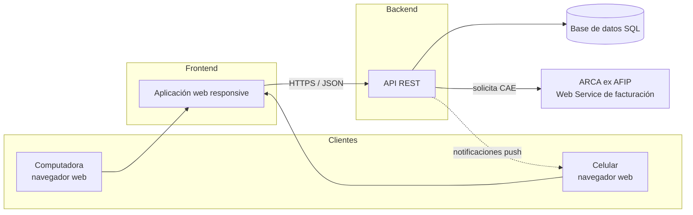
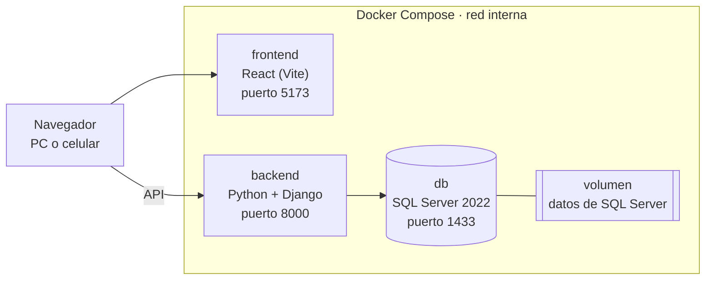
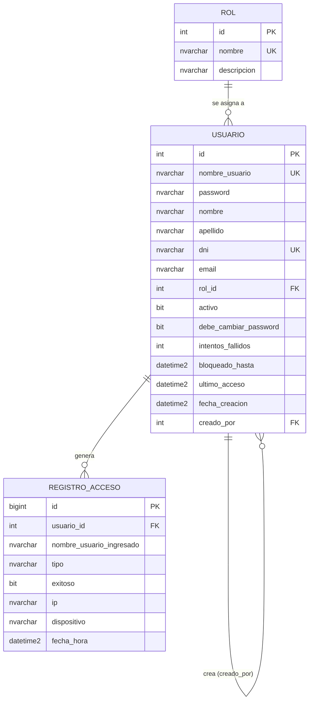
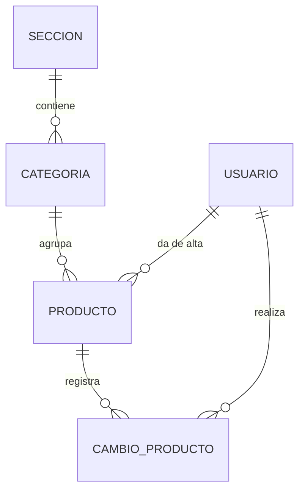
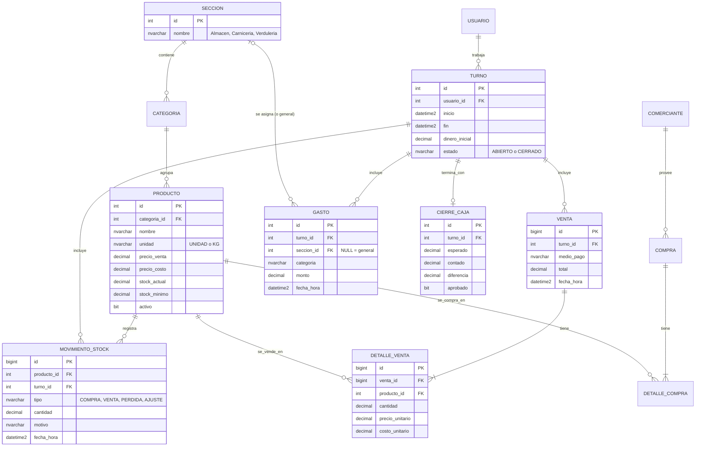

# Documentación — Sistema de Mercado

> **Versión:** 0.1 · **Fecha:** 2026-11-10 · **Autor:** _(tu nombre)_

---

## Índice

1. [Introducción](#1-introducción)
2. [Descripción general del sistema](#2-descripción-general-del-sistema)
3. [Objetivos](#3-objetivos)
4. [Requerimientos](#4-requerimientos)
5. [Casos de uso](#5-casos-de-uso)
6. [Arquitectura y tecnologías](#6-arquitectura-y-tecnologías)
7. [Modelo de datos](#7-modelo-de-datos)
8. [Plan de trabajo](#8-plan-de-trabajo)
9. [Glosario](#9-glosario)

---

## 1. Introducción

Este documento describe el sistema de gestión a desarrollar para un mercado de la zona: el problema que resuelve, sus propósitos, usuarios, requerimientos y diseño. Sirve como guía para el desarrollo y como registro del proyecto realizado en el marco de las pasantías escolares.

## 2. Descripción general del sistema

- **Nombre del sistema:** Sistema de Mercado
- **Descripción:** Sistema de gestión para un mercado de la zona, accesible desde computadora y teléfono celular, que digitaliza las tareas diarias del negocio: stock, ventas, cuentas, pagos, deudas, recibos, facturas y cierre de caja.
- **País:** Argentina. La facturación y los medios de pago se ajustan a la normativa y a los usos argentinos.

### 2.1 Situación actual

Hoy casi todo el trabajo se hace en papel: las cuentas con los comerciantes (proveedores que les venden la mercadería a los dueños), el cierre de caja, las deudas y los pagos. Solo una pequeña parte se lleva en un sistema demasiado básico.

### 2.2 Problemas detectados

| Problema | Consecuencia |
| --- | --- |
| Cuentas y anotaciones hechas a mano | Se pierde mucho tiempo en tareas repetitivas |
| Papeles que se extravían | Se pierde información de deudas, pagos y ventas |
| Copiar o pasar información de un papel a otro | Se cometen errores de transcripción |
| Registros en papel sin orden | Es difícil encontrar la información cuando se necesita |
| Acumulación de hojas | Ocupan mucho espacio físico |
| No queda registro de quién hizo cada cosa | No se pueden detectar responsables de cambios o errores |

### 2.3 Usuarios y roles

Todos los que trabajan en el mercado usarán el sistema, cada uno con **su propia cuenta y contraseña**. Cada rol tiene distintos permisos.

| Rol | Quiénes | Puede hacer |
| --- | --- | --- |
| **Administrador** | Dueños del mercado | Todo: crear y gestionar usuarios, ver la actividad de todos, modificar precios (individuales y por categoría), **supervisar y aprobar el cierre de caja**, ver todos los reportes, desde computadora y celular |
| **Encargado** | 2 o 3 empleados de confianza, los más cercanos a los dueños | Todo lo del empleado, más: **modificar precios durante su turno**, controlar pagos, recibir mercadería de comerciantes y cargarla al stock, registrar pagos a comerciantes, anular o corregir ventas, ver reportes del día y **comunicarse directamente con el administrador** desde el sistema. **No** puede crear usuarios ni supervisar el cierre de caja |
| **Empleado** | Personal que trabaja en el mercado | Tareas del día a día: ventas, emisión de facturas y recibos, cobros, inicio y cambio de turno. **No** puede modificar precios |

### 2.4 Alcance

**Incluye:**

- **División del mercado en 3 secciones:** Almacén, Carnicería y Verdulería. Cada sección tiene sus propios productos, ventas, compras, gastos y resultados.
- Alta y baja sencilla de productos, organizados por sección y categoría (ej.: Carnicería → Pollo).
- Control de stock **exacto** (por unidad o por kilo), calculado automáticamente con cada venta, compra o pérdida, con indicador de colores tipo semáforo y alarma en el celular.
- Registro de ventas, con un **panel siempre visible** de lo vendido hoy, en el mes y en cualquier período.
- Registro de compras de mercadería y de gastos.
- **Cierre automático del día a las 00:00**: el sistema, solo, cierra las sesiones que quedaron abiertas y calcula todo lo que entró y salió (mercadería, dinero, gastos, pagos y ganancias). El resultado lo ven únicamente los dueños.
- Turnos ligados al inicio y cierre de sesión de cada empleado o encargado, con **cálculo de horas trabajadas**, que solo controlan los dueños.
- **Registro de actividad**: todo cambio hecho en el sistema se puede consultar por día y horario, junto con quién tenía el sistema abierto en ese momento.
- **Resumen por día, semana y mes** de lo que se vende, se repone, se compra y se pierde.
- Resultados (ganancia o pérdida) **por sección y del mercado en general**.
- Gestión de comerciantes (proveedores): compras de mercadería, deudas y pagos.
- Cuentas, pagos, deudas y recibos.
- **Facturación electrónica oficial de Argentina** ante ARCA (ex AFIP): facturas A, B y C, notas de crédito y débito, con CAE.
- Medios de pago usados en Argentina: efectivo, tarjeta de débito, tarjeta de crédito, transferencia bancaria, billeteras virtuales / pago con QR (ej.: Mercado Pago) y cuenta corriente ("fiado").
- Cierre de caja, discriminado por medio de pago.
- Usuarios con roles, turnos y registro de actividad (auditoría).
- Modificación de precios individual y masiva por categoría (administradores y encargados en su turno).
- Mensajería interna entre encargados y administradores.
- Reportes y consulta desde el celular para los dueños.

**No incluye** _(a confirmar)_:

- Venta online / tienda para clientes.

## 3. Objetivos

### Propósito general

Desarrollar un sistema de gestión completo y fácil de usar, accesible desde computadora y teléfono, que reemplace el trabajo en papel del mercado. El sistema debe reducir el tiempo de trabajo, evitar la pérdida de información y los errores de copia, y registrar quién hace cada operación.

### Propósitos específicos

1. **Eliminar el papel:** digitalizar cuentas, deudas, pagos, recibos, facturas y cierres de caja, para que la información quede guardada, ordenada y no ocupe espacio físico.
2. **Emitir facturas electrónicas oficiales:** generar desde el sistema las facturas A, B o C según la condición fiscal del cliente, autorizadas por ARCA (ex AFIP) con su CAE, sin hacerlas a mano.
3. **Gestionar a los comerciantes:** registrar a los proveedores, la mercadería que entregan, lo que se les debe y los pagos realizados.
4. **Controlar el stock exacto con semáforo:** el sistema calcula solo la cantidad exacta de cada producto (en unidades o en kilos), sumando las compras y restando las ventas y pérdidas. La lista de productos se muestra con colores según la cantidad disponible:
    - 🟢 **Verde:** stock suficiente.
    - 🟡 **Amarillo:** stock bajo, hay que reponer.
    - 🔴 **Rojo:** sin stock.
5. **Alertar faltantes:** hacer sonar una alarma leve en el celular cuando un producto se queda sin stock.
6. **Registrar ventas y cuentas:** cargar ventas, pagos y deudas de forma rápida, con cualquier medio de pago (efectivo, débito, crédito, transferencia, QR o cuenta corriente), descontando automáticamente del stock y actualizando las cuentas.
7. **Calcular solo el cierre de caja:** cada noche a las **00:00** el sistema hace el cierre del día sin que nadie lo pida: cierra las sesiones que quedaron abiertas y calcula el dinero (ventas, cobros, gastos, pagos y ganancias, separado por medio de pago) y la mercadería que entró y salió. Los empleados **no** hacen el cierre de caja. El resultado se muestra solo en la cuenta de los dueños, también en el celular. _(Decisión del 12/11/2026; antes el cierre era por turno y lo contaba el empleado.)_
8. **Controlar usuarios y turnos:** cada empleado o encargado **inicia su turno al iniciar sesión** con su propia contraseña, y lo **termina al cerrar sesión**. Todo lo que pasa en ese tiempo (ventas, movimientos de stock, dinero) queda a nombre de esa persona, con fecha y hora. Así se puede saber quién era responsable ante cualquier error o faltante.
9. **Supervisar desde el celular:** que los dueños vean desde su teléfono la actividad, los turnos, el stock y las cuentas.
10. **Gestionar precios:** modificar el precio de un producto, o aplicar un ajuste porcentual a toda una categoría. Por ejemplo: aumentar un 5% todos los productos de pollo. Pueden hacerlo los administradores en cualquier momento y los encargados durante su turno, desde la computadora o el celular. Cada cambio queda registrado en la auditoría.
11. **Ser fácil de usar:** ofrecer muchas funciones, pero con una interfaz simple y clara, para que cualquier persona pueda usarlo, incluso alguien que recién empieza a trabajar.
12. **Encontrar información rápido:** buscar ventas, pagos, deudas o productos en segundos, en lugar de revisar hojas.
13. **Comunicar encargados y dueños:** permitir que los encargados se comuniquen directamente con el administrador desde el sistema, para avisos, consultas o problemas del turno.
14. **Organizar el mercado por secciones:** dividir el mercado en **Almacén, Carnicería y Verdulería**, cada una con sus propios productos.
15. **Mostrar siempre lo vendido:** tener a la vista en todo momento cuánto se vendió hoy, y poder consultar lo vendido por día, semana, mes o año, en total y por sección.
16. **Registrar compras y gastos:** cargar las compras de mercadería a los comerciantes y los gastos del mercado (luz, alquiler, sueldos, bolsas, etc.), asignándolos a una sección o al mercado en general.
17. **Calcular ganancias y pérdidas por sección:** que el sistema calcule cuánto se ganó o perdió en cada sección (ventas menos costo de la mercadería, pérdidas y gastos) y en el mercado en general, para tener cuenta de todo **en conjunto y por separado**.
18. **Registrar las horas trabajadas:** calcular automáticamente las horas que trabajó cada persona, a partir del inicio y fin de sus turnos.
19. **Agregar y quitar productos fácilmente:** dar de alta un producto nuevo o dar de baja uno que ya no se vende, en pocos pasos, sin perder el historial de ventas de los productos dados de baja.

## 4. Requerimientos

Los requerimientos se organizan por módulo. El primer módulo es el de **acceso: login, usuarios y roles**, base de todo el sistema, porque cada operación depende de saber quién la hace y qué permisos tiene.

### 4.1 Módulo de acceso: requerimientos funcionales

#### Inicio y cierre de sesión

| ID | Requerimiento | Prioridad |
| --- | --- | --- |
| RF-01 | El sistema debe permitir iniciar sesión con **nombre de usuario y contraseña**, desde la computadora o el celular. | Alta |
| RF-02 | Si los datos son incorrectos, se muestra un mensaje genérico ("Usuario o contraseña incorrectos"), sin indicar cuál de los dos falló. | Alta |
| RF-03 | Al ingresar, cada usuario ve la pantalla de inicio que corresponde a su rol (administrador, encargado o empleado). | Alta |
| RF-04 | El sistema muestra siempre el nombre y el rol del usuario conectado. | Media |
| RF-05 | El usuario puede **cerrar sesión** en cualquier momento. | Alta |
| RF-06 | La sesión se cierra automáticamente después de un tiempo de inactividad (propuesta: 30 minutos). | Media |
| RF-07 | Después de **5 intentos fallidos** seguidos, la cuenta se bloquea por 15 minutos. Un administrador puede desbloquearla antes. | Alta |

#### Gestión de usuarios (solo administrador)

| ID | Requerimiento | Prioridad |
| --- | --- | --- |
| RF-08 | El administrador puede **crear usuarios**, cargando nombre, apellido, DNI, nombre de usuario, contraseña inicial y rol. | Alta |
| RF-09 | El administrador puede **editar** los datos y el rol de un usuario. | Alta |
| RF-10 | El administrador puede **desactivar** y reactivar usuarios. Los usuarios no se borran, para conservar su historial en la auditoría. | Alta |
| RF-11 | El administrador puede **restablecer la contraseña** de un usuario. | Alta |
| RF-12 | El administrador puede ver la lista de usuarios con su rol, su estado (activo, inactivo o bloqueado) y su último acceso. | Media |

#### Contraseñas

| ID | Requerimiento | Prioridad |
| --- | --- | --- |
| RF-13 | Todo usuario puede **cambiar su propia contraseña**, ingresando la actual y la nueva. | Alta |
| RF-14 | Al primer ingreso, o después de un restablecimiento, el sistema obliga al usuario a cambiar la contraseña. | Media |

#### Roles y permisos

| ID | Requerimiento | Prioridad |
| --- | --- | --- |
| RF-15 | Cada usuario tiene **un único rol**: Administrador, Encargado o Empleado. | Alta |
| RF-16 | El sistema muestra a cada usuario solo las opciones que su rol permite (ver la matriz 4.3). | Alta |
| RF-17 | La API verifica los permisos del rol en **cada operación**, aunque el usuario intente acceder a una función sin pasar por el menú. | Alta |

#### Auditoría de accesos

| ID | Requerimiento | Prioridad |
| --- | --- | --- |
| RF-18 | Se registra cada inicio de sesión exitoso, cada intento fallido y cada cierre de sesión, con usuario, fecha, hora y dispositivo. | Alta |
| RF-19 | Se registra cada creación, modificación, desactivación y cambio de rol de un usuario, indicando qué administrador lo hizo. | Alta |
| RF-20 | El administrador puede consultar el historial de accesos desde la computadora y el celular. | Media |

### 4.2 Reglas de negocio del módulo de acceso

| ID | Regla |
| --- | --- |
| RN-01 | El nombre de usuario es único y no se puede repetir. |
| RN-02 | El DNI es único: una persona tiene una sola cuenta. |
| RN-03 | Siempre debe existir al menos **un administrador activo**. No se puede desactivar ni cambiar el rol del último. |
| RN-04 | Un administrador no puede desactivar su propia cuenta. |
| RN-05 | Un usuario desactivado o bloqueado no puede iniciar sesión. |
| RN-06 | La contraseña debe tener al menos 8 caracteres, con al menos una letra y un número. |

### 4.3 Matriz de permisos por rol

| Función | Administrador | Encargado | Empleado |
| --- | :---: | :---: | :---: |
| Iniciar y cerrar sesión, cambiar su contraseña | ✅ | ✅ | ✅ |
| Iniciar y terminar su turno (al iniciar y cerrar sesión) | — _(no lleva turno)_ | ✅ | ✅ |
| Registrar ventas y cobros | ✅ | ✅ | ✅ |
| Emitir facturas y recibos | ✅ | ✅ | ✅ |
| Ver el stock (semáforo) | ✅ | ✅ | ✅ |
| Ver el total vendido hoy | ✅ | ✅ | ✅ _(a confirmar)_ |
| Registrar pérdidas de mercadería | ✅ | ✅ | ❌ |
| Registrar gastos | ✅ | ✅ | ❌ |
| Dar de alta y de baja productos, crear categorías | ✅ | ✅ | ❌ |
| Ver el precio de costo de los productos | ✅ | ✅ | ❌ |
| Recibir mercadería y cargar stock (compras) | ✅ | ✅ | ❌ |
| Ver horas trabajadas de todos | ✅ | ❌ | ❌ |
| Ver ganancias y pérdidas por sección | ✅ | ❌ | ❌ |
| Cerrar un turno que quedó abierto o corregir una hora de salida | ✅ | ❌ | ❌ |
| Ver la actividad del sistema por día y horario | ✅ | ❌ | ❌ |
| Ver el resumen del día, la semana y el mes | ✅ | ❌ | ❌ |
| Hacer un recuento de stock o cambiar el stock mínimo | ✅ | ✅ | ❌ |
| Ver el historial de movimientos de stock | ✅ | ✅ | ❌ |
| Ver y reimprimir recibos del buzón | ✅ todos | ✅ todos | ✅ solo los suyos |
| Probar y configurar el lector y la impresora de su caja | ✅ | ✅ | ✅ |
| Registrar y controlar pagos a comerciantes | ✅ | ✅ | ❌ |
| Anular o corregir ventas | ✅ | ✅ | ❌ |
| Modificar precios (individual y por categoría) | ✅ | ✅ solo en su turno | ❌ |
| Ver reportes del día | ✅ | ✅ | ❌ |
| Enviar mensajes al administrador | — | ✅ | ❌ |
| Ver el cierre automático del día (00:00) | ✅ | ❌ | ❌ |
| Ver todos los reportes e historial | ✅ | ❌ | ❌ |
| Crear, editar y desactivar usuarios | ✅ | ❌ | ❌ |
| Ver la auditoría completa | ✅ | ❌ | ❌ |

_(A confirmar: si el empleado también puede enviar mensajes al administrador o al encargado)._

### 4.4 Requerimientos no funcionales del módulo de acceso

| ID | Requerimiento | Categoría |
| --- | --- | --- |
| RNF-01 | Las contraseñas se guardan **cifradas con hash** (algoritmo de Django: PBKDF2 o Argon2), nunca en texto plano. | Seguridad |
| RNF-02 | La autenticación usa **JWT**: un token de acceso de corta duración (15 minutos) y un token de renovación. | Seguridad |
| RNF-03 | Toda la comunicación entre el frontend y la API viaja por **HTTPS**. | Seguridad |
| RNF-04 | La pantalla de login es **responsive** y se usa cómodamente en el celular. | Usabilidad |
| RNF-05 | Los mensajes de error y las pantallas están en español y son claros para alguien sin experiencia. | Usabilidad |
| RNF-06 | El inicio de sesión responde en menos de 2 segundos en la red local. | Rendimiento |
| RNF-07 | Los registros de auditoría no se pueden modificar ni borrar desde el sistema. | Seguridad |

### 4.5 Módulo de turnos y horas trabajadas

| ID | Requerimiento | Prioridad |
| --- | --- | --- |
| RF-21 | Cuando un empleado o encargado **inicia sesión**, el sistema **abre su turno** y guarda la fecha y hora de inicio. | Alta |
| RF-22 | _(Eliminado el 12/11/2026: los empleados no cuentan la caja; el cierre lo hace el sistema a las 00:00, ver 4.11.)_ | — |
| RF-23 | Cuando el usuario **cierra sesión**, el sistema **cierra su turno** y guarda la fecha y hora de fin. El tiempo entre que puso su contraseña y que cerró sesión es su horario de trabajo. | Alta |
| RF-24 | Todas las operaciones (ventas, cobros, gastos, movimientos de stock, cambios de precio) quedan asociadas al **turno y al usuario** que las hizo. | Alta |
| RF-25 | El sistema calcula automáticamente las **horas trabajadas** de cada turno (fin − inicio). | Alta |
| RF-26 | **Solo los dueños** pueden ver las horas trabajadas por persona, por día, semana y mes. | Alta |
| RF-27 | Si alguien se va sin cerrar sesión, **a las 00:00 el sistema le cierra el turno** y lo marca «para revisar». El dueño ve el aviso y puede confirmar o **corregir la hora real de salida**; queda guardado quién lo corrigió, cuándo y la hora que había antes. Como ayuda, el sistema muestra el último momento en que esa persona lo usó. | Alta |
| RF-28 | El administrador puede ver en todo momento quién tiene un turno abierto, y cerrarlo si hace falta. | Media |
| RF-59 | A las **00:00 se cortan las sesiones** de empleados y encargados: quien siga trabajando tiene que volver a entrar con su contraseña y empieza un turno nuevo. | Alta |

Cómo termina un turno:

| Forma | Qué pasa |
| --- | --- |
| La persona cierra sesión | El turno termina en ese momento |
| 30 minutos sin usar el sistema (RF-06) | La pantalla cierra la sesión sola y el turno termina ahí; queda marcado «se cerró por inactividad» |
| Cerró el navegador o se apagó el equipo | El turno queda abierto hasta las 00:00, cuando lo cierra el sistema (RF-27) |
| Un dueño lo cierra o da de baja al usuario | El turno termina y a esa persona se le corta la sesión |

Los **dueños no llevan turno**: su ingreso queda en el registro de accesos, pero no cuenta como horario de trabajo.

### 4.6 Módulo de secciones, productos y stock

| ID | Requerimiento | Prioridad |
| --- | --- | --- |
| RF-29 | El mercado se divide en tres **secciones**: Almacén, Carnicería y Verdulería. | Alta |
| RF-30 | Cada producto pertenece a **una sección** y a una categoría dentro de ella (ej.: Carnicería → Pollo → Pechuga). | Alta |
| RF-31 | Se puede **dar de alta un producto** cargando: nombre, sección, categoría, unidad de medida, precio de venta y precio de costo. El producto nace con stock 0; el stock inicial se carga desde la pantalla de Stock (con «Recuento» → «Carga inicial de stock», que no cuenta como compra) y ahí también se define el stock mínimo. | Alta |
| RF-32 | Cada producto se mide en **unidades** (ej.: un paquete de fideos) o en **kilos** con decimales (ej.: 1,250 kg de carne o tomate). | Alta |
| RF-33 | Se puede **dar de baja** un producto que ya no se vende. No se borra: deja de aparecer en la venta, pero se conserva su historial. Se puede reactivar. | Alta |
| RF-34 | El sistema calcula el **stock exacto** de cada producto: suma las compras y resta las ventas y las pérdidas. Nadie escribe el stock a mano. | Alta |
| RF-35 | Cada cambio de stock queda registrado como un **movimiento** (ingreso de mercadería, venta, pérdida o ajuste), con cantidad, stock resultante, costo, usuario, turno, fecha y hora. | Alta |
| RF-36 | Se pueden registrar **pérdidas** (mermas): mercadería vencida, en mal estado o rota, indicando el motivo. Restan del stock y se cuentan como pérdida de la sección. No se puede perder más de lo que el sistema tiene. | Alta |
| RF-37 | Se puede hacer un **recuento** (ajuste de inventario) cuando el conteo físico no coincide con el sistema: se escribe cuánto hay en realidad, con el motivo, y el sistema calcula la diferencia. | Media |
| RF-38 | La lista de productos se puede ver **por sección**, con el stock exacto y el color del semáforo: 🔴 sin stock, 🟡 en el stock mínimo o menos, 🟢 por encima del mínimo. Primero aparece lo que falta. | Alta |
| RF-60 | Al **recibir mercadería** se carga la cantidad y, si vino a otro precio, el costo de esa entrega. El costo queda guardado en el movimiento para valorizar lo que entró; el precio del producto no cambia (eso es el módulo de precios). | Alta |
| RF-61 | Cada producto tiene un **stock mínimo** que definen dueños y encargados. El cambio queda en el historial del producto. | Media |
| RF-62 | Los productos que se venden **por unidad** solo admiten cantidades enteras; los que se venden **por kilo**, hasta 3 decimales. | Alta |
| RF-83 | Al dar de alta o editar un producto se indica **cómo llega del comerciante**: suelto, o en **caja, cajón, bandeja, bolsa, pack o bulto**, y cuántas unidades o kilos trae cada una (ej.: tomate en cajón de 18 kg, gaseosa en pack de 6). El stock y la venta siguen siendo por unidad o por kilo. _(Pedido del 12/11/2026.)_ | Alta |
| RF-84 | Al **recibir mercadería** de un producto que llega en caja, cajón, etc., se carga cuántas llegaron y el sistema calcula el total («3 cajones × 18 kg = 54 kg»). Si esa vez vinieron con otro contenido se corrige en el momento, sin cambiar el del producto. También se puede cargar suelto. El movimiento guarda cómo llegó. | Alta |
| RF-85 | En esa carga se puede poner el **costo de cada caja o cajón** y el sistema saca el costo por unidad o por kilo. La pantalla de Stock muestra además el stock expresado en cajas o cajones (≈ 2,7 cajones). Todo esto lo hacen dueños y encargados. | Media |
| RF-121 | En **Stock**, al recibir mercadería, registrar una pérdida o hacer un recuento se elige **en qué se cuenta**: por kilo o unidad, o por **caja, cajón, bandeja, bolsa, pack o bulto**, aunque el producto esté cargado como «suelto». Se escribe cuántos y cuánto trae cada uno (puede ser aproximado) y el sistema calcula el total. Si un producto «suelto» se recibe o se compra por cajón, **queda anotado en el producto** en qué llega. La pantalla de Stock se puede ver **en unidades y kilos** o **en cajas, cajones, bandejas…** («5,7 cajones · son 102 kg»). _(Pedido del 13/11/2026.)_ | Alta |
| RF-63 | La pantalla de inicio avisa cuántos productos están **sin stock** o con poco stock. _(La alarma sonora en el celular llega con la PWA, etapa 11.)_ | Media |
| RF-55 | Cada producto se identifica por su **nombre**, un **número de producto** opcional (código corto propio, ej.: 101, cómodo para lo que se pesa) y un **código de barras** opcional (el del envase, que lee el lector). Son dos campos separados y un mismo código no puede identificar a dos productos. _(Cambio del 12/11/2026: antes había un solo campo «código».)_ | Alta |
| RF-56 | Dueños y encargados pueden **crear categorías** nuevas dentro de una sección, desde la misma pantalla de alta de productos. | Media |
| RF-57 | Cada alta, baja, reactivación y corrección de un producto queda registrada con el usuario, la fecha y la hora. | Alta |
| RF-58 | Dueños y encargados pueden **corregir** el nombre, el código, la sección y categoría, y si se vende por unidad o por kilo (por ejemplo, para arreglar errores de ortografía). La auditoría guarda qué cambió: «Nombre: Pechga → Pechuga». Los **precios no** se cambian acá, sino en el módulo de precios (etapa 6). | Alta |

**Precios** (etapa 6, hecha el 13/11/2026). La «categoría» es la subdivisión dentro de una sección: Carnicería → **Pollo** → pechuga, alitas, milanesas…

| ID | Requerimiento | Prioridad |
| --- | --- | --- |
| RF-90 | Se puede cambiar el **precio de venta y el costo de un producto** desde la pantalla Precios. | Alta |
| RF-91 | Se puede **subir o bajar un porcentaje** a todos los productos a la venta de una **categoría** (ej.: +20 % a todo Pollo), eligiendo primero la sección y después la categoría. Se puede destildar algún producto para dejarlo afuera. | Alta |
| RF-92 | El porcentaje se aplica al **precio de venta**, al **costo** o a **los dos**, y el precio de venta se puede **redondear** (sin centavos, o de a $ 10, $ 50 o $ 100, al más cercano). El costo no se redondea. | Media |
| RF-93 | Antes de guardar, la pantalla muestra **cómo queda cada precio** (el actual tachado y el nuevo), el margen, y avisa si alguno queda por debajo del costo. No se guarda nada hasta confirmar. | Alta |
| RF-94 | Cada cambio de precio queda en la auditoría por producto («Venta $6500.00 → $7800.00 · +20 % a toda la categoría Pollo») con quién y cuándo, y se ve en la Actividad del sistema. Las ventas ya hechas no cambian (RN-11). | Alta |

Reglas: el porcentaje no puede ser 0, ni bajar más de un 90 %, ni subir más de un 500 % de una vez (RN-22). Los productos dados de baja no cambian de precio con el ajuste por categoría (RN-23). Lo hacen dueños y encargados; el encargado solo puede estando en su turno, porque su sesión existe mientras el turno está abierto.

Reglas del módulo:

| ID | Regla |
| --- | --- |
| RN-14 | No puede haber dos productos con el mismo nombre en la misma sección (sin importar mayúsculas ni acentos), aunque uno esté dado de baja: en ese caso se reactiva el existente. |
| RN-15 | No puede haber dos categorías con el mismo nombre en la misma sección. |
| RN-16 | El precio de venta debe ser mayor a 0 y el costo no puede ser negativo. Si el precio de venta es menor que el costo, la pantalla avisa pero permite guardarlo. |
| RN-17 | El precio de costo solo lo ven dueños y encargados. |

### 4.7 Módulo de ventas y panel de ventas

| ID | Requerimiento | Prioridad |
| --- | --- | --- |
| RF-39 | Cada venta registra: productos, cantidades, precios, medio de pago, usuario, turno, fecha y hora. | Alta |
| RF-40 | Al confirmar una venta, el stock de cada producto se **descuenta automáticamente**. | Alta |
| RF-41 | En la pantalla principal se ve **siempre** el total vendido **hoy**, en total y por sección, y se actualiza con cada venta. | Alta |
| RF-42 | Se puede consultar lo vendido **por día, semana, mes, año** o entre dos fechas, en total y por sección. | Alta |
| RF-43 | Se puede consultar lo vendido por **turno** y por **usuario**. | Alta |
| RF-44 | Se muestra la evolución de las ventas en gráficos (por ejemplo, ventas de cada día del mes). | Media |
| RF-72 | En la pantalla de venta el producto se agrega **escaneando** su código de barras, o escribiendo el número de producto o parte del nombre. Lo que se vende por unidad suma de a uno con cada lectura; lo que va por kilo pide el peso. | Alta |
| RF-73 | El **precio lo pone el sistema**, no la pantalla: se toma del producto al momento de cobrar. El recibo guarda el nombre, el precio y el costo de ese momento. | Alta |
| RF-74 | Medios de pago de la venta: efectivo, débito, crédito, transferencia y QR (uno por venta). En efectivo se puede cargar con cuánto paga el cliente y el sistema calcula el **vuelto**. _(Desde el 13/11/2026 también «cuenta corriente»: ver 4.13.)_ | Alta |
| RF-75 | Si el sistema no tiene stock suficiente de un producto, **la venta se hace igual**: el stock queda en negativo (rojo), el vendedor ve un aviso y los dueños lo ven para hacer un recuento. _(Decisión del 12/11/2026.)_ | Alta |
| RF-76 | Dueños y encargados pueden **anular** una venta indicando el motivo: la mercadería vuelve al stock, la venta deja de sumar y queda registrado quién la anuló. Las ventas nunca se borran. | Alta |

| RF-86 | En la venta, el sistema **suma solo** y muestra el **total a cobrar en grande y en rosa**. Antes de pagar se pueden cambiar cantidades, quitar o agregar productos. El recibo queda guardado siempre, se imprima o no. _(Pedido del 12/11/2026.)_ | Alta |
| RF-87 | Una compra **ya pagada se puede modificar** (el cliente se olvidó algo, o quiere sacar o cambiar un producto): se vuelve a abrir con sus productos, se corrige y el sistema dice **cuánto cobrar de más o cuánto devolver**. El stock se ajusta solo. | Alta |
| RF-88 | La compra original **no se borra ni se pisa**: queda marcada como «modificada» y enlazada al recibo nuevo que la reemplaza, con quién la cambió y cuándo. En los totales cuenta solo la versión corregida, y los dueños ven la modificación en Actividad («Compra modificada · $ antes → $ después»). | Alta |
| RF-89 | Puede modificar una compra pagada **el cajero que la cobró, el mismo día**; encargados y dueños, cualquiera. Devolver la compra entera sigue siendo una anulación (RF-76), de encargados y dueños. _(Decisión del 12/11/2026.)_ | Alta |

### 4.12 Lector de código de barras, impresora de recibos y buzón de recibos

| ID | Requerimiento | Prioridad |
| --- | --- | --- |
| RF-77 | El sistema funciona con un **lector de código de barras** USB o Bluetooth, sin instalar nada: el lector se comporta como un teclado que escribe el código y aprieta Enter. Se puede escanear en la venta, en el buscador de productos y de stock, y al cargar el código de barras de un producto. | Alta |
| RF-78 | En la venta, el lector funciona aunque el cursor no esté en el buscador (por ejemplo, con el recibo en pantalla: empieza una venta nueva). | Media |
| RF-79 | Cada venta genera un **recibo** que se puede imprimir en una **impresora de recibos** (térmica de 58 u 80 mm) o en cualquier impresora instalada en la computadora. El recibo aclara «Comprobante no válido como factura» (la factura de ARCA es la etapa 12). | Alta |
| RF-80 | Pantalla **«Lector e impresora»** para conectar y probar los aparatos: muestra qué código leyó el lector y a qué producto corresponde, y permite configurar el recibo (nombre del negocio, dirección, mensaje al pie, ancho del papel, imprimir solo al cobrar) e imprimir uno de prueba. La configuración se guarda en cada equipo, porque cada caja puede tener otra impresora. | Alta |
| RF-81 | **Buzón de recibos**: en un solo lugar están los recibos de hoy y de la semana pasada, con buscador por número, producto o vendedor, para verlos, reimprimirlos o anularlos. Dueños y encargados ven todos; un empleado ve los suyos. | Alta |
| RF-82 | El buzón **se limpia solo todos los domingos**: salen los recibos de más de una semana, así siempre quedan los de esta semana y los de la anterior. **Las ventas no se borran**: siguen en la base para los reportes, el cierre y la auditoría. _(Decisión del 12/11/2026.)_ | Alta |

### 4.13 Clientes y cuenta corriente («fiado»)

Etapa 9, hecha el 13/11/2026. La cuenta corriente es de **clientes**: compran, se anota, y pagan después.

| ID | Requerimiento | Prioridad |
| --- | --- | --- |
| RF-95 | Se cargan los **clientes** de cuenta corriente: nombre (obligatorio), DNI o CUIT, teléfono, dirección y una nota. No se borran: se dan de baja y se pueden reactivar. | Alta |
| RF-96 | Dan de alta, corrigen y dan de baja clientes **los dueños y los encargados que un dueño autorizó**. El permiso se da y se quita desde la pantalla Usuarios, encargado por encargado, y queda registrado. _(Decisión del 13/11/2026.)_ | Alta |
| RF-97 | Todos los usuarios ven la lista de clientes con **cuánto debe** cada uno, para poder fiarles y cobrarles. | Alta |
| RF-98 | La deuda de un cliente nadie la escribe a mano: cambia solo con **movimientos** (compra fiada, pago, anulación o ajuste), cada uno con importe, saldo resultante, usuario, turno, fecha y hora. | Alta |
| RF-99 | En la venta se puede elegir el medio de pago **«Cuenta corriente»** y el cliente: no se cobra en el momento, el total se suma a su deuda y el recibo sale con su nombre. Cualquier cajero puede fiarle a un cliente ya cargado. | Alta |
| RF-100 | **Límite de fiado.** Los dueños fijan un **límite general** (para todos) y, si quieren, un **límite propio** para un cliente, que reemplaza al general. Si una compra fiada hace que la deuda pase el límite, el sistema **no deja anotarla** y explica cuánto le queda. Sin límite general ni propio, no hay tope. _(Decisión del 13/11/2026.)_ | Alta |
| RF-101 | **Cualquier cajero cobra un pago** de la deuda, total o parcial, en efectivo, débito, crédito, transferencia o QR. Queda a su nombre y se puede imprimir un **comprobante** con lo que pagó y lo que sigue debiendo. No se puede cobrar más de lo que debe. _(Decisión del 13/11/2026.)_ | Alta |
| RF-102 | De cada cliente se ve **su cuenta**: todos los movimientos, del más nuevo al más viejo, con el recibo de cada compra y quién lo cargó. | Alta |
| RF-103 | Los dueños pueden **ajustar la cuenta a mano** (sumar o restar deuda) con un motivo obligatorio: sirve para cargar lo que ya debía en el cuaderno o corregir un error. | Media |
| RF-104 | El resumen y el cierre de las 00:00 separan lo **vendido fiado** (no entró plata) de los **pagos de cuentas corrientes** (plata que entró, con su parte en efectivo). | Alta |
| RF-105 | Altas, bajas, correcciones, cambios de límite, pagos y ajustes aparecen en la **Actividad del sistema** (grupo «Cuentas corrientes»). | Alta |

Reglas: no puede haber dos clientes con el mismo nombre ni con el mismo DNI (RN-24). A un cliente dado de baja no se le fía, pero su deuda sigue y se puede cobrar (RN-25). Si se anula o se modifica una venta fiada, su importe sale de la deuda; si eso deja la cuenta en negativo, el cliente queda con saldo a favor (RN-26). La deuda no se paga con «cuenta corriente» (RN-27). El límite de fiado lo fijan solo los dueños, aunque el encargado esté autorizado a cargar clientes (RN-28).

### 4.14 Lista de gastos

Etapa 8 (parte de gastos), hecha el 13/11/2026. _(Decisión del 13/11/2026: los gastos son una lista simple —monto y propósito— que puede anotar cualquiera; reemplaza a lo previsto en RF-46, que pedía categoría y sección.)_

| ID | Requerimiento | Prioridad |
| --- | --- | --- |
| RF-106 | **Cualquier usuario** (dueño, encargado o empleado) puede **anotar un gasto**: un **monto** y, al lado, **para qué fue**. Queda con su nombre, su turno, la fecha y la hora. | Alta |
| RF-107 | Los gastos se ven como una **lista del día**, del más nuevo al más viejo, con el **total** al pie en negativo. Todos ven la lista de hoy; dueños y encargados pueden mirar también otros días. | Alta |
| RF-108 | Un gasto no se borra: si se anotó mal, se **anula** (con motivo opcional) y queda tachado en la lista, sin restar. Lo anula quien lo anotó, ese mismo día, o un encargado o dueño. | Alta |
| RF-109 | **Cuenta final del día:** plata que entró (ventas cobradas, sin lo fiado, más los pagos de cuentas corrientes) **menos los gastos**. Se muestra arriba de todo en «Resumen y cierre del día», por día, semana o mes. Puede dar negativo. | Alta |
| RF-110 | El **cierre automático de las 00:00** guarda la cantidad y el total de gastos del día, y con eso la cuenta final y el **efectivo que debería haber en la caja** (ventas y pagos en efectivo menos los gastos). | Alta |
| RF-111 | Cada gasto y cada anulación aparecen en la **Actividad del sistema** (grupo «Gastos») y cuentan en los cambios del día. | Alta |

Reglas: el monto tiene que ser mayor a 0 y el propósito es obligatorio (RN-29). Se asume que los gastos se pagan con la plata de la caja, por eso bajan el efectivo esperado (RN-30). Un gasto anulado no se puede volver a activar: se anota de nuevo (RN-31).

### 4.15 Compras a comerciantes

Etapa 7, hecha el 13/11/2026. Reemplaza y detalla a RF-45.

| ID | Requerimiento | Prioridad |
| --- | --- | --- |
| RF-112 | **Solo dueños y encargados** pueden anotar, ver, pagar y anular las compras a comerciantes. _(Decisión del 13/11/2026.)_ | Alta |
| RF-113 | Cada compra se anota como un renglón con: el **producto** comprado, la **cantidad**, el **costo** (total de esa cantidad; el sistema calcula el costo por unidad o kilo), el **nombre del comerciante**, y la **fecha y hora**, que las pone el sistema. Queda a nombre de quien la anotó. El comerciante se crea solo la primera vez que se escribe su nombre. | Alta |
| RF-114 | La compra **suma la mercadería al stock**, al costo de esa compra. Se puede destildar si la mercadería ya se cargó desde Stock, para no contarla dos veces. | Alta |
| RF-115 | Cada compra muestra **cómo va el pago** con un color: **verde** si está pagada completa, **amarillo** si se pagó una parte y falta el resto, **rojo** si todavía no se pagó. Al anotarla se elige una de las tres. _(Decisión del 13/11/2026.)_ | Alta |
| RF-116 | Después se pueden **anotar pagos** al comerciante (el total que falta o una parte), con el medio de pago. La compra pasa sola de rojo a amarillo y a verde. No se puede pagar más de lo que falta. | Alta |
| RF-117 | La pantalla muestra **cuánto se les debe** a los comerciantes en total y a cada uno, y permite filtrar por color y por comerciante. | Alta |
| RF-118 | Lo **pagado a comerciantes** se resta en la **cuenta final del día** y en el cierre de las 00:00, el día en que se pagó; lo pagado en efectivo baja además el efectivo que debería haber en la caja. | Alta |
| RF-119 | Una compra mal anotada se **anula** con motivo obligatorio: queda tachada en la lista, deja de contar en la deuda y, si había sumado stock, se lo vuelve a restar. Compras, pagos y anulaciones aparecen en la Actividad (grupo «Compras a comerciantes»). | Alta |

| RF-120 | La cantidad comprada se puede anotar **por caja, cajón, bandeja, bolsa, pack o bulto**, además de por kilo o por unidad, igual que en Stock: se escribe cuántos se compraron y cuánto trae cada uno (puede ser aproximado; si el producto ya lo tiene cargado en «Llega en», se propone solo) y el sistema calcula el total que suma al stock. La lista muestra «2 cajones × 18 kg = 36 kg» y lo que salió cada cajón. _(Pedido del 13/11/2026: «se compra un cajón de cebolla, no se puede andar contando cebolla por cebolla».)_ | Alta |

| RF-122 | **Productos y Stock son la misma lista.** Todo producto de Productos aparece en Stock y al revés (Stock muestra los que están a la venta; los dados de baja se ven en Productos). Si se compra a un comerciante o se agrega al stock algo que **todavía no existe**, se **crea el producto en el momento**, sin pasar antes por Productos: en Compras con «+ Es un producto nuevo» (su costo queda en lo que salió en esa compra) y en Stock con «+ Agregar un producto nuevo» (después se indica cuánto hay). Se piden los datos mínimos: nombre, sección, categoría, si va por kilo o unidad y precio de venta. La pantalla Productos muestra además el stock de cada uno, con su color. _(Pedido del 13/11/2026.)_ | Alta |

Reglas: el producto tiene que estar a la venta; si todavía no existe, se crea en la misma compra (RF-122) (RN-32). La cantidad y el costo deben ser mayores a 0; lo que se cuenta por unidad no admite decimales (RN-33). La compra no cambia el precio de costo ni el de venta del producto: eso se hace en Precios (RN-34).

### 4.8 Módulo de compras, gastos y caja

| ID | Requerimiento | Prioridad |
| --- | --- | --- |
| RF-45 | Se registran las **compras** de mercadería a los comerciantes: comerciante, productos, cantidades, costo y forma de pago. La compra **suma al stock** automáticamente. | Alta |
| RF-46 | Se registran los **gastos** del mercado (luz, alquiler, sueldos, bolsas, limpieza, etc.), con monto, categoría de gasto, y sección a la que corresponde o "general". | Alta |
| RF-47 | El sistema calcula **solo**, a las 00:00, el dinero del día: ventas y cobros − gastos y pagos, y la ganancia. Los empleados no cuentan ni cierran la caja. | Alta |
| RF-48 | El cierre de caja muestra los totales **por medio de pago** (efectivo, débito, crédito, transferencia, QR, cuenta corriente). | Alta |
| RF-49 | _(Eliminado el 12/11/2026: ya no hay conteo de caja por turno. Consecuencia: el sistema dice cuánto dinero **debería** haber, pero no detecta solo un faltante; para eso un dueño tendría que cargar lo que contó. Queda como mejora posible.)_ | — |
| RF-50 | Solo los dueños ven el historial de cierres del día, por fecha. Lo que hizo cada persona se consulta en la actividad (4.11). | Alta |

### 4.9 Módulo de resultados por sección

| ID | Requerimiento | Prioridad |
| --- | --- | --- |
| RF-51 | El sistema calcula el **resultado** de cada sección: ventas − costo de la mercadería vendida − pérdidas − gastos de la sección. | Alta |
| RF-52 | El sistema calcula el resultado del **mercado en general**: suma de las secciones − gastos generales. | Alta |
| RF-53 | Los resultados se pueden ver por día, mes, año o entre dos fechas, indicando si hubo **ganancia o pérdida**. | Alta |
| RF-54 | Se puede comparar las tres secciones entre sí (cuál vende más, cuál gana más, cuál tiene más pérdidas). | Media |

Hecho el 13/11/2026 (pantalla `/resultados`, solo dueños), con estas decisiones del mismo día: los gastos **no se reparten por sección** (son una lista simple, sin sección): cada sección muestra ventas − costo de lo vendido − pérdidas, y los gastos se restan **una sola vez en el total general**. Cada sección se puede abrir para ver **sus productos** (cuánto se vendió, vendido, costo, pérdidas y resultado de cada uno). Se consulta por día, semana, mes o año. Cada producto cuenta en la sección donde está cargado hoy.

### 4.10 Reglas de negocio de los nuevos módulos

| ID | Regla |
| --- | --- |
| RN-07 | Un usuario solo puede tener **un turno abierto** a la vez. |
| RN-08 | No se pueden registrar ventas, cobros ni gastos sin un turno abierto. |
| RN-09 | El stock nunca se edita directamente: solo cambia mediante movimientos (compra, venta, pérdida o ajuste). |
| RN-10 | Un producto dado de baja no se puede vender, pero sus ventas anteriores siguen en los reportes. |
| RN-11 | Para calcular la ganancia se usa el **precio de costo vigente al momento de la venta**, que se guarda en cada venta. |
| RN-12 | Todo gasto pertenece a una sección o a "general". |
| RN-13 | Solo los administradores pueden crear usuarios (cada vez que entra un empleado nuevo). |
| RN-18 | Un turno nunca pasa de las 00:00: a esa hora el sistema lo cierra y empieza otro día. |
| RN-19 | Un empleado o encargado solo puede usar el sistema mientras su turno está abierto. Si el turno se cierra, su sesión deja de servir. |
| RN-20 | La hora de salida corregida debe ser posterior a la entrada, no puede pasar de las 00:00 de ese día ni estar en el futuro. |
| RN-21 | Los movimientos de stock no se modifican ni se borran: un error se corrige con otro movimiento (recuento). |

### 4.11 Actividad, resumen y cierre automático del día

Pedido de los dueños (12/11/2026): saber todos los días cuánto se vende, se repone y se compra; poder ver todo lo que se hizo en el sistema a cierta hora y quién lo tenía abierto; y que el sistema haga solo el cierre a las 00:00.

| ID | Requerimiento | Prioridad |
| --- | --- | --- |
| RF-64 | Los dueños pueden ver **todo lo que se hizo en el sistema** en un día y entre dos horas: ingresos y salidas (también los intentos fallidos), altas y bajas de usuarios, cambios de productos, movimientos de stock y correcciones de horario. No solo los errores: cualquier actividad. | Alta |
| RF-65 | Junto con la actividad se muestra **quién tenía el sistema abierto** en ese horario (los turnos que se cruzan con el rango), para saber quién estaba a cargo ante un problema. | Alta |
| RF-66 | La actividad se puede filtrar por persona y por tipo (stock, productos, ingresos y salidas, horarios, usuarios). | Media |
| RF-67 | El sistema calcula el **resumen de un día, una semana o un mes**: mercadería que entró (repuesta), pérdidas, diferencias de recuento, horas trabajadas y cantidad de cambios; en total, por sección, por producto y día por día. | Alta |
| RF-68 | El resumen suma además lo **vendido**, lo **comprado** a comerciantes, los gastos, los pagos y la ganancia, a medida que se construyen esos módulos (etapas 5, 7 y 8). | Alta |
| RF-69 | Cada noche a las **00:00** el sistema genera solo el **cierre del día**: cierra los turnos abiertos (RF-27) y guarda la foto de los totales. Nadie tiene que pedirlo. | Alta |
| RF-70 | Si la computadora estaba apagada a las 00:00, el sistema **se pone al día solo** la próxima vez que se enciende o que alguien inicia sesión: genera los cierres que faltan. | Alta |
| RF-71 | El resumen, la actividad, los horarios y los cierres los ven **únicamente los dueños** (no los encargados), desde la computadora o el celular. | Alta |

Pendiente de este módulo: el dinero del cierre (RF-47, RF-48 y RF-68) depende de ventas, compras y gastos, que todavía no existen. Hoy el cierre calcula mercadería y personal.

## 5. Casos de uso

| ID | Caso de uso | Actor | Descripción |
| --- | --- | --- | --- |
| CU-01 | | | |

## 6. Arquitectura y tecnologías

El sistema usa una arquitectura de **tres capas**. El frontend (web responsive) se comunica con el backend (API), y solo el backend accede a la base de datos (SQL).



### 6.1 Capas

| Capa | Responsabilidad | Tecnología |
| --- | --- | --- |
| **Frontend (web responsive)** | Interfaz que usan empleados, encargados y dueños. Se adapta a la pantalla de la computadora y del celular. Muestra el semáforo de stock, las ventas, la caja, los reportes y los mensajes. No guarda datos ni contiene reglas de negocio | **React** (JavaScript) |
| **Backend (API)** | Contiene toda la lógica del negocio: valida usuarios y permisos por rol, registra ventas y descuenta stock, calcula el cierre de caja, aplica cambios de precios por categoría, guarda la auditoría, se conecta con ARCA para obtener el CAE y envía las alarmas al celular | **Python + Django** (con Django REST Framework para la API) |
| **Base de datos (SQL)** | Guarda de forma permanente y ordenada toda la información: usuarios, productos, categorías, stock, ventas, facturas, comerciantes, pagos, deudas, turnos, cierres de caja, mensajes y auditoría | **Microsoft SQL Server** |

### 6.2 Decisiones de diseño

- **Una sola aplicación web para computadora y celular.** Al ser responsive, no hace falta desarrollar ni instalar una app aparte para cada dispositivo.
- **El frontend nunca accede directamente a la base de datos.** Todo pasa por la API, que controla los permisos de cada rol. Así un empleado no puede, por ejemplo, cambiar precios aunque intente hacerlo.
- **Autenticación con usuario y contraseña.** La API entrega un token de sesión (por ejemplo JWT) y verifica en cada petición quién es el usuario y qué rol tiene.
- **Auditoría en el backend.** Cada operación importante (venta, cambio de precio, anulación, pago, inicio y cambio de turno) se registra automáticamente con usuario, fecha y hora.
- **Alarma en el celular.** Para que suene una alarma con el sistema cerrado, la web debe funcionar como **PWA** (aplicación web progresiva, que se puede "instalar" en la pantalla del celular) y recibir **notificaciones push** enviadas por la API.
- **Facturación electrónica.** El backend se conecta con los web services de ARCA (WSAA para autenticarse y WSFEv1 para pedir el CAE). Para eso necesita el certificado digital del CUIT del mercado.
- **Comunicación segura.** Todo el tráfico entre el frontend y la API viaja por HTTPS.

### 6.3 Tecnologías elegidas

| Componente | Tecnología | Detalle |
| --- | --- | --- |
| Lenguaje del backend | Python | |
| Framework del backend | Django | Incluye ORM, migraciones, panel de administración y sistema de usuarios |
| API | Django REST Framework | Para construir la API REST |
| Autenticación | JWT (`djangorestframework-simplejwt`) | Token de sesión por usuario |
| Conexión a la base | `mssql-django` + Microsoft ODBC Driver 18 for SQL Server | Permite que Django trabaje con SQL Server |
| Frontend | React | Creado con Vite |
| PWA / notificaciones | `vite-plugin-pwa` + Web Push | Para instalar la web en el celular y recibir la alarma de stock |
| Base de datos | Microsoft SQL Server | Edición Express o Developer para desarrollo |
| Facturación | Web services de ARCA (WSAA + WSFEv1) | Primero en el entorno de homologación (pruebas) |

### 6.4 Contenedores (Docker)

Cada capa corre en **su propio contenedor Docker**. Los tres se definen y levantan juntos con **Docker Compose** (`docker compose up`).



| Servicio | Imagen base | Puerto | Función |
| --- | --- | --- | --- |
| `db` | `mcr.microsoft.com/mssql/server:2022-latest` | 1433 | Base de datos SQL Server. Los datos se guardan en un **volumen**, así no se pierden al recrear el contenedor |
| `backend` | `python:3.12-slim` + ODBC Driver 18 | 8000 | API en Django. Se conecta a `db` por la red interna de Docker |
| `frontend` | `node:22` (desarrollo) / `nginx` (producción) | 5173 / 80 | Aplicación React. En desarrollo con recarga automática; en producción se sirven los archivos compilados con nginx |

Ventajas:

- **Mismo entorno en cualquier PC:** no hace falta instalar Python, Node ni SQL Server en la computadora, solo Docker.
- **Capas aisladas:** cada una se puede reiniciar, actualizar o reemplazar sin afectar a las otras.
- **Fácil de mover:** el mismo `docker-compose.yml` sirve para pasar más adelante a otro servidor o a la nube.
- Las contraseñas y configuraciones van en un archivo `.env`, que **no** se sube al repositorio.

Estructura de carpetas prevista:

```text
sistema-mercado/
├── docker-compose.yml
├── .env                # contraseñas y configuración (no se versiona)
├── backend/
│   ├── Dockerfile
│   ├── requirements.txt
│   └── ...             # proyecto Django
├── frontend/
│   ├── Dockerfile
│   ├── package.json
│   └── ...             # proyecto React
└── docs/
    └── documentacion.md
```

### 6.5 API: endpoints del módulo de acceso

| Método | Ruta | Quién | Qué hace | Requerimientos |
| --- | --- | --- | --- | --- |
| POST | `/api/auth/login/` | Cualquiera | Recibe `nombre_usuario` y `password`. Devuelve tokens `access` y `refresh` y los datos del usuario | RF-01, RF-02, RF-07, RF-18 |
| POST | `/api/auth/refresh/` | Con sesión | Renueva los tokens. El token usado queda invalidado | RF-06 |
| POST | `/api/auth/logout/` | Quien tenga el token `refresh` | Invalida el token `refresh`, registra la salida y **termina el turno**. Con `motivo: "inactividad"` el turno queda marcado así. Acepta un `refresh` vencido hace menos de un día (se verifica la firma), porque cuando la sesión se corta por inactividad el token ya venció | RF-05, RF-06, RF-18, RF-23 |
| GET | `/api/auth/yo/` | Con sesión | Datos del usuario conectado: nombre, rol y si debe cambiar la contraseña | RF-04 |
| POST | `/api/auth/cambiar-password/` | Con sesión | Recibe `password_actual` y `password_nueva` | RF-13, RF-14, RN-06 |
| GET | `/api/estado/` | Cualquiera | Verifica que la API y SQL Server funcionan | — |

#### Gestión de usuarios (solo administrador)

| Método | Ruta | Qué hace | Requerimientos |
| --- | --- | --- | --- |
| GET | `/api/usuarios/` | Lista de usuarios con rol, estado, bloqueo y último acceso. Filtro opcional `?activo=1` o `?activo=0` | RF-12 |
| POST | `/api/usuarios/` | **Alta**: recibe `nombre`, `apellido`, `dni`, `nombre_usuario`, `email` (opcional), `rol` y `password` (contraseña inicial). El usuario queda obligado a cambiarla al primer ingreso | RF-08, RF-14, RN-01, RN-02, RN-06 |
| GET | `/api/usuarios/{id}/` | Datos de un usuario | RF-12 |
| POST | `/api/usuarios/{id}/desactivar/` | **Baja**: recibe `motivo` (opcional). La cuenta no se borra; deja de poder ingresar y sus sesiones abiertas se cortan | RF-10, RN-03, RN-04, RN-05 |
| POST | `/api/usuarios/{id}/reactivar/` | Vuelve a habilitar una cuenta dada de baja | RF-10 |

Validaciones del alta:

- El **nombre de usuario** se guarda en minúsculas y solo admite letras sin acentos, números, punto y guion bajo (3 a 50 caracteres).
- El **DNI** admite 7 u 8 números; si se escribe con puntos (`30.111.222`) se guardan solo los números.
- Cada alta, baja y reactivación queda en la tabla `cambio_usuario` con el administrador que la hizo (RF-19).

Notas de implementación:

- Los tokens invalidados (por logout o por renovación) se guardan en la tabla `token_invalidado`. La app `token_blacklist` de simplejwt no se usa porque sus migraciones no son compatibles con SQL Server.
- Mientras un usuario deba cambiar su contraseña, la API solo le permite usar `yo`, `cambiar-password` y `logout`.
- Los usuarios con rol Administrador tienen automáticamente todos los permisos (`is_superuser`), también en el panel `/admin/`, sin importar cómo se creó la cuenta.
- Pruebas automáticas: `docker compose exec backend python manage.py test usuarios` (28 pruebas).

#### Pantallas

| Ruta | Pantalla | Quién |
| --- | --- | --- |
| `/login` | Inicio de sesión | Cualquiera |
| `/cambiar-password` | Cambio de contraseña (obligatorio en el primer ingreso) | Con sesión |
| `/` | Inicio con los módulos que permite el rol | Con sesión |
| `/usuarios` | Lista de usuarios con pestañas Activos / Dados de baja, buscador, botones "Dar de baja" (pide confirmación y motivo opcional) y "Reactivar" | Administrador |
| `/usuarios/nuevo` | Alta de usuario. Sugiere el nombre de usuario (Juan Pérez → `jperez`) y una contraseña inicial fácil de dictar (ej.: `Tomate4821`); al guardar muestra los datos para pasárselos a la persona | Administrador |
| `/productos` | Lista de productos con filtro por sección (Todas, Almacén, Carnicería, Verdulería), pestañas A la venta / Dados de baja, buscador por nombre o código, precio, costo y margen; botones "Dar de baja" y "Reactivar" | Administrador, Encargado |
| `/productos/nuevo` | Alta de producto: sección, categoría (con "+ Nueva"), nombre, código opcional, por unidad o por kilo (se sugiere según la sección), costo y precio de venta con cálculo del margen. Al guardar queda listo para cargar otro de la misma sección y categoría | Administrador, Encargado |
| `/productos/{id}/editar` | Corrección de nombre, código, sección, categoría y unidad. Muestra los precios sin poder cambiarlos | Administrador, Encargado |
| `/precios` | Se elige sección y categoría; se indica subir o bajar, el porcentaje, qué cambia (venta, costo o los dos) y el redondeo. La tabla muestra el precio actual tachado y el nuevo antes de confirmar. Cada fila tiene «Cambiar» para poner a mano el precio de un solo producto | Administrador, Encargado |
| `/stock` | Stock de cada producto con semáforo, filtro por sección y por color, buscador. Dueños y encargados tienen los botones «Recibir mercadería», «Pérdida», «Recuento», «Mínimo» e «Historial»; el formulario muestra cómo va a quedar el stock antes de confirmar | Todos (los empleados solo miran) |
| `/stock/movimientos` | Historial de entradas y salidas con tipo, cantidad, stock resultante, valor al costo, quién y cuándo. Filtros por tipo, fechas y producto (`?producto=ID`) | Administrador, Encargado |
| `/horarios` | «Trabajando ahora», turnos «para revisar» (con corrección de la hora de salida) y horas trabajadas por persona por día, semana o mes, con el detalle de cada ingreso | Administrador |
| `/actividad` | Todo lo que se hizo en un día y horario, con filtros por persona y tipo, y quién tenía el sistema abierto | Administrador |
| `/resumen` | Resumen del día, la semana o el mes (mercadería, pérdidas, recuentos, horas, cambios; por sección, producto y día) y lista de los cierres automáticos de las 00:00 | Administrador |

La pantalla de inicio muestra avisos: productos sin stock o con poco stock (todos) y horarios para revisar (dueños). Si la sesión se corta sola (inactividad, o el turno terminó a las 00:00), la pantalla de login explica por qué.

### 6.6 API: secciones, categorías y productos

| Método | Ruta | Quién | Qué hace | Requerimientos |
| --- | --- | --- | --- | --- |
| GET | `/api/secciones/` | Con sesión | Las 3 secciones con sus categorías | RF-29 |
| POST | `/api/categorias/` | Dueño, encargado | Crea una categoría: `seccion`, `nombre` | RF-56, RN-15 |
| GET | `/api/productos/` | Con sesión | Lista. Filtros: `?seccion=`, `?categoria=`, `?activo=1\|0`, `?q=` (nombre o código exacto). A los empleados no se les envía `precio_costo` | RF-38, RN-17 |
| POST | `/api/productos/` | Dueño, encargado | Alta: `nombre`, `categoria`, `unidad` (`UNIDAD` o `KG`), `precio_costo`, `precio_venta`, `codigo` (opcional) | RF-31, RF-32, RF-55, RN-14, RN-16 |
| GET | `/api/productos/{id}/` | Con sesión | Datos de un producto | — |
| PATCH | `/api/productos/{id}/` | Dueño, encargado | Corrige `nombre`, `codigo`, `categoria` o `unidad`. Si se envían precios, se ignoran | RF-58 |
| POST | `/api/productos/{id}/desactivar/` | Dueño, encargado | Baja con `motivo` opcional. No se borra | RF-33, RN-10 |
| POST | `/api/productos/{id}/reactivar/` | Dueño, encargado | Vuelve a ponerlo a la venta | RF-33 |
| POST | `/api/productos/{id}/precio/` | Dueño, encargado | Cambia el precio de un producto: `precio_venta` y/o `precio_costo` | RF-90, RN-16 |
| POST | `/api/precios/ajuste/` | Dueño, encargado | Ajuste por porcentaje a una categoría: `categoria`, `porcentaje` (positivo sube, negativo baja), `aplicar_a` (`VENTA`, `COSTO` o `AMBOS`), `redondeo` (0, 1, 10, 50 o 100), `productos` (opcional: solo esos) y `confirmar`. Sin `confirmar` no guarda: devuelve la vista previa con `precio_venta_nuevo`, `precio_costo_nuevo`, `cambia` y `bajo_costo` | RF-91 a RF-94 |

#### Stock

| Método | Ruta | Quién | Qué hace | Requerimientos |
| --- | --- | --- | --- | --- |
| GET | `/api/productos/` | Con sesión | Cada producto trae `stock_actual`, `stock_minimo` y `semaforo` (`ROJO`, `AMARILLO` o `VERDE`) | RF-38 |
| PATCH | `/api/productos/{id}/` | Dueño, encargado | También acepta `stock_minimo`. `stock_actual` se ignora: no se escribe a mano | RF-61, RN-09 |
| POST | `/api/productos/{id}/ingreso/` | Dueño, encargado | Llegó mercadería. Suelta: `cantidad`. Por caja, cajón…: `bultos` y `contenido` (opcional; si falta usa el del producto). Costo opcional: `costo_unitario` o `costo_bulto`. `motivo` opcional. Suma al stock | RF-34, RF-60, RF-84, RF-85 |
| POST | `/api/productos/{id}/perdida/` | Dueño, encargado | `cantidad` y `motivo` (obligatorio). Resta del stock. También acepta `bultos` (+ `presentacion` y `contenido`) en lugar de `cantidad` | RF-36, RF-121 |
| POST | `/api/productos/{id}/ajuste/` | Dueño, encargado | Recuento: `stock_real` y `motivo` (obligatorio). El sistema calcula la diferencia. También acepta `bultos` (+ `presentacion` y `contenido`) en lugar de `stock_real` | RF-37, RF-121 |

En los tres movimientos, `presentacion` (`CAJA`, `CAJON`, `BANDEJA`, `BOLSA`, `PACK` o `BULTO`) es opcional: si falta se usa la del producto. En el ingreso, si el producto estaba como `SUELTO`, se le guarda esa presentación y su contenido.
| GET | `/api/movimientos/` | Dueño, encargado | Historial (hasta 300, lo más nuevo primero). Filtros: `?producto=`, `?tipo=INGRESO\|PERDIDA\|AJUSTE`, `?desde=`, `?hasta=` (AAAA-MM-DD) | RF-35 |

Cada movimiento se aplica dentro de una transacción que bloquea la fila del producto, para que dos personas cargando a la vez no pisen el stock.

Pruebas: `docker compose exec backend python manage.py test productos` (49 pruebas).

### 6.6 ter API: ventas y recibos

| Método | Ruta | Quién | Qué hace | Requerimientos |
| --- | --- | --- | --- | --- |
| POST | `/api/ventas/` | Con sesión | Cobra una venta: `items` (`producto`, `cantidad`), `medio_pago` (`EFECTIVO`, `DEBITO`, `CREDITO`, `TRANSFERENCIA`, `QR`) y `paga_con` (opcional, efectivo). Descuenta el stock y devuelve el recibo y los `avisos` de stock | RF-39, RF-40, RF-72 a RF-75 |
| GET | `/api/ventas/` | Con sesión | Buzón de recibos (hasta 500). Filtros `?desde=`, `?hasta=`. Un empleado recibe solo los suyos. `?todas=1` (dueños) incluye los que ya salieron del buzón | RF-81 |
| GET | `/api/ventas/{id}/` | Con sesión | Un recibo | RF-81 |
| POST | `/api/ventas/{id}/corregir/` | Quien la cobró (el mismo día), encargado o dueño | Modifica una compra pagada: `items` y `medio_pago` nuevos. Anula la original como «modificada», devuelve su mercadería al stock y crea la venta corregida enlazada (`corrige_a`). La pantalla usa `/ventas?corregir=ID` | RF-87 a RF-89 |
| POST | `/api/ventas/{id}/anular/` | Dueño, encargado | `motivo` obligatorio. Devuelve la mercadería al stock | RF-76 |
| GET | `/api/ventas/hoy/` | Dueño, encargado | Vendido hoy: total, por medio de pago, por sección y ganancia bruta | RF-41 |

Desde el 13/11/2026 `medio_pago` también acepta `CUENTA` (cuenta corriente); en ese caso hay que enviar `cliente` (id) y el recibo devuelve `cliente` (`id`, `nombre`).

### 6.6 quater API: clientes y cuenta corriente

| Método | Ruta | Quién | Qué hace | Requerimientos |
| --- | --- | --- | --- | --- |
| GET | `/api/clientes/` | Con sesión | Lista con `saldo`, `limite` (propio), `limite_vigente` y `disponible`. Filtros `?activo=1\|0`, `?q=`, `?deben=1` | RF-97 |
| POST | `/api/clientes/` | Dueño, encargado autorizado | Alta: `nombre`, `dni`, `telefono`, `direccion`, `nota`; `limite` solo los dueños | RF-95, RF-96, RN-24 |
| GET | `/api/clientes/{id}/` | Con sesión | Un cliente | RF-97 |
| PATCH | `/api/clientes/{id}/` | Dueño, encargado autorizado | Corrige datos. `limite` solo los dueños (`null` = usa el general) | RF-95, RF-100, RN-28 |
| POST | `/api/clientes/{id}/desactivar/` y `/reactivar/` | Dueño, encargado autorizado | Baja (con `motivo` opcional) y reactivación | RF-95, RN-25 |
| GET | `/api/clientes/{id}/movimientos/` | Con sesión | La cuenta del cliente (hasta 200 movimientos) | RF-102 |
| POST | `/api/clientes/{id}/pago/` | Con sesión | Cobra un pago: `importe`, `medio_pago`, `detalle` opcional. Devuelve el cliente y el `comprobante` | RF-101, RN-27 |
| POST | `/api/clientes/{id}/ajuste/` | Dueño | `importe` con signo y `motivo` obligatorio | RF-103 |
| GET | `/api/cuentas/configuracion/` | Con sesión | `limite_general` (`null` = sin límite) | RF-100 |
| POST | `/api/cuentas/configuracion/` | Dueño | Cambia `limite_general` (vacío o `null` lo quita) | RF-100 |
| POST | `/api/usuarios/{id}/permiso-clientes/` | Dueño | `permitir: true\|false`. Solo para encargados | RF-96 |

`GET /api/auth/yo/` devuelve `gestiona_clientes`. `GET /api/resumen/` devuelve `ventas.fiado` y `cuenta_corriente` (`cobros`, `total`, `efectivo`, `por_medio`). La actividad acepta `grupo=CLIENTES`.

Pantallas: `/clientes` («Cuentas corrientes», todos): deuda total, límite general, lista de clientes con su deuda, «Cobrar pago», «Ver la cuenta», y para quien puede, alta, edición, baja, límites y ajustes. En `/ventas` se elige «Cuenta corriente» y el cliente. En `/usuarios`, cada encargado tiene la casilla «Puede cargar clientes de cuenta corriente».

Pruebas: `docker compose exec backend python manage.py test clientes` (19 pruebas).

### 6.6 quinquies API: gastos

| Método | Ruta | Quién | Qué hace | Requerimientos |
| --- | --- | --- | --- | --- |
| GET | `/api/gastos/?fecha=AAAA-MM-DD` | Con sesión (otro día que no sea hoy: dueño o encargado) | Lista del día con `cantidad`, `total` (sin los anulados) y `gastos` | RF-107 |
| POST | `/api/gastos/` | Con sesión | Anota un gasto: `monto` (mayor a 0) y `proposito` | RF-106, RN-29 |
| POST | `/api/gastos/{id}/anular/` | Quien lo anotó (el mismo día), encargado o dueño | Anula con `motivo` opcional | RF-108 |

`GET /api/resumen/` devuelve además `gastos` (`cantidad`, `anulados`, `total`, `lista`) y `caja` (`entro`, `gastos`, `resultado`, `efectivo`); cada día de `por_dia` trae `gastos`. `GET /api/cierres/` devuelve `gastos_cantidad`, `gastos_total`, `entro`, `resultado_dia` y `efectivo_esperado`. La actividad acepta `grupo=GASTOS`.

Tabla `gasto`: `id`, `monto` `DECIMAL(14,2)` (en positivo), `proposito` `NVARCHAR(200)`, `usuario_id`, `turno_id` (NULL si lo anotó un dueño), `fecha_hora`, `anulado`, `anulado_por_id`, `anulado_en` y `motivo_anulacion`. `cierre_diario` suma `gastos_cantidad` y `gastos_total`; la cuenta final y el efectivo esperado se calculan a partir de lo guardado.

Pantalla: `/gastos` (todos). Pruebas: `docker compose exec backend python manage.py test gastos` (10 pruebas).

### 6.6 sexies API: compras a comerciantes y resultados por sección

| Método | Ruta | Quién | Qué hace | Requerimientos |
| --- | --- | --- | --- | --- |
| GET | `/api/compras/` | Dueño, encargado | `deuda_total`, `comerciantes` (con la `deuda` de cada uno) y `compras` (hasta 300). Filtros `?estado=DEBE\|PARCIAL\|PAGADO`, `?comerciante=`, `?desde=`, `?hasta=` | RF-115, RF-117 |
| POST | `/api/compras/` | Dueño, encargado | Anota una compra: `comerciante` (nombre), `producto` (o `producto_nuevo`: `nombre`, `categoria`, `unidad`, `precio_venta`, para crearlo en el momento; RF-122), `cantidad` (suelto) o `presentacion` + `bultos` + `contenido` (por caja, cajón…), `costo_total`, `pagado` (0 = rojo, una parte = amarillo, todo = verde), `medio_pago`, `sumar_stock`, `nota` | RF-113, RF-114, RF-120, RN-32, RN-33 |
| POST | `/api/compras/{id}/pago/` | Dueño, encargado | `importe` y `medio_pago` | RF-116 |
| POST | `/api/compras/{id}/anular/` | Dueño, encargado | `motivo` obligatorio | RF-119 |
| GET | `/api/resultados/?desde=&hasta=` | Dueño | Hasta un año. `secciones` (cada una con `ventas`, `costo`, `ganancia_bruta`, `perdidas`, `resultado` y sus `productos`), `general` (lo mismo más `gastos`, `resultado_secciones` y `resultado`) y `comparacion` | RF-51 a RF-54 |

Cada compra devuelve `estado` (`PAGADO`, `PARCIAL` o `DEBE`), `pagado`, `falta`, `costo_unitario` y sus `pagos`. `GET /api/resumen/` devuelve además `comerciantes` (`compras`, `comprado`, `pagos`, `pagado`, `pagado_efectivo`, `deuda_actual`) y `caja.pagos_comerciantes`. `GET /api/cierres/` suma `compras_total`, `pagos_comerciantes` y `pagos_comerciantes_efectivo`. La actividad acepta `grupo=COMPRAS`.

Tablas: `comerciante` (`id`, `nombre` único, `fecha_creacion`, `creado_por_id`); `compra` (`id`, `comerciante_id`, `producto_id`, `nombre_producto`, `unidad`, `cantidad`, `costo_total`, `costo_unitario`, `pagado`, `sumo_stock`, `nota`, `usuario_id`, `turno_id`, `fecha_hora` y los datos de la anulación); `pago_compra` (`id`, `compra_id`, `importe`, `medio_pago`, `usuario_id`, `turno_id`, `fecha_hora`).

Pantallas: `/compras` (dueños y encargados) y `/resultados` (dueños). Pruebas: `docker compose exec backend python manage.py test compras` (13 pruebas, incluye las de resultados).

Los productos aceptan y devuelven `codigo` (número de producto) y `codigo_barras`; `?q=` busca por nombre o por cualquiera de los dos códigos.

Pantallas: `/ventas` (todos), `/recibos` (todos) y `/dispositivos` («Lector e impresora», todos). El inicio muestra «Vendido hoy» a dueños y encargados.

Notas de implementación:

- **Lector:** `frontend/src/dispositivos.js` tiene el gancho `useLector`, que reconoce al lector por la velocidad (teclas con menos de 100 ms entre sí, terminadas en Enter) cuando el cursor no está en un campo. Si el cursor está en un campo, el lector escribe ahí y ese campo maneja el Enter.
- **Impresora:** se imprime con la impresión del navegador (`window.print()`); los estilos de impresión dejan solo el recibo y el tamaño de página se ajusta a 58 u 80 mm. Sirve cualquier impresora instalada en Windows. Para que no aparezca la ventana de impresión en cada venta se puede abrir Chrome con `--kiosk-printing`.
- **Limpieza del buzón:** `turnos.servicios.limpiar_buzon()` corre con el planificador y en cada inicio de sesión. Marca `en_buzon = 0` en las ventas anteriores al domingo de la semana pasada; no borra nada.
- Pruebas: `docker compose exec backend python manage.py test ventas` (26 pruebas). En total el backend tiene 130.

### 6.6 bis API: horarios, actividad, resumen y cierres (solo dueños)

| Método | Ruta | Qué hace | Requerimientos |
| --- | --- | --- | --- |
| GET | `/api/turnos/?desde=&hasta=&usuario=` | Turnos que empezaron en el período (fechas AAAA-MM-DD; sin fechas, hoy). Cada uno trae entrada, salida, `minutos`, cómo se cerró y si fue corregido | RF-25, RF-26 |
| GET | `/api/turnos/?estado=abiertos` | Quién está trabajando ahora | RF-28 |
| GET | `/api/turnos/?estado=revisar` | Turnos que cerró el sistema a las 00:00 y falta revisar | RF-27 |
| POST | `/api/turnos/{id}/corregir/` | Con `fin` (fecha y hora) corrige la salida o cierra un turno abierto; sin `fin` confirma la hora del sistema. `nota` opcional | RF-27, RN-20 |
| GET | `/api/actividad/?desde=&hasta=&usuario=&grupo=` | `desde` y `hasta` son fecha y hora. Devuelve `eventos` (hasta 500) y `de_turno`. `grupo`: `ACCESO`, `USUARIOS`, `PRODUCTOS`, `STOCK` o `TURNOS` | RF-64 a RF-66 |
| GET | `/api/resumen/?desde=&hasta=` | Totales del período (máximo 3 meses): `mercaderia`, `personal`, `cambios` y `por_dia` | RF-67 |
| GET | `/api/cierres/` | Últimos 60 cierres automáticos del día | RF-69 |

Notas de implementación:

- **Planificador:** el contenedor `tareas` (mismo código que el backend, comando `python manage.py planificador`) revisa cada 20 segundos si terminó el día y llama a `cerrar_dias_pendientes()`. La misma función se ejecuta en cada inicio de sesión, por si la computadora estuvo apagada a las 00:00 (RF-70). Se puede llamar muchas veces sin duplicar nada.
- **Sesión atada al turno:** la clase `turnos.autenticacion.AutenticacionConTurno` rechaza (401) a empleados y encargados sin turno abierto, y anota su última actividad como mucho una vez por minuto.
- Los turnos y cierres son de solo lectura en el panel `/admin/`: las correcciones se hacen desde el sistema para que quede registrado quién las hizo.
- Pruebas: `docker compose exec backend python manage.py test turnos` (27 pruebas). En total el backend tiene 95.

### 6.7 Alojamiento

Por ahora el sistema se aloja **en local**: los tres contenedores (backend, frontend y SQL Server) corren en una computadora con Docker. Los celulares acceden por la red WiFi del mercado.

Consideraciones del alojamiento local:

- La computadora servidor debe estar encendida para que el sistema funcione.
- Desde fuera del mercado (por ejemplo, un dueño en su casa) no se puede acceder, salvo que más adelante se configure acceso remoto o se pase a la nube.
- Las notificaciones push y la instalación como PWA requieren **HTTPS**. En la red local hará falta un certificado (por ejemplo, generado con `mkcert`) o una solución alternativa para probar la alarma en el celular.
- Hay que planificar **copias de seguridad** periódicas de la base de datos.

## 7. Modelo de datos

Base de datos: **Microsoft SQL Server**. Las tablas se crean con las migraciones de Django.

### 7.1 Módulo de acceso: usuarios y roles



#### Tabla `rol`

| Campo | Tipo (SQL Server) | Restricciones | Descripción |
| --- | --- | --- | --- |
| id | `INT IDENTITY` | PK | Identificador del rol |
| nombre | `NVARCHAR(30)` | NOT NULL, UNIQUE | `Administrador`, `Encargado` o `Empleado` |
| descripcion | `NVARCHAR(200)` | NULL | Explicación del rol |

Datos iniciales:

| id | nombre | descripcion |
| --- | --- | --- |
| 1 | Administrador | Dueño del mercado, acceso total |
| 2 | Encargado | Empleado de confianza con permisos extra |
| 3 | Empleado | Personal del mercado, tareas diarias |

#### Tabla `usuario`

| Campo | Tipo (SQL Server) | Restricciones | Descripción |
| --- | --- | --- | --- |
| id | `INT IDENTITY` | PK | Identificador del usuario |
| nombre_usuario | `NVARCHAR(50)` | NOT NULL, UNIQUE | Nombre con el que inicia sesión |
| password | `NVARCHAR(128)` | NOT NULL | Contraseña cifrada (hash), nunca en texto plano |
| nombre | `NVARCHAR(50)` | NOT NULL | Nombre de la persona |
| apellido | `NVARCHAR(50)` | NOT NULL | Apellido de la persona |
| dni | `NVARCHAR(10)` | NOT NULL, UNIQUE | DNI, evita cuentas duplicadas |
| email | `NVARCHAR(100)` | NULL | Correo electrónico (opcional) |
| rol_id | `INT` | NOT NULL, FK → `rol.id` | Rol del usuario |
| activo | `BIT` | NOT NULL, DEFAULT 1 | 0 = desactivado, no puede ingresar |
| debe_cambiar_password | `BIT` | NOT NULL, DEFAULT 1 | Obliga a cambiar la contraseña en el próximo ingreso |
| intentos_fallidos | `INT` | NOT NULL, DEFAULT 0 | Intentos fallidos seguidos (se reinicia al entrar bien) |
| bloqueado_hasta | `DATETIME2` | NULL | Fecha y hora hasta la que la cuenta está bloqueada |
| ultimo_acceso | `DATETIME2` | NULL | Último inicio de sesión exitoso |
| fecha_creacion | `DATETIME2` | NOT NULL, DEFAULT SYSDATETIME() | Cuándo se creó la cuenta |
| creado_por | `INT` | NULL, FK → `usuario.id` | Administrador que creó la cuenta |

#### Tabla `registro_acceso`

| Campo | Tipo (SQL Server) | Restricciones | Descripción |
| --- | --- | --- | --- |
| id | `BIGINT IDENTITY` | PK | Identificador del registro |
| usuario_id | `INT` | NULL, FK → `usuario.id` | Usuario (NULL si el nombre ingresado no existe) |
| nombre_usuario_ingresado | `NVARCHAR(50)` | NOT NULL | Lo que se escribió en el login |
| tipo | `NVARCHAR(20)` | NOT NULL | `LOGIN`, `LOGOUT`, `BLOQUEO` o `CAMBIO_PASSWORD` |
| exitoso | `BIT` | NOT NULL | Si la operación tuvo éxito |
| ip | `NVARCHAR(45)` | NULL | Dirección IP del dispositivo |
| dispositivo | `NVARCHAR(200)` | NULL | Navegador o dispositivo usado |
| fecha_hora | `DATETIME2` | NOT NULL, DEFAULT SYSDATETIME() | Momento del evento |

#### Tabla `cambio_usuario`

Historial de altas, bajas y reactivaciones (RF-19). No se modifica ni se borra (RNF-07).

| Campo | Tipo (SQL Server) | Restricciones | Descripción |
| --- | --- | --- | --- |
| id | `BIGINT IDENTITY` | PK | Identificador del registro |
| usuario_id | `INT` | NOT NULL, FK → `usuario.id` | Usuario afectado |
| realizado_por_id | `INT` | NOT NULL, FK → `usuario.id` | Administrador que hizo el cambio |
| accion | `NVARCHAR(20)` | NOT NULL | `ALTA`, `BAJA` o `REACTIVACION` |
| detalle | `NVARCHAR(300)` | NULL | Rol asignado (alta) o motivo (baja) |
| fecha_hora | `DATETIME2` | NOT NULL | Momento del cambio |

#### Tabla `token_invalidado`

Tokens de renovación anulados por cierre de sesión o renovación.

| Campo | Tipo (SQL Server) | Restricciones | Descripción |
| --- | --- | --- | --- |
| id | `INT IDENTITY` | PK | Identificador |
| jti | `NVARCHAR(255)` | NOT NULL, UNIQUE | Identificador único del token |
| vence | `DATETIME2` | NOT NULL | Cuándo vence el token (después se puede borrar) |
| fecha_hora | `DATETIME2` | NOT NULL | Cuándo se invalidó |

> **Nota de implementación:** en Django se usará un **modelo de usuario personalizado** (heredando de `AbstractBaseUser` y `PermissionsMixin`) con el campo `rol`, en lugar del usuario por defecto. Hay que definirlo **antes de la primera migración**, porque después es muy difícil cambiarlo.

### 7.2 Secciones, categorías y productos



#### Tabla `seccion`

| Campo | Tipo (SQL Server) | Restricciones | Descripción |
| --- | --- | --- | --- |
| id | `INT IDENTITY` | PK | Identificador |
| nombre | `NVARCHAR(30)` | NOT NULL, UNIQUE | `Almacén`, `Carnicería` o `Verdulería` (se cargan con una migración) |
| orden | `SMALLINT` | NOT NULL | Orden en que se muestran |

#### Tabla `categoria`

| Campo | Tipo (SQL Server) | Restricciones | Descripción |
| --- | --- | --- | --- |
| id | `INT IDENTITY` | PK | Identificador |
| seccion_id | `INT` | NOT NULL, FK → `seccion.id` | Sección a la que pertenece |
| nombre | `NVARCHAR(50)` | NOT NULL, UNIQUE junto con `seccion_id` | Ej.: Pollo, Bebidas, Frutas |

Categorías iniciales: **Almacén** → Almacén general, Bebidas, Lácteos, Limpieza, Perfumería · **Carnicería** → Vacuno, Pollo, Cerdo, Embutidos · **Verdulería** → Verduras, Frutas.

#### Tabla `producto`

| Campo | Tipo (SQL Server) | Restricciones | Descripción |
| --- | --- | --- | --- |
| id | `INT IDENTITY` | PK | Identificador |
| categoria_id | `INT` | NOT NULL, FK → `categoria.id` | Categoría (y por ella, la sección) |
| nombre | `NVARCHAR(100)` | NOT NULL | Nombre del producto |
| codigo | `NVARCHAR(30)` | NULL, UNIQUE cuando no es NULL (índice filtrado) | Número de producto: código corto propio (ej.: 101) |
| codigo_barras | `NVARCHAR(30)` | NULL, UNIQUE cuando no es NULL (índice filtrado) | Código de barras del envase, el que lee el lector |
| unidad | `NVARCHAR(10)` | NOT NULL | `UNIDAD` o `KG` |
| precio_venta | `DECIMAL(14,2)` | NOT NULL | Precio por unidad o por kilo |
| precio_costo | `DECIMAL(14,2)` | NOT NULL | Costo por unidad o por kilo |
| activo | `BIT` | NOT NULL, DEFAULT 1 | 0 = dado de baja |
| fecha_creacion | `DATETIME2` | NOT NULL | Cuándo se dio de alta |
| creado_por_id | `INT` | NOT NULL, FK → `usuario.id` | Quién lo dio de alta |

| presentacion | `NVARCHAR(10)` | NOT NULL, DEFAULT `SUELTO` | Cómo llega: `SUELTO`, `CAJA`, `CAJON`, `BANDEJA`, `BOLSA`, `PACK` o `BULTO` |
| contenido | `DECIMAL(12,3)` | NULL | Unidades o kilos que trae cada caja, cajón… (NULL si llega suelto) |
| stock_actual | `DECIMAL(12,3)` | NOT NULL, DEFAULT 0 | Stock en unidades o kilos. Solo cambia con movimientos (RN-09) |
| stock_minimo | `DECIMAL(12,3)` | NOT NULL, DEFAULT 0 | En esta cantidad o menos, el semáforo pasa a amarillo |

#### Tabla `movimiento_stock`

Cada entrada o salida de mercadería (RF-35). Es de solo lectura (RN-21).

| Campo | Tipo (SQL Server) | Restricciones | Descripción |
| --- | --- | --- | --- |
| id | `BIGINT IDENTITY` | PK | Identificador |
| producto_id | `INT` | NOT NULL, FK → `producto.id` | Producto |
| tipo | `NVARCHAR(10)` | NOT NULL | `INGRESO`, `PERDIDA`, `AJUSTE` o `VENTA` (esta última la usará el módulo de ventas) |
| cantidad | `DECIMAL(12,3)` | NOT NULL | Con signo: positivo entra, negativo sale |
| stock_resultante | `DECIMAL(12,3)` | NOT NULL | Cómo quedó el stock después del movimiento |
| costo_unitario | `DECIMAL(14,2)` | NOT NULL | Costo por unidad o kilo en ese momento, para valorizar |
| motivo | `NVARCHAR(200)` | NULL | Motivo de la pérdida o del recuento, o nota del ingreso |
| usuario_id | `INT` | NOT NULL, FK → `usuario.id` | Quién lo cargó |
| turno_id | `BIGINT` | NULL, FK → `turno.id` | Turno en el que se hizo (NULL si lo hizo un dueño) |
| fecha_hora | `DATETIME2` | NOT NULL | Momento del movimiento |

#### Tabla `cambio_producto`

Igual que `cambio_usuario`: `id`, `producto_id`, `realizado_por_id`, `accion` (`ALTA`, `BAJA`, `REACTIVACION`, `EDICION` o `PRECIO`), `detalle` (precios al dar de alta, motivo de la baja, qué se corrigió o cómo cambió el precio) y `fecha_hora`. Es de solo lectura.

### 7.3 Turnos y cierre del día

#### Tabla `turno`

| Campo | Tipo (SQL Server) | Restricciones | Descripción |
| --- | --- | --- | --- |
| id | `BIGINT IDENTITY` | PK | Identificador |
| usuario_id | `INT` | NOT NULL, FK → `usuario.id`. Índice único filtrado: un solo turno con `fin` NULL por usuario (RN-07) | Empleado o encargado |
| inicio | `DATETIME2` | NOT NULL | Cuándo inició sesión |
| fin | `DATETIME2` | NULL | Cuándo terminó. NULL = turno abierto |
| ultima_actividad | `DATETIME2` | NOT NULL | Último momento en que usó el sistema |
| tipo_cierre | `NVARCHAR(20)` | NULL | `USUARIO`, `INACTIVIDAD`, `SISTEMA` (00:00) o `ADMINISTRADOR` |
| para_revisar | `BIT` | NOT NULL, DEFAULT 0 | 1 = lo cerró el sistema y un dueño tiene que revisar la salida |
| fin_original | `DATETIME2` | NULL | Hora de salida que había antes de la corrección |
| corregido_por_id | `INT` | NULL, FK → `usuario.id` | Dueño que corrigió o confirmó |
| corregido_en | `DATETIME2` | NULL | Cuándo lo hizo |
| nota | `NVARCHAR(300)` | NULL | Aclaración del dueño |

Las horas trabajadas no se guardan: se calculan como `fin − inicio`.

#### Tabla `cierre_diario`

Foto de los totales de cada día, generada por el sistema a las 00:00. Solo lectura.

| Campo | Tipo (SQL Server) | Restricciones | Descripción |
| --- | --- | --- | --- |
| id | `BIGINT IDENTITY` | PK | Identificador |
| fecha | `DATE` | NOT NULL, UNIQUE | Día que se cerró |
| generado_en | `DATETIME2` | NOT NULL | Cuándo lo generó el sistema |
| turnos | `INT` | NOT NULL | Cantidad de turnos del día |
| minutos_trabajados | `INT` | NOT NULL | Suma de los turnos |
| turnos_cerrados_por_sistema | `INT` | NOT NULL | Cuántos no cerraron sesión |
| movimientos_stock | `INT` | NOT NULL | Cantidad de movimientos |
| valor_ingresado | `DECIMAL(14,2)` | NOT NULL | Mercadería que entró, al costo |
| valor_perdidas | `DECIMAL(14,2)` | NOT NULL | Pérdidas, al costo |
| valor_ajustes | `DECIMAL(14,2)` | NOT NULL | Diferencias de recuento (con signo) |
| cambios | `INT` | NOT NULL | Cambios registrados ese día |

| ventas_cantidad | `INT` | NOT NULL | Ventas del día (sin las anuladas) |
| ventas_total | `DECIMAL(14,2)` | NOT NULL | Dinero vendido |
| ventas_efectivo | `DECIMAL(14,2)` | NOT NULL | Parte cobrada en efectivo |
| ganancia_bruta | `DECIMAL(14,2)` | NOT NULL | Vendido menos el costo de esa mercadería (todavía sin gastos) |

Cuando existan compras y gastos se agregan acá sus columnas (RF-47).

#### Tabla `venta`

| Campo | Tipo (SQL Server) | Restricciones | Descripción |
| --- | --- | --- | --- |
| id | `BIGINT IDENTITY` | PK | Identificador; también es el número de recibo (se muestra como `000123`) |
| usuario_id | `INT` | NOT NULL, FK → `usuario.id` | Quién vendió |
| turno_id | `BIGINT` | NULL, FK → `turno.id` | Turno en el que se vendió (NULL si vendió un dueño) |
| fecha_hora | `DATETIME2` | NOT NULL | Momento de la venta |
| medio_pago | `NVARCHAR(15)` | NOT NULL | `EFECTIVO`, `DEBITO`, `CREDITO`, `TRANSFERENCIA` o `QR` |
| total | `DECIMAL(14,2)` | NOT NULL | Total cobrado |
| paga_con, vuelto | `DECIMAL(14,2)` | NULL | Solo en efectivo, si se cargó con cuánto pagó |
| en_buzon | `BIT` | NOT NULL, DEFAULT 1 | 0 = ya salió del buzón de recibos (limpieza de los domingos) |
| corrige_a_id | `BIGINT` | NULL, FK → `venta.id` | Si esta venta es la versión corregida de otra, cuál era la original |
| anulada | `BIT` | NOT NULL, DEFAULT 0 | 1 = venta anulada, o reemplazada por una versión corregida |
| anulada_por_id, anulada_en, motivo_anulacion | — | NULL | Quién la anuló, cuándo y por qué |

#### Tabla `detalle_venta`

`id`, `venta_id` (FK), `producto_id` (FK), `nombre` y `unidad` (como eran al vender), `cantidad` `DECIMAL(12,3)`, `precio_unitario`, `costo_unitario` y `subtotal` `DECIMAL(14,2)`.

La tabla `venta` tiene además `cliente_id` (FK → `cliente.id`, NULL salvo en las ventas fiadas) y admite `CUENTA` en `medio_pago`. `cierre_diario` suma `ventas_fiado`, `cobros_cuenta` y `cobros_cuenta_efectivo`. `usuario` suma `puede_gestionar_clientes` (`BIT`, DEFAULT 0).

### 7.3 bis Clientes y cuenta corriente

#### Tabla `cliente`

| Campo | Tipo (SQL Server) | Restricciones | Descripción |
| --- | --- | --- | --- |
| id | `INT IDENTITY` | PK | Identificador |
| nombre | `NVARCHAR(100)` | NOT NULL, UNIQUE | Nombre y apellido |
| dni | `NVARCHAR(13)` | NULL | DNI o CUIT, solo números |
| telefono, direccion, nota | `NVARCHAR` | NULL | Datos de contacto |
| limite | `DECIMAL(14,2)` | NULL | Límite propio de fiado. NULL = usa el general |
| saldo | `DECIMAL(14,2)` | NOT NULL, DEFAULT 0 | Lo que debe. Solo cambia con movimientos. Negativo = saldo a favor |
| activo | `BIT` | NOT NULL, DEFAULT 1 | 0 = dado de baja |
| fecha_creacion, creado_por_id | | NOT NULL | Cuándo y quién lo cargó |

#### Tabla `movimiento_cuenta`

Solo lectura. `id` (también es el número del comprobante de pago), `cliente_id`, `tipo` (`COMPRA`, `PAGO`, `ANULACION` o `AJUSTE`), `importe` con signo (positivo aumenta la deuda), `saldo_resultante`, `venta_id` (NULL salvo compras y anulaciones), `medio_pago` (solo en los pagos), `detalle`, `usuario_id`, `turno_id` y `fecha_hora`.

#### Tablas `cambio_cliente` y `configuracion_cuentas`

`cambio_cliente` guarda la auditoría: `cliente_id` (NULL cuando cambia el límite general), `realizado_por_id`, `accion` (`ALTA`, `BAJA`, `REACTIVACION`, `EDICION`, `LIMITE` o `LIMITE_GENERAL`), `detalle` y `fecha_hora`. `configuracion_cuentas` tiene una sola fila con `limite_general` (NULL = sin límite general).

### 7.4 Vista general del resto del modelo

Diagrama general de las entidades de los demás módulos. El detalle de cada tabla (campos y tipos) se completará en la etapa en que se desarrolle. _(En este diagrama, `TURNO` y `CIERRE_CAJA` muestran el diseño original; lo vigente es la sección 7.3.)_



Decisiones del modelo:

- **Cantidades con decimales** (`DECIMAL(12,3)`) para poder manejar kilos en Carnicería y Verdulería (ej.: 1,250 kg).
- **Montos de dinero** en `DECIMAL(14,2)`, nunca en `FLOAT`, para no tener errores de redondeo.
- `stock_actual` se recalcula solo a partir de los movimientos (RN-09). Se guarda en el producto para que la consulta del semáforo sea rápida.
- Cada `detalle_venta` guarda el **precio y el costo del momento** (RN-11). Así, si después cambia el precio, las ganancias pasadas no cambian.
- Las **horas trabajadas** no se guardan: se calculan como `fin − inicio` de cada turno.

## 8. Plan de trabajo

El sistema se desarrolla **de a poco, por módulos**. Cada etapa termina con algo que funciona y se puede probar, y se documenta antes de pasar a la siguiente.

| Etapa | Módulo | Qué incluye | Estado |
| --- | --- | --- | --- |
| 0 | Análisis y documentación | Propósitos, arquitectura y requerimientos del módulo de acceso | Completada (se actualiza en cada etapa) |
| 1 | Preparación del entorno | Git, `docker-compose.yml` con los 3 contenedores (db, backend, frontend), proyecto Django y proyecto React conectados a SQL Server | Completada (2026-11-10) |
| 2 | Acceso | Login, usuarios (solo los dueños los crean), roles, permisos y registro de accesos | En curso — parte 1 (login) y parte 2 (alta y baja de usuarios) completadas 2026-11-10; falta editar datos y rol (RF-09), restablecer contraseña y desbloquear (RF-07, RF-11) e historial de accesos (RF-20) |
| 3 | Secciones, productos y stock | Almacén, Carnicería y Verdulería; alta y baja de productos; stock exacto por unidad o kilo con movimientos; pérdidas; semáforo de colores | Completada — parte 1 (secciones, categorías, alta y baja de productos) el 2026-11-10; parte 2 (stock, movimientos, pérdidas, recuento, mínimo y semáforo) el 2026-11-12. La venta descontará stock en la etapa 5 |
| 4 | Turnos, horas, actividad y cierre del día | Turno abierto al iniciar sesión y cerrado al irse; horas trabajadas solo para dueños; actividad por día y horario; resumen por día, semana y mes; cierre automático a las 00:00 | Completada 2026-11-12 en lo que no depende del dinero. El cierre suma ventas, compras y gastos cuando existan (etapas 5, 7 y 8) |
| 5 | Ventas, recibos, lector e impresora | Venta escaneando productos, descuento automático de stock, medios de pago, vuelto, recibo imprimible, anulación, buzón de recibos con limpieza los domingos, vendido hoy, y dinero de las ventas en el resumen y en el cierre de las 00:00 | Completada 2026-11-12. Falta: gráficos (RF-44), consulta por turno y por año (RF-42, RF-43) y probar con el lector y la impresora reales |
| 6 | Precios | Cambio de precio individual y por categoría | Completada 2026-11-13: ajuste por porcentaje a una categoría (venta, costo o los dos, con redondeo y vista previa) y cambio individual |
| 7 | Comerciantes y compras | Proveedores, compras que suman stock, deudas y pagos | Completada 2026-11-13: lista de compras (producto, cantidad, costo, comerciante, fecha y hora), verde/amarillo/rojo según el pago, pagos posteriores, deuda por comerciante, y pagos restados en la cuenta final y el cierre |
| 8 | Caja y gastos | Gastos por sección; dinero del día por medio de pago dentro del cierre automático de las 00:00 | Gastos completados 2026-11-13 como lista simple (monto y propósito, cualquiera anota) que se resta en la cuenta final del día y en el cierre de las 00:00. Falta: compras y pagos a comerciantes (etapa 7) |
| 9 | Clientes y cuenta corriente | Fiado, deudas de clientes, recibos | Completada 2026-11-13: clientes, venta en cuenta corriente, límite general y por cliente, pagos con comprobante, ajustes, permiso para encargados, y fiado y cobros en el resumen y el cierre |
| 10 | Reportes y resultados | Ventas por día, mes y año; ganancia o pérdida por sección y general; horas trabajadas; gráficos | Resultados por sección completados 2026-11-13 (con productos de cada sección y gastos en el total general). Falta: gráficos y consulta entre dos fechas libres |
| 11 | Mensajería y notificaciones | Mensajes encargado ↔ dueño, PWA y alarma de stock en el celular | Pendiente |
| 12 | Facturación electrónica | Conexión con ARCA (primero en homologación) | Pendiente |

## 9. Glosario

| Término | Definición |
| --- | --- |
| Administrador | Dueño del mercado. Tiene acceso total al sistema. |
| ARCA | Agencia de Recaudación y Control Aduanero (ex AFIP), organismo fiscal de Argentina que autoriza las facturas electrónicas. |
| CAE | Código de Autorización Electrónico que ARCA asigna a cada factura para que sea válida. |
| Cuenta corriente | Deuda de un cliente que compra "fiado" y paga después. |
| Auditoría | Registro automático de quién hizo cada operación y a qué hora. |
| Categoría | Grupo de productos relacionados (ej.: pollo), usado para ajustar precios en conjunto. |
| Cierre del día | Cálculo que el sistema hace solo a las 00:00: cierra las sesiones abiertas y guarda los totales del día (mercadería, personal y, más adelante, dinero). Solo lo ven los dueños. |
| Recuento | Contar la mercadería y cargar cuánto hay en realidad, para que el sistema corrija su stock. |
| Comerciante | Proveedor que les vende la mercadería a los dueños del mercado. |
| Empleado | Persona que trabaja en el mercado y realiza las tareas diarias. |
| Encargado | Empleado de confianza, cercano a los dueños. Puede cambiar precios durante su turno, controlar pagos y comunicarse directo con el administrador. |
| Factura electrónica | Comprobante fiscal oficial, emitido y autorizado por el organismo de impuestos. |
| Merma / pérdida | Mercadería que se pierde por vencimiento, mal estado o rotura. Resta del stock y cuenta como pérdida de la sección. |
| Movimiento de stock | Cada entrada o salida de mercadería (compra, venta, pérdida o ajuste) que modifica el stock. |
| Resultado | Ganancia o pérdida de un período: ventas − costo de lo vendido − pérdidas − gastos. |
| Sección | División del mercado: Almacén, Carnicería o Verdulería. Cada una tiene sus propios productos y resultados. |
| Semáforo de stock | Indicador de colores (verde, amarillo, rojo) según la cantidad disponible de un producto. |
| Stock | Cantidad disponible de cada producto. |
| Turno | Tiempo que un empleado o encargado tuvo su cuenta abierta: desde que entra con su contraseña hasta que cierra sesión. Es su horario de trabajo. |
